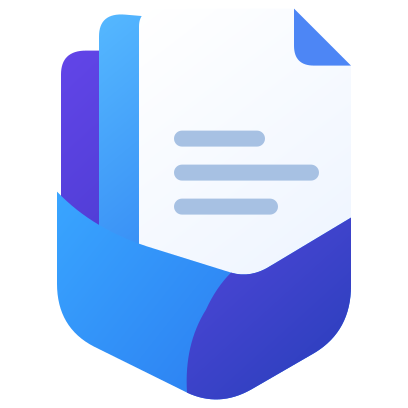
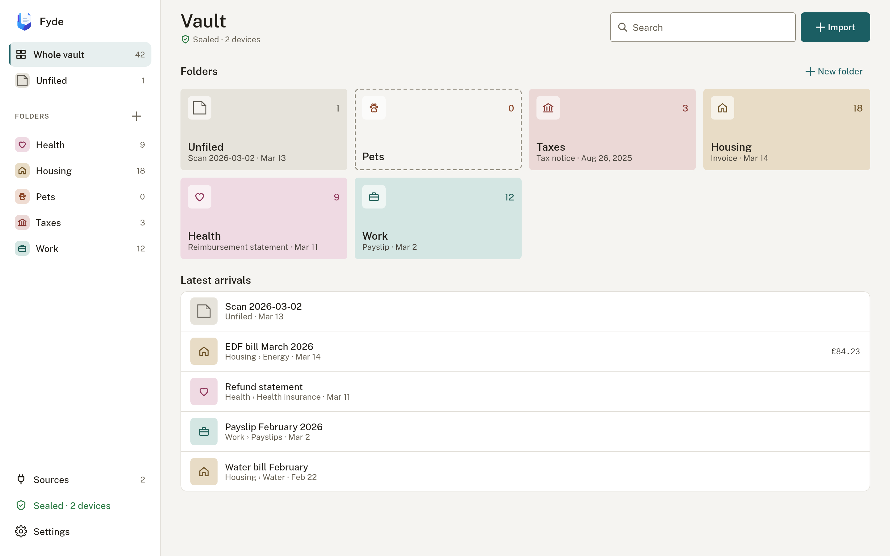
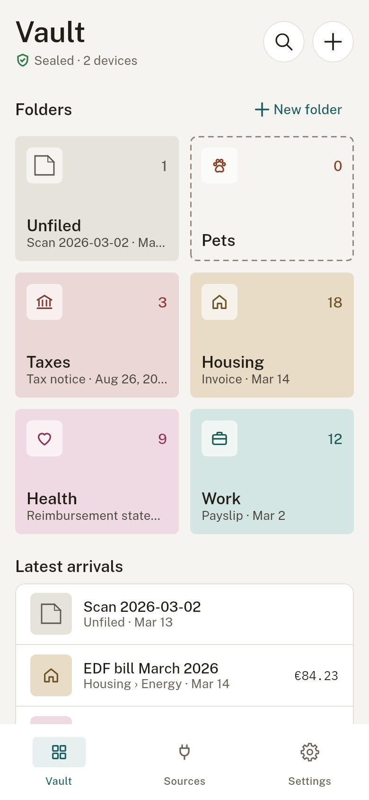
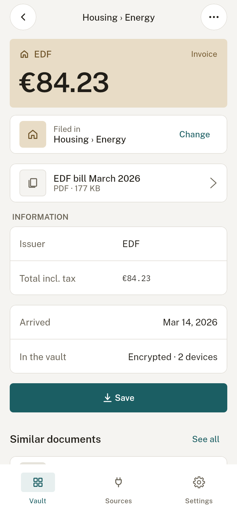
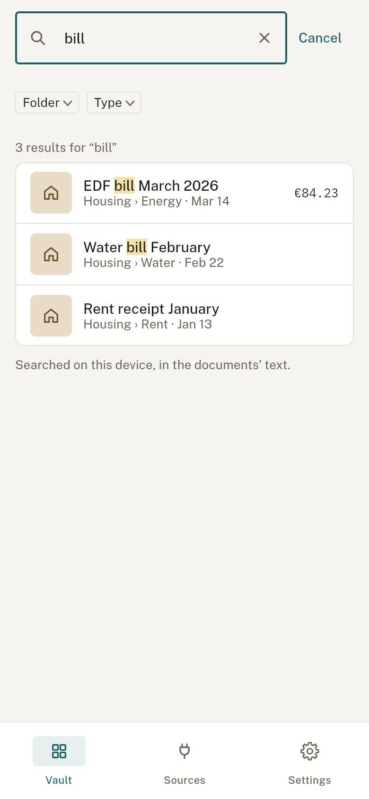
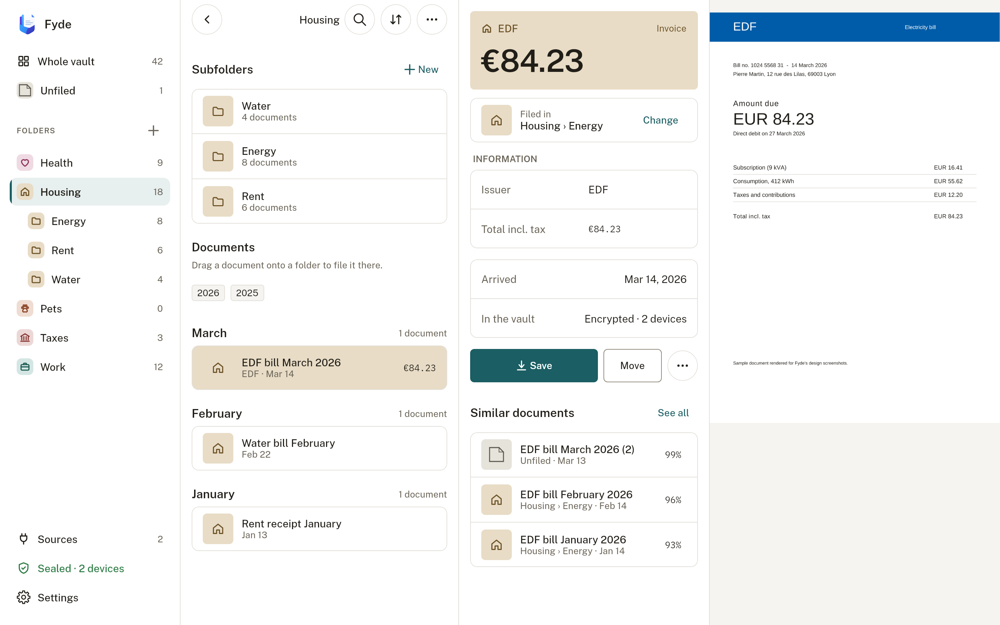
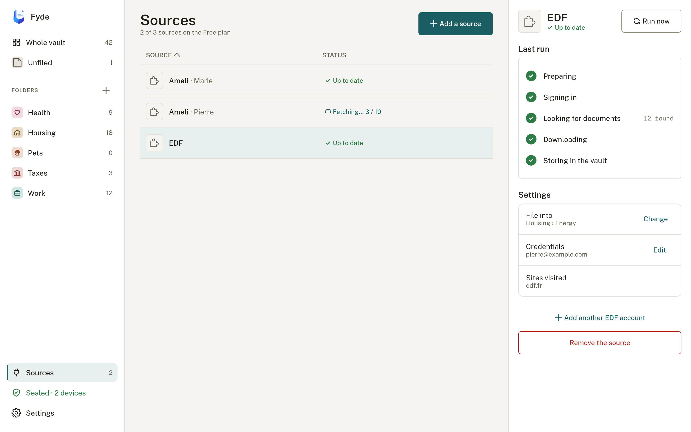
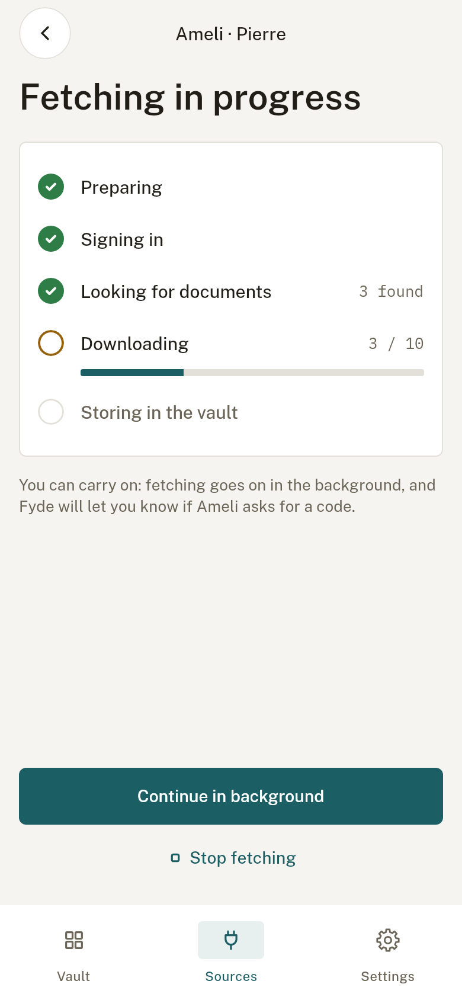
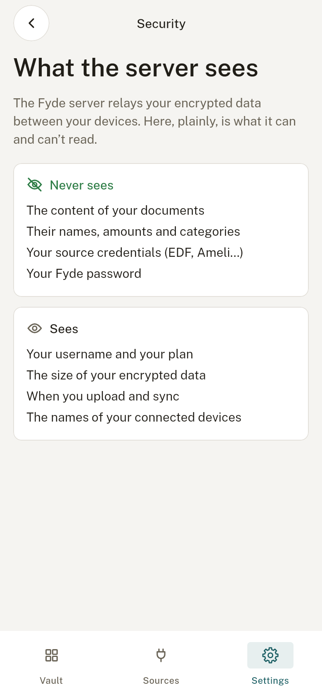

<p align="center">
  
</p>

<h1 align="center">Fyde</h1>

<p align="center">
  <strong>Your documents, under seal.</strong><br>
  A personal document vault that collects your bills, payslips and statements by itself,<br>
  encrypts them on your own devices and keeps them in sync, everywhere, even offline.
</p>

<p align="center">
  Desktop (Linux · macOS · Windows) · Android · iOS
</p>

> [!WARNING]
> **Fyde is a work in progress.** Anything can break at any time, including your vault, your
> account and the server. Features may change or disappear without notice, and updates may
> require you to start over with a new vault. Don't keep the only copy of an important document
> in Fyde yet.

> [!IMPORTANT]
> ### 🧩 Want to build something with Fyde? Start with the SDK
>
> This app is one client among many possible ones. Everything that makes Fyde work lives in
> **[`fyde-sdk`](https://github.com/fyde-lab/sdk)**, a Rust library you can use in your own
> project. It handles accounts, end-to-end encryption, sync, local search, folders and sources,
> and the server only ever sees ciphertext.
>
> **→ [github.com/fyde-lab/sdk](https://github.com/fyde-lab/sdk)**: building your own client, a
> CLI, an integration or an automation? Use the SDK. See [Build on Fyde](#build-on-fyde) below.

<p align="center">
  
</p>

---

## Why Fyde

Every month the same paperwork turns up in a dozen places: the electricity bill on the energy
supplier's site, the payslip on the payroll portal, the health-insurance refund on Ameli, the tax
notice on impots.gouv. Fyde gathers all of it into one vault.

- ⚡ **Fetched for you.** Connect a provider once and Fyde signs in to it, finds your new documents
  and files them in your vault.
- 🔒 **Encrypted on your devices.** Documents are encrypted before they leave your phone or
  computer. Nobody else can read them, not even the Fyde server.
- 🔄 **On all your devices.** Your vault syncs across your phone, tablet and computer, and stays
  readable offline.

## A quick tour

### Your vault, organised your way

You arrange documents in your own folders and subfolders. Anything Fyde can't place yet waits in
**Unfiled**. Each document opens as a pass that shows what matters at a glance,
such as the amount, the due date and the reference, with the original file one tap away.

<p align="center">
  
  &nbsp;
  
  &nbsp;
  
</p>

- **Search everything.** Search runs on your device, inside the documents' text, and you can
  narrow it by folder, type or year.
- **Similar documents.** Each document lists the ones that look most like it, so you can tidy up a
  batch in one go.
- **Keep things tidy.** You can create, rename and move folders, and move or delete documents, by
  tapping, by dragging (on desktop) or with keyboard shortcuts.

On a large screen the folder, its documents and the open document's preview all sit side by side:

<p align="center">
  
</p>

### Sources: let the documents come to you

A **source** is a provider Fyde can collect from, such as an energy supplier, a mobile operator, a
bank, a health insurer, the tax office or an online shop. You pick it, enter your login for that
site and choose which folder its documents go into. Fyde then signs in on your device and brings
back what's new. You can follow each run as it happens and stop it at any time.

<p align="center">
  
</p>

<p align="center">
  
</p>

- **Several accounts per source.** For example, you can connect your own Ameli account and your
  partner's side by side.
- **Your logins stay yours.** The passwords you give to sources are encrypted with the rest of your
  vault, and the server never sees them.

### Private by design

Fyde is built so that the server only ever relays encrypted data between your devices. The app
spells out exactly what that means:

<table>
  <tr>
    <td width="300"></td>
    <td>
      <strong>The server never sees</strong>
      <ul>
        <li>what your documents contain</li>
        <li>their names, amounts or folders (folder names included)</li>
        <li>your logins for your sources</li>
        <li>your Fyde password or your recovery kit</li>
      </ul>
      <strong>The server does see</strong>
      <ul>
        <li>your username and your plan</li>
        <li>how much encrypted data you store</li>
        <li>when you upload and sync</li>
        <li>the names of your signed-in devices</li>
        <li>which sources you turn on (EDF, Ameli…), never their logins</li>
      </ul>
    </td>
  </tr>
</table>

- **Your password never leaves your device.** Sign-in uses OPAQUE, a protocol that proves you know
  your password without ever sending it, or anything equivalent to it, to the server.
- **Recovery kit.** You can generate a 24-word recovery key and save it as a PDF (or print it, on desktop and Android), so you
  can get your vault back if you forget your password.
- **You control your devices.** You can see every device signed in to your account and sign out
  any of them remotely.

## Getting Fyde

Fyde is a work in progress (see the warning above) and has **no packaged releases yet**. For now you build it from
source. You'll need [Nix](https://nixos.org/download/) (it provides JDK 21, the Rust toolchain and
every native library), plus a checkout of this repository:

```sh
git clone git@github.com:fyde-lab/application.git
cd application
nix-shell                                   # loads the build tools

./gradlew :desktopApp:packageDistributionForCurrentOS   # desktop installer (.deb, .dmg or .msi)
./gradlew :androidApp:assembleRelease                   # Android APK
```

- The desktop installer ends up in `desktopApp/build/compose/binaries/`.
- The Android APK must be signed before a phone will install it: copy
  `keystore.properties.example` to `keystore.properties` and point it at your signing key.
- The iOS app builds on a Mac: open `iosApp/iosApp.xcodeproj` in Xcode and run it with the
  Release configuration.

These release builds connect to the hosted Fyde server, `doc.halium.fr`. Development builds
(`./gradlew :desktopApp:run`, for example) expect a local server on `127.0.0.1:40051` instead.

| Platform | Status |
|---|---|
| 🖥️ Desktop (Linux, macOS, Windows) | ✅ Available |
| 🤖 Android | ✅ Available |
| 🍎 iOS | ✅ Available (build from Xcode) |
| 🌐 Web | 🚧 Not yet: the encryption engine doesn't run in browsers yet |

The interface is available in **French** and **English**, in light and dark appearance.

## About the screenshots

The images above are the app itself: its real screens, rendered from sample data (from
[`design/current/screens/`](design/current/screens/), regenerated whenever the interface changes).
Every feature described in this README works in the app today.

## Build on Fyde

If you want to create something around Fyde, such as your own app, a command-line tool, a
backup script or an integration with another service, use
**[`fyde-sdk`](https://github.com/fyde-lab/sdk)** rather than this app. It's the same library
this app runs on:

- **Accounts:** sign up and sign in without the password ever leaving the device.
- **Documents:** encrypted on the device, kept in a local cache that works offline and is
  searchable by full text or by similarity.
- **Folders:** create, move and file documents into them.
- **Sync:** every write is an encrypted event that the other devices replay.
- **Sources:** run the scripts that collect documents from providers' sites.

The crate isn't on crates.io yet. Depend on it from git:

```toml
[dependencies]
fyde-sdk = { git = "https://github.com/fyde-lab/sdk.git", branch = "master" }
```

To add a new provider, write a Lua script in
[`fyde-scripts`](https://github.com/fyde-lab/scripts), the home of every source Fyde can collect
from.

## For contributors

Fyde is a [Kotlin Multiplatform](https://kotlinlang.org/docs/multiplatform.html) and
[Compose Multiplatform](https://www.jetbrains.com/compose-multiplatform/) app. All encryption, sync
and source runs live in the Rust [`fyde-sdk`](https://github.com/fyde-lab/sdk), which the app
reaches through UniFFI bindings in `sdkBridge/`.

- [`CLAUDE.md`](CLAUDE.md): architecture, conventions and build commands
- [`design/`](design/README.md): the design system as built, every screen of the app, and the
  proposals for new ones
