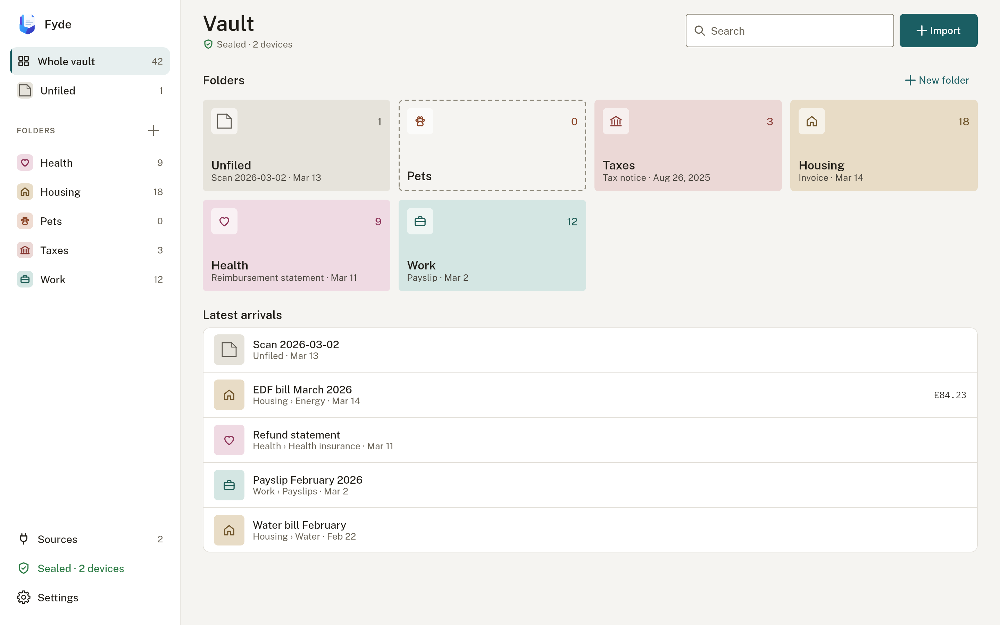

# Fyde design system, as built

Fyde is a personal document vault: it fetches documents from the user's providers by itself,
keeps them end-to-end encrypted and local-first, and syncs them across the user's devices. This
document describes **what the app draws today** on desktop, Android and iOS (the web build is a
stub: fyde-sdk can't compile to WebAssembly), read from the code. It's the base every new design
starts from; see [`../README.md`](../README.md) for how proposals build on it.

- **The code wins.** Every value here comes from `shared/src/commonMain/kotlin/com/peltoche/fyde/`
  (`theme/`, `components/`, `icons/`, `layout/` and the screens). Where this document and the code
  disagree, fix the document.
- **Screens:** [`screens/`](screens/) holds every screen in the catalogue below at Compact
  (390×844), Medium (834×1194) and Expanded (1440×900), rendered at 2× in English by
  `ScreenshotsJvmTest` from `ScreenshotFixtures.kt`'s fake data; [`sheets/`](sheets/) has one
  contact sheet per area and size. Regenerate both with `design/capture.sh`, never by hand.
- **Drawing something new:** [`../kit/tokens.css`](../kit/tokens.css) mirrors the tokens below for
  HTML mockups, in a proposal's own folder under [`../proposals/`](../proposals/).
- **Screen IDs** (O1, V1, D6…) are the earlier target design's
  ([`../proposals/000-original-design/`](../proposals/000-original-design/)): the catalogue maps
  each screen to the ID it implements, so its wording and rationale stay findable. That design's
  palette and type were never built; don't take values from it.
- Code comments citing "design-system.md § Section" mean this document.

## Colour

Screens read every colour through the `AppColors` facade (`theme/AppColors.kt`), never a hex. Most roles are backed by a Material 3 `ColorScheme` slot; the ones M3 has no slot for live in `AppExtendedColors` (`LocalAppExtendedColors`). Both are provided by `AppTheme`.

### Roles

| `AppColors` role | Backed by | Light | Dark | Used for |
|---|---|---|---|---|
| `background` | M3 `background` | `#F5F4F1` | `#16140F` | Page fill (every `Scaffold`), unselected chip fill, neutral `AppIconTile`, `DocumentCard`'s preview well, disabled field fill, `AppTopBar` at Expanded |
| `surface` | M3 `surface` | `#FFFFFF` | `#1E1B16` | `AppCard`, `AppGroup`, sidebar and rail, document list and pass columns, field boxes, `AppCircleButton`, `SelectionBar`, radio dot, unchecked switch thumb |
| `surfaceElevated` | M3 `surfaceContainerHigh` | `#FFFFFF` | `#282420` | Floating surfaces: dialogs, sheets and centred panels, menus, snackbar, drag ghost; bottom bar; `AppTopBar` below Expanded; empty-state circle; `SimilarityBadge`; stopped step disc; unchecked switch track |
| `border` | M3 `outlineVariant` | `#E3E0DA` | `#35302A` | Hairlines: dividers, `AppGroup`/card/chip/tile outlines, unselected circle button ring, progress and meter tracks, skeleton fill, to-do step ring, disabled outlines |
| `borderStrong` | M3 `outline` | `#8F8A7C` | `#7A7364` | Text-field and dropdown outlines, `SourceFolderField` box, outlined button border, unchecked checkbox/radio, empty `FolderCard` dashed outline, stopped step ring |
| `text` | M3 `onBackground` (= `onSurface`) | `#211E18` | `#EDE9E1` | All primary text, `ChevronLeftGlyph`'s default tint, sidebar row glyphs |
| `textMuted` | M3 `onSurfaceVariant` | `#6B6558` | `#9B9484` | Secondary text and captions, unselected navigation, placeholders, default tint of most glyphs |
| `primary` | M3 `primary` (also `tertiary`) | `#1B5E63` | `#5FBFC4` | Filled buttons, text-button labels, focus ring, selected navigation, 3dp selection bars, checked checkbox/switch/radio, progress fill, focused field border, running status, brand panel and band fill, the seal's disc |
| `onPrimary` | M3 `onPrimary` | `#FFFFFF` | `#06232A` | Content on `primary` (filled button label, checkmark, switch thumb, brand panel text) |
| `secondary` | M3 `secondary` | `#6B5636` | `#B99569` | Defined but read by no screen or component (only the catalogue and theme previews) |
| `onSecondary` | M3 `onSecondary` | `#FFFFFF` | `#2B1B08` | Defined, unused |
| `error` | M3 `error` | `#B3261E` | `#F2938A` | Destructive buttons, menu items and dialog confirms, error notes, field error border and helper text, failed status and step, `LogoutGlyph`/`TrashGlyph`/`AlertGlyph` default tint |
| `onError` | M3 `onError` | `#FFFFFF` | `#3A0F0B` | Content on `error` (destructive filled button, failed step's glyph) |
| `warning` | extended | `#95610A` | `#E8B34D` | Warning notes and banner, current step's ring, waiting status, `AppPlanQuota` at its limit, `ClockGlyph`/`AlertTriangleGlyph` default tint |
| `onWarning` | extended | `#FFFFFF` | `#2B1C02` | Defined, unused |
| `success` | extended | `#2E7D46` | `#7FD98A` | Up-to-date status, done step's disc, ok note's icon, sidebar seal line, `LockGlyph`/`ShieldGlyph`/`CheckGlyph`/`CheckCircleGlyph` default tint |
| `onSuccess` | extended | `#FFFFFF` | `#0F2A17` | Check on a done step's disc |
| `selectionSurface` | extended | `#E7EFEF` | `#1F3638` | Selected `AppGroupRow`/`AppListItem`, selected chip, navigation indicator, selected sidebar row and rail cell, selected top-nav tab |
| `selectionTextBackground` | extended | `#BFE0E1` | `#2C5457` | Defined, not wired to text selection or any component |
| `highlight` | extended | `#F3E2A9` | `#5C4A12` | Background behind the words a search matched in `DocumentRow` titles (text on it stays `text`) |
| `categoryTile` | extended | white at 62% alpha | white at 62% alpha | The square behind a folder's icon on its fill (`FolderIconTile`) |
| `categoryCaption` | extended | `#4C4840` | `#9B9484` | Secondary line on a folder fill (`FolderCard` caption, `FolderBand` subtitle, `DocumentPass` cell labels) |
| `brandStepDoneFill` | constant | `#8FD1AE` | `#8FD1AE` | A done step's disc on the brand panel's `primary` fill |
| `brandStepDoneInk` | constant | `#0B2418` | `#0B2418` | The check on `brandStepDoneFill` |
| `tintOf(accent)` | function | accent at 15% alpha | accent at 15% alpha | The one tinted-container recipe: badges, warning/error notes and banner, `primary` wash (ok note, active circle button, seal wash), tinted `AppIconTile`, error-state circle, plan quota at limit |
| `category` | extended | see Folder colours | see Folder colours | Folder fills and inks |

M3 slots some components read directly (not through `AppColors`):

| M3 slot | Light | Dark | Read by |
|---|---|---|---|
| `surfaceVariant` | `#EDEBE6` | `#282420` | `AppNote` Info wash |
| `surfaceContainerHighest` | `#E7E4DE` | `#332D25` | `AppMenuButton`'s circle |
| `primaryContainer` | `primary` lerped 80% toward `background` (≈ `#C9D4D3`) | 65% toward `background` (≈ `#314947`) | Tonal `AppButton` |
| `errorContainer` | `error` lerped 80% toward `background` (≈ `#EDCDC6`) | 65% (≈ `#5A3D36`) | Destructive tonal `AppButton`, `AppBanner` Error |
| `onPrimaryContainer`, `onErrorContainer` | = `text` | = `text` | Their containers' content |

The container hexes are computed (Compose's `lerp` interpolates in Oklab), so treat the last digit as approximate. Other slots set for stock M3 components: `surfaceContainerLowest` (`#FFFFFF` / `#110F0B`), `surfaceContainerLow` (`#F9F8F5` / `#1A1712`), `surfaceContainer` (= `surface` / = `surfaceContainerHigh`), `surfaceBright` (`#FFFFFF` / `#332D25`), `surfaceDim` (`#E7E4DE` / = `background`), `inverseSurface` = `text`, `inverseOnSurface` = `background`, `inversePrimary` (`#5FBFC4` / `#1B5E63`), `secondaryContainer`/`tertiaryContainer` derived like `primaryContainer`. `surfaceTint` is set to `surface`, so M3 tonal elevation adds no tint.

### Folder colours

`AppCategoryColors` (`theme/AppCategoryColors.kt`): 16 colours a top-level folder can take, plus `unclassified` (À classer). Each is a `fill` (the card, band, pass, tile and selected row background) and an `ink` (the folder's icon, count and pass header text on that fill). Text on a fill stays `text`; secondary lines use `categoryCaption`; icon squares use `categoryTile`.

| `FydeFolderColor` | Palette entry | Light fill | Light ink | Dark fill | Dark ink |
|---|---|---|---|---|---|
| `SAND` | `housing` | `#E8DCC6` | `#6E5328` | `#3A3121` | `#E3C58F` |
| `GREEN` | `money` | `#D7E8DA` | `#2B6E45` | `#1E3326` | `#9ED5AE` |
| `TEAL` | `work` | `#D4E6E3` | `#1D5C55` | `#1B3331` | `#8FD0C6` |
| `BRICK` | `taxes` | `#EBD8D6` | `#8A3B36` | `#3A2422` | `#EBA49E` |
| `ROSE` | `health` | `#EFDAE3` | `#8E3459` | `#3A2230` | `#EDA3C4` |
| `BLUE` | `telecom` | `#D8E3EF` | `#2C5582` | `#1F2B3A` | `#9DBDE3` |
| `INDIGO` | `transport` | `#DDDBEF` | `#45428F` | `#26253B` | `#B4B1EC` |
| `AMBER` | `shopping` | `#F0E1CF` | `#86501C` | `#3A2C1D` | `#E9B887` |
| `OCHRE` | `family` | `#E9E3CB` | `#6A5B1E` | `#33301C` | `#DCCB8A` |
| `CYAN` | `identity` | `#D3E7EB` | `#1B5866` | `#1B3138` | `#8DCCDB` |
| `SLATE` | `legal` | `#DDE1E7` | `#3F4A5C` | `#252A33` | `#B5C0D2` |
| `LEAF` | `education` | `#DAEAD3` | `#3A6A2A` | `#213019` | `#A9D696` |
| `RUST` | `pets` | `#EFDCD2` | `#8A4325` | `#3A261D` | `#EDAF92` |
| `PLUM` | `leisure` | `#EDD9EE` | `#7A3580` | `#35223A` | `#E2A8E8` |
| `VIOLET` | `subscriptions` | `#E3DCEC` | `#5D3F80` | `#2B2436` | `#C9B3E8` |
| `MOSS` | `donations` | `#DDE8CF` | `#4A6326` | `#26301C` | `#BCD69A` |
| none (À classer) | `unclassified` | `#E6E3DB` | `#5B574F` | `#262A28` | `#B7B9B4` |

Mapping (`FydeFolderAppearance?.colors()` in `VaultFolders.kt`): a folder's appearance colour picks the row above; a `null` appearance (À classer) picks `unclassified`. Only top-level folders carry an appearance; a subfolder shows its top-level folder's colour and the plain `FolderGlyph`. A top-level folder with no appearance gets `SAND` + `FOLDER`. A new folder starts on a random one of the first eight colours (`SAND` to `OCHRE`), with the `FOLDER` icon. The appearance picker shows those first eight swatches, then the other eight behind "Plus de couleurs", then the 20 `FydeFolderIcon` cells (the selected cell drawn on the folder's fill in its ink, others on `surface` in `text`).

### Contrast

Facts the code states, plus ratios computed from the hexes above with the WCAG 2 formula:

- `borderStrong` (`outline`) was darkened to clear WCAG's 3:1 for UI component boundaries: light `#8F8A7C` gives 3.13:1 on `background` and 3.45:1 on `surface`; dark `#7A7364` gives 3.91:1 on `background` and 3.65:1 on `surface`. `border` is decorative only (hairlines on filled shapes).
- `text`: 15.1:1 on light `background`, 16.6:1 on `surface`; 15.2:1 / 14.2:1 in dark.
- `textMuted`: 5.26:1 / 5.79:1 light; 6.10:1 / 5.69:1 dark.
- `primary`: 6.75:1 / 7.43:1 light; 8.53:1 / 7.96:1 dark. `onPrimary` on `primary`: 7.43:1 light, 7.60:1 dark.
- `warning` 4.78:1 and `success` 4.61:1 on light `background` (both 4.5:1+); far higher in dark.
- Folder ink on its own fill: 4.81–6.82:1 light, 7.10–8.69:1 dark. `text` on any fill: 12.1:1 or more. `categoryCaption` on fills: 6.64–7.23:1 light, 4.24–4.94:1 dark.
- Colour never carries state alone: `AppProgressBar`, `AppSegmentedMeter`, `RunStepper` and `SourceStatus` pair it with a glyph or text.

### Themes

- `AppThemeOption` has one entry, `Fyde` (id `fyde`): the palette above, each option providing a light and a dark `ColorScheme` plus `AppExtendedColors`. Settings shows no theme picker while it's the only one. Typography, shapes and spacing are shared by every theme.
- `AppAppearance` picks which half is drawn: `System` (id `system`, the default, follows `isSystemInDarkTheme()`), `Light` (`light`), `Dark` (`dark`). It's picked in Settings' appearance and language page, saved on the device and restored at startup.

## Typography

Bundled fonts (`shared/src/commonMain/composeResources/font/`), the same on every platform:

- **Public Sans**, the body family for every M3 slot: `public_sans_regular.ttf` (400), `public_sans_medium.ttf` (500), `public_sans_semibold.ttf` (600).
- **IBM Plex Mono**, only for the `data` role: `plex_mono_regular.ttf` (400), with `fontFeatureSettings = "tnum"`. No other weight is bundled.

`AppTypography` roles (sizes in sp, line heights in sp, letter spacing in sp):

| Role | M3 slot | Family | Size | Line height | Weight | Tracking | Used for |
|---|---|---|---|---|---|---|---|
| `passAmount` | `displayLarge` | Public Sans | 44 | 48 | SemiBold 600 | -0.88 | A document pass's headline value |
| `brandHeadline` | (copy of `display`) | Public Sans | 38 | 44 | SemiBold 600 | 0 | Brand panel headline |
| `display` | `headlineLarge` | Public Sans | 30 | 38 | SemiBold 600 | 0 | Onboarding and empty-state headlines |
| `title` | `titleLarge` | Public Sans | 22 | 28 | SemiBold 600 | 0 | Screen titles, `FolderBand` name, a pass headline that is a name, `AppTopBar` without back |
| `section` | `titleMedium` | Public Sans | 17 | 24 | SemiBold 600 | 0 | Section titles, dialog titles, `FolderCard` name, `AppTopBar` with back, empty/error-state titles |
| `bodyEmphasis` | `bodyLarge` | Public Sans | 15 | 22 | Medium 500 | 0 | List-row titles, field labels, page-bar title, step labels; also M3's default text style, so text-field input and placeholder |
| `body` | `bodyMedium` | Public Sans | 15 | 22 | Regular 400 | 0 | Standard copy, notes, menu items, attribute rows, checkbox/switch labels |
| `caption` | `bodySmall` | Public Sans | 13 | 18 | Regular 400 | 0.1 | Metadata, helper text, chips, banners, counts |
| `micro` | `labelSmall` | Public Sans | 11 | 16 | Medium 500 | 0.3 | Badges, bottom-bar and rail labels |
| `overline` | (copy of `micro`) | Public Sans | 11 | 16 | SemiBold 600 | 0.72 | Uppercase group labels (callers uppercase the text): DOSSIERS, the appearance picker's headings |
| `label` | `labelLarge` | Public Sans | 14 | 20 | Medium 500 | 0.1 | M3 baseline proportions (not retuned): button labels (M3 buttons' default), top-nav tab labels |
| `data` | (own style, `LocalAppDataTextStyle`) | IBM Plex Mono | 13 | 18 | Regular 400 | 0, `tnum` | Amounts, counts, similarity percentages, step details |

The other M3 slots keep M3's baseline sizes with only the family swapped to Public Sans: `displayMedium`, `displaySmall`, `headlineMedium`, `headlineSmall`, `titleSmall`, `labelMedium`.

Derivations components make inline: `caption` Medium (`SourceStatus`); `caption` SemiBold uppercase (`DocumentAttributes` heading); `body` Medium / SemiBold when selected (sidebar rows); `body` SemiBold (`AppPlanQuota` at its limit); `data` Medium (`AppPlanQuota` count); `bodyEmphasis` Regular (brand panel subtitle).

## Shape, spacing, elevation

### Shape

`AppRadius` (`theme/AppShapes.kt`), a deliberately small scale; only `full` is a circle.

| Token | Radius |
|---|---|
| `none` | 0dp |
| `xs` | 2dp |
| `sm` | 4dp |
| `md` | 6dp |
| `lg` | 10dp |
| `full` | `CircleShape` |

`AppShapes` assignments: `button` = md (6), `input` = sm (4), `card` = md (6), `dialog` = lg (10), `note` = sm (4), `popover` = lg (10), `iconTile` = md (6), `sidebarRailCell` = 12dp (off-scale). The M3 `Shapes` slots are `extraSmall` 2, `small` 4, `medium` 6, `large` 10, `extraLarge` 10.

Where each radius shows up: `xs` on `AppBadge`, `AppProgressBar`, `AppSegmentedMeter` bars, `DocumentPage`; `sm` on fields, `AppChip`, `AppIconButton`, the navigation indicator, `AppNote`, skeletons by default; `md` on buttons, `AppCard`, `DocumentCard`, `FolderCard`, `FolderBand`, `DocumentPass`, icon tiles; `lg` on `AppGroup`, `DocumentAttributes`' group, sidebar rows, dialogs, centred sheet panels, menus, snackbar; `full` on `AppCircleButton`, `AppMenuButton`, `SimilarityBadge`, radio, quota segments, empty-state circle, step discs. Literal radii: the modal bottom sheet's top corners 10dp, `AppPlanQuota` 16dp, sidebar folder tiles 7dp, rail cells 12dp.

Strokes: `AppDimensions.borderHairline` 1dp (dividers, outlines); `borderFocus` 2dp (focused field border, current step ring, pass perforation). Checkbox-like rings (radio, step discs) use 1.5dp. The empty `FolderCard`'s dashed outline is 1.5dp, `borderStrong`, 6dp dash / 4dp gap.

Focus ring (`appFocusRing`, `theme/AppFocusRing.kt`): 2dp `primary` stroke drawn 2dp outside the element, in the element's own shape, never shifting layout. Shown only for keyboard focus (a focus within 300ms of a pointer press draws none).

### Spacing

`AppSpacing` (`theme/AppSpacing.kt`), identical everywhere:

| Token | Value |
|---|---|
| `space1` | 2dp |
| `space2` | 4dp |
| `space3` | 8dp |
| `space4` | 12dp |
| `space5` | 16dp |
| `space6` | 20dp |
| `space7` | 24dp |
| `space8` | 32dp |
| `space9` | 40dp |
| `space10` | 56dp |

Recurring uses: screen margins `space5`/`space7`/`space8` by size class; card and group-row inset `space5`; row vertical padding `space3`; icon-to-label gap `space2` in buttons, `space3` in notes and checkbox rows; `AppSectionTitle` has `space7` above and `space3` below; dialog padding `space7`. Off-scale literals live in the sidebar (14dp horizontal padding, 10dp gaps and row padding, 16dp subfolder indent), the rail (18dp vertical padding, 10dp spacing), `AppPlanQuota` (3dp between segments) and `StateMessage` (280dp max description width).

Sizes that aren't gaps are in `AppDimensions` (see Layout and the component tables): touch target 48dp, icon tiles 36/44/48/52dp, row floors 56/64/72dp, `progressBarHeight` 6dp, `segmentedMeterHeight` 4dp, `backButton` 44dp, `sealHero` 168dp, `authLogo` 56dp, `folderCardHeight` 132dp, `folderCardIcon` 38dp, `documentCardWell` 160dp, `documentCardPageWidth` 104dp, `documentRowPage` 40×52dp, `documentFilePage` 62×84dp.

### Elevation

There are no elevation tokens. Depth is drawn by tone and hairlines:

- Three tone steps: `background` → `surface` → `surfaceElevated`. In light `surface` and `surfaceElevated` are the same white, so a white surface on the page reads by tone against `background`, and floating surfaces separate by their own shadow or scrim. In dark they step `#16140F` → `#1E1B16` → `#282420`.
- `AppCard` has 0dp elevation and no border unless `outlined`; `AppGroup` and `DocumentCard` use a `border` hairline instead of a shadow.
- `surfaceTint` = `surface`, so M3's tonal elevation (bottom bar, sheets, menus) adds no colour.
- The only explicit shadows: a document's first page in `DocumentCard`'s well (1dp, rectangle) and the drag ghost (6dp, card shape, `surfaceElevated`). Menus (`DropdownMenu`) and the snackbar keep M3's default shadow; dialogs and sheets use the platform dialog's scrim.

### Iconography

- No icon pack: every glyph is drawn on a `Canvas` (`icons/NavGlyphs.kt`, `icons/CategoryGlyphs.kt`, `icons/DocumentGlyph.kt`). Outline style, round caps and joins; most are traced from a 24-unit SVG grid and scaled to the box. `CategoryGlyphs.kt` replays SVG path data through one `PathGlyph` helper. Only `PlayGlyph` is filled; `MoreGlyph` is three dots.
- Default stroke 1.6dp; exceptions noted below. Each glyph takes `tint` (glyphs don't read `LocalContentColor`, so callers pass the colour) and its size from the caller's `Modifier.size`.
- `AppIconSize` (`theme/AppDimensions.kt`):

| Token | Size | Use |
|---|---|---|
| `xs` | 12dp | Inline with caption text, a row's trailing chevron, status and step glyphs |
| `sm` | 16dp | A field's or button's leading icon, an icon button's glyph, a pass header icon |
| `md` | 20dp | Navigation destinations, the glyph inside an `AppIconTile` or folder tile |
| `prominent` | 24dp | Rail destinations, a device glyph leading a two-line row, the seal card's shield, a sheet's warning |
| `lg` | 32dp | The alert glyph inside `AppErrorState`'s circle |
| `xl` | 40dp | The glyph inside `AppEmptyState`'s circle; rail logo and folder tiles |

Glyphs (default tint, stroke if not 1.6dp):

| Glyph | Default tint | Stroke | Meaning |
|---|---|---|---|
| `SearchGlyph` | textMuted | 1.6 | Search |
| `LockGlyph` | success | 1.6 | Padlock (the seal) |
| `GearGlyph` | textMuted | 1.4 | Settings destination |
| `PuzzleGlyph` | textMuted | 1.4 | A source without a logo |
| `ChevronRightGlyph` | textMuted | 1.4 | Row chevron; rotated 90° for dropdowns and chip menus |
| `ChevronLeftGlyph` | text | 1.6 | Back |
| `StarGlyph` | textMuted | 1.5 | Favourite |
| `DownloadGlyph` | textMuted | 1.6 | Download |
| `MoreGlyph` | textMuted | dots r 1.6 | More actions |
| `PlayGlyph` | textMuted | filled | Run |
| `StopGlyph` | textMuted | 1.6 | Stop / stopped |
| `PlusGlyph` | textMuted | 1.8 | Add / new |
| `CloseGlyph` | textMuted | 1.6 | Close / clear |
| `AlertGlyph` | error | 2.2 | Exclamation mark (error) |
| `AlertTriangleGlyph` | warning | 1.7 | A risk to accept |
| `BoltGlyph` | textMuted | 1.4 | Fetched automatically |
| `SyncGlyph` | textMuted | 1.4 | Sync across devices |
| `CheckGlyph` | success | 1.6 | Confirmed / done |
| `CheckCircleGlyph` | success | 1.6 | Ok note |
| `ClockGlyph` | warning | 1.6 | Waiting, expiry |
| `EyeGlyph` (`crossed`) | textMuted | 1.6 | Show / hide password |
| `KeyGlyph` | textMuted | 1.6 | The user's key; also a folder icon |
| `PhoneGlyph` | textMuted | 1.6 | A phone session; also a folder icon |
| `LaptopGlyph` | textMuted | 1.6 | A computer session |
| `InfoGlyph` | textMuted | 1.6 | Info note |
| `PagesGlyph` | textMuted | 1.6 | Stacked pages |
| `ShieldGlyph` | success | 1.6 | Sealed vault |
| `SlidersGlyph` | textMuted | 1.6 | Plan limits |
| `SunGlyph` | textMuted | 1.6 | Appearance |
| `LogoutGlyph` | error | 1.6 | Log out |
| `TrashGlyph` | error | 1.6 | Delete |
| `ServerGlyph` | textMuted | 1.6 | What the server sees |
| `PencilGlyph` | textMuted | 1.6 | Change password |
| `GlobeGlyph` | textMuted | 1.6 | Sites a source may reach |
| `DocumentGlyph` | primary | 1.4 (flap 70%) | A document; À classer's icon |
| `GridGlyph` | textMuted | 1.6 | Vault destination |
| `PlugGlyph` | textMuted | 1.6 | Sources destination |
| `SortGlyph` | textMuted | 1.6 | Newest/oldest toggle |
| `SparkleGlyph` | textMuted | 1.6 | Automatic filing |
| `FolderGlyph` | textMuted | 1.6 | Folder; a subfolder's mark |
| `HomeGlyph`, `WalletGlyph`, `BriefcaseGlyph`, `LandmarkGlyph`, `HeartGlyph`, `TrainGlyph`, `BagGlyph`, `UsersGlyph`, `IdCardGlyph`, `ScaleGlyph`, `GraduationCapGlyph`, `PawGlyph`, `TicketGlyph`, `RepeatGlyph`, `GiftGlyph`, `CarGlyph`, `CalendarGlyph` | textMuted | 1.6 | Folder icons |

The 20 `FydeFolderIcon`s map onto glyphs one to one (`FolderIconGlyph`): `FOLDER`, `HOME`, `WALLET`, `BRIEFCASE`, `LANDMARK`, `HEART`, `PHONE`, `TRAIN`, `BAG`, `USERS`, `ID_CARD`, `SCALE`, `GRADUATION_CAP`, `PAW`, `TICKET`, `REPEAT`, `GIFT`, `CAR`, `KEY`, `CALENDAR`; no icon (À classer) draws `DocumentGlyph`. Folder icons are drawn in the folder's `ink`.

## Layout and navigation

The size class comes from the window's width only (`AppWindowSizeClassProvider`, `layout/AppWindowSizeClass.kt`): it reads `LocalWindowInfo.current.containerDpSize.width`, never a `BoxWithConstraints` measurement, and never the platform. Compact < 600dp, Medium 600–839dp, Expanded ≥ 840dp.

`TopLevelScaffold` (the shell of the vault, sources and settings) builds one layout tree at every size. At Expanded the content beside the sidebar gets the class of `window width − 260dp`, but never below Medium; at Medium the content keeps Medium.

`AppContentContainer` centres content at a max width and applies the screen margin: `AppContentWidth.List` = 1280dp (`maxWidthList`), `AppContentWidth.Detail` = 720dp (`maxWidthDetail`). Row height floors (`heightIn(min)`, never shrinking natural height): `rowHeightComfortable` 72dp, `rowHeightStandard` 64dp (default `AppGroupRow`, `DocumentRow`), `rowHeightCompact` 56dp (attribute rows). Every control's hit area is at least `touchTargetMin` 48dp.

### Compact

- Below 600dp. Screen margin 16dp (`space5`).
- Navigation: `AppNavigationBar` at the bottom, M3 `NavigationBar` on `surfaceElevated` with no divider, three destinations (vault `GridGlyph`, sources `PlugGlyph`, settings `GearGlyph`, 20dp). The selected item's indicator is a 56×32dp `selectionSurface` block, radius `sm`; selected glyph and label `primary`, others `textMuted`; labels `micro`.
- Bars: `AppTopBar` 56dp (`topBarHeight`), `surfaceElevated` with a bottom hairline; `AppPageBar` at least 56dp with the 44dp back circle at the start and an optional centred `bodyEmphasis` title.
- `AppTwoPaneLayout` shows one pane at a time. `AppBottomSheet` is a modal bottom sheet (top corners 10dp, `surfaceElevated`, opened fully, with its grab handle), except on desktop where it's always the centred panel. `AppDialog` stacks its actions full width, confirm first. `SelectionBar` puts its actions on their own row.
- Sign-in and vault-creation screens draw their own phone layout (no split).

### Medium

- 600–839dp. Screen margin 24dp (`space7`).
- Navigation: `AppSidebarRail` (`AppSidebar.kt`), 80dp (`sidebarRailWidth`, its trailing vertical hairline included), `surface`, 18dp vertical padding, items 10dp apart. Top to bottom: the logo (40dp), "whole vault", a 32×1dp `border` separator, À classer (while it holds documents) and each top-level folder as a 40dp folder tile (12dp radius, 20dp glyph), then sources and settings. Cells are 48dp (`sidebarRailCell`), radius 12dp; destination glyphs 24dp (`prominent`), `primary` when selected, else `text`. A selected cell takes `selectionSurface` plus a 3dp (`selectionBarWidth`) `primary` bar on its leading edge. Names and counts are in an end-side tooltip.
- `AppTopBar` 64dp (`topBarHeightExpanded`), still filled with a bottom hairline.
- `AppTwoPaneLayout`: primary pane 360dp (`twoPaneListWidth`), a vertical hairline, the secondary pane fills the rest (settings uses it).
- `AppBottomSheet` becomes a centred panel (max 500dp, `sheetPanelMaxWidth`, radius 10dp, `surfaceElevated`, 20dp vertical padding). `AppDialog`: 280–500dp wide, actions right-aligned on one row, cancel before confirm.
- Sign-in and vault-creation screens: a 96dp `primary` band (`authBrandBand`, 40dp horizontal padding) above the form; the form column is 440dp (`authFormColumn`), 600dp for the sources picker (`authFormColumnWide`).

### Expanded

- 840dp and up. Screen margin 32dp (`space8`).
- Navigation: `AppSidebar`, 260dp (`sidebarWidth`, its trailing vertical hairline included), `surface`, 14dp horizontal and 20dp vertical padding, rows 2dp apart. Top to bottom: brand row (30dp logo, 10dp gap, app name in `section`), "whole vault", À classer (while it holds documents), the DOSSIERS `overline` heading with a "+" icon button, the folder tree (24dp folder tiles at 7dp radius with 16dp glyphs, subfolders indented 16dp per level, the open branch expanded), sources, the seal line (`ShieldGlyph` and `success` text, not clickable), settings. Rows are 40dp (`sidebarRowHeight`), radius `lg`, 10dp padding and gaps, label `body` Medium (SemiBold when selected), count in `caption` `textMuted`; selection as on the rail (fill and 3dp `primary` leading bar).
- `AppTopBar` is flat at Expanded: no fill (`background`) and no divider, acting as the page's heading.
- Panel widths: a document open beside its list is a 400dp list column (`documentListColumn`, `surface`), a hairline, a 360dp pass column (`documentPassColumn`, `surface`), then the preview filling the rest. The sources table has a 380dp detail panel (`sourceDetailPanelWidth`) flush to the right edge. The vault header's search launcher is 300dp (`searchLauncherWidth`). Settings keeps the 360dp list pane. `twoPaneListWidthExpanded` (480dp) is defined but used nowhere.
- Sign-in and vault-creation screens: a 520dp full-height `primary` brand panel (`authBrandPanel`, 40dp horizontal and 32dp vertical padding, `onPrimary` content, `brandHeadline` title) beside the centred form column (440dp, or 600dp).
- Keyboard shortcuts (`VaultShortcuts`) and drag and drop (`VaultDrag.kt`) exist only here; a right-click menu (`onSecondaryClick`) opens on the rows of the list beside an open document.

## Components

All under `shared/src/commonMain/kotlin/com/peltoche/fyde/components/` unless noted. `DesignSystemScreen.kt` is the in-app catalogue of them, with sections Actions, Forms, Content, Feedback, Navigation, Layout and Overlay. It's not reachable from the app's navigation: the JVM screenshot fixtures (`jvmTest/.../ScreenshotFixtures.kt`, shot `design-system`) render it. Components marked *catalogue only* appear in no screen today.

### action

| Component | Draws | Variants / visual parameters | Tokens |
|---|---|---|---|
| `AppButton` | A 48dp-high button, one-line label (ellipsised), optional leading icon | `variant`: `Filled` (`primary`/`onPrimary`), `Tonal` (`primaryContainer`), `Outlined` (1dp `borderStrong` border, `text` label); `destructive` swaps to `error`/`onError`, `errorContainer`, or an `error` border and label; `loading` shows an 18dp spinner (2dp stroke); with `loadingText` a filled button keeps its colours | `AppShapes.button` (6dp), `touchTargetMin`, `space2` icon gap, label = M3 `labelLarge`, focus ring |
| `AppTextButton` | A low-emphasis label button / inline link | `destructive` (`error` label), `loading` (16dp spinner), `leadingIcon` | `primary` label, `AppShapes.button`, focus ring |
| `AppIconButton` | An icon-only button (M3 `IconButton`, 48dp target) | `tint` (default `textMuted`), `enabled` | Radius `sm` (state layer and focus ring) |
| `AppCircleButton` | A 44dp circle around one glyph | `active` fills it and its ring with the `primary` wash | `surface` + 1dp `border` ring, `backButton` 44dp |
| `AppBackButton` | `AppCircleButton` with a 20dp `ChevronLeftGlyph` in `text`; also handles the system back gesture | `enabled`, `handlesSystemBack` | As `AppCircleButton` |
| `AppMenuButton` *(catalogue only)* | A 48dp circle trigger opening an `AppDropdownMenu` of `AppMenuAction`s | `destructive` actions | M3 `surfaceContainerHighest` fill, radius `full` |
| `AppRetryButton` | An Outlined `AppButton` "Retry" | none | `space4` top padding |
| `SelectionBar` | The foot of a list while items are ticked: top hairline, close circle, count, actions | `stacked` (Compact) puts actions on their own equal-width row | `surface`, `space5`/`space3` padding, `space3` gaps, count in `bodyEmphasis`, 16dp `CloseGlyph` |
| `Modifier.onSecondaryClick` | Nothing visual: right-click handler for row menus | none | none |

### content

| Component | Draws | Variants / visual parameters | Tokens |
|---|---|---|---|
| `AppCard` | A flat card with 16dp inner padding | `outlined` adds a 1dp `border`; `onClick` makes it a control | `surface`, `AppShapes.card` (6dp), 0dp elevation, `space5` |
| `AppGroup` | The rounded, outlined container lists, settings and facts sit in | none | `surface`, 1dp `border`, radius `lg` (10dp) |
| `AppGroupCard` | `AppGroup` with 16dp padding, for non-row content | none | `space5` |
| `AppGroupRow` | One row of an `AppGroup`; caller lays out its content | `minHeight` (default 64dp), `onClick`, `selected` (fills `selectionSurface`), `background`, `horizontalPadding` | `space5` sides, `space3` top/bottom, `space4` between children |
| `AppListItem` *(catalogue only)* | M3 `ListItem` with title, supporting text, leading/trailing slots | `selected`: `selectionSurface` plus a 3dp `primary` leading bar | Title `bodyEmphasis` one line, supporting `caption` `textMuted`, transparent when unselected |
| `AppDivider` | A 1dp hairline | `vertical`, `thickness` | `border` |
| `AppSectionTitle` | A section label above a group | `first` drops the top space | `section`, `text`, `space7` above / `space3` below |
| `AppBadge` *(catalogue only)* | A small status label | `Neutral` (`textMuted`), `Primary`, `Success`, `Warning`, `Error`: text in the colour on `tintOf(colour)` | `micro`, radius `xs`, `space3`×`space1` padding |
| `AppChip` | A bordered filter chip, optional down chevron (8dp) | `selected` (`primary` outline and text on `selectionSurface`), `enabled`, `showChevron`; hit area grown to 48dp when clickable | `background` fill, 1dp `border`, radius `sm`, `caption`, `space3`×`space2` padding |
| `AppIconTile` | The square leading visual of a row, card or header | `size` (default 44dp); with `tint` it's `tintOf(tint)`, otherwise neutral `background` + 1dp `border` | `AppShapes.iconTile` (6dp); sizes `iconTileSmall` 36, `iconTile` 44, `iconTileHeader` 48, `iconTileLarge` 52 |
| `AppImageTile` | A neutral `AppIconTile` holding a source logo (72% of the tile, radius `sm`) or a `PuzzleGlyph` (45%) | `size` | As `AppIconTile` |
| `SimilarityBadge` | A percentage pill | none | `data`, `text` on `surfaceElevated`, radius `full`, `space3`×`space1` |
| `SealHero` | The seal, the only illustration: concentric hairline rings (r 83.5 and 71.5 of 168), a 58-radius wash, an 84dp disc holding a 38dp `LockGlyph` (2.7dp stroke) | `onPrimary`: `onPrimary` disc and 12% wash, `primary` lock, rings at 22%/16% `onPrimary` (brand panel); otherwise `primary` disc, `primary` wash, `border` rings, `onPrimary` lock | `sealHero` 168dp |
| `DocumentRow` | A document in a list: folder tile (44dp) or first page (40×52dp), title over subtitle, amount at the end | `selected` fills the row with the folder's `fill`; `highlightTerms` mark matches on `highlight`; `checked` adds a leading `AppCheckbox`; `trailing` replaces the amount; `thumbnail` | Min 64dp, `space5` sides, `space3` top/bottom, `space4` gaps; title `bodyEmphasis`, subtitle `caption` `textMuted`, amount `data` |
| `DocumentCard` | A document in a grid: 160dp preview well (`background`) holding its first page (104dp wide, cut by the well's bottom, 1dp shadow) or a 52dp folder tile, then title and caption | `thumbnail` | `surface`, 1dp `border`, `AppShapes.card`, `space4` padding |
| `DocumentPage` | A first page as a small sheet with a hairline edge, fitted to a box | `width`, `height` | Radius `xs`, 1dp `border` |
| `FolderFillTile` | A tile in a folder's `fill` with its icon in the folder's `ink` | `size`, `shape` (default 6dp), `iconSize` (default 20dp) | `AppCategoryColor` |
| `FolderCard` | A folder in a grid: icon square and count on top, name and caption below | `empty`: a 1.5dp dashed `borderStrong` outline instead of the fill | 132dp high (`folderCardHeight`), folder `fill`, `AppShapes.card`, `space4` padding, 38dp icon square; count `bodyEmphasis` in `ink`, name `section`, caption `caption` `categoryCaption` |
| `FolderCardPlaceholder` | An `AppSkeleton` the size of a `FolderCard` | none | `AppShapes.card` |
| `FolderBand` | The head of a folder page: 52dp icon square, name, subtitle, optional description | `description` | Folder `fill`, `AppShapes.card`, `space5` padding; name `title`, subtitle `caption` `categoryCaption`, description `body` |
| `FolderIconTile` | The pale square a folder icon sits in on its fill | `size` | `categoryTile`, `AppShapes.iconTile`, 20dp glyph |
| `DocumentPass` | The head of a document: issuer and type in `ink`, a headline, a line, a dashed perforation (2dp, 6dp dashes, `ink` at 40%), up to three label/value cells | `headlineKind`: `Value` (`passAmount`) or `Name` (`title`) | Folder `fill`, `AppShapes.card`, `space5` padding; issuer `bodyEmphasis`, type `caption`, cell label `caption` `categoryCaption`, value `bodyEmphasis` |
| `DocumentAttributes` | An uppercase heading, then a group of label / value rows, values wrapping | `isAmount` sets a value in `data` | Heading `caption` SemiBold `textMuted`; group `surface`, 1dp `border`, radius `lg`; rows min 56dp, label `body` `textMuted`, value `body` `text` |

### feedback

| Component | Draws | Variants / visual parameters | Tokens |
|---|---|---|---|
| `AppNote` | An inline note: 20dp icon box in the kind's colour, then the message | `Info` (`surfaceVariant` wash, `textMuted` icon), `Ok` (`primary` wash, `success` icon), `Warning` (`warning` wash and icon), `Error` (`error` wash and icon); text or `AnnotatedString` | `AppShapes.note` (4dp), `space4` padding, `space3` gap, `body` `text` |
| `AppErrorNote` | `AppNote` `Error` with a 16dp `AlertGlyph` | none | As `AppNote` |
| `AppBanner` *(catalogue only)* | A full-width strip with a message and optional dismiss text button | `Error` (`errorContainer`), `Warning` (`tintOf(warning)`) | `space5`×`space4` padding, `caption` `text` |
| `AppEmptyState` | Centred: 96dp circle with an icon, title, description (max 280dp), optional button | `actionVariant` (Filled default, Outlined) | Circle `surfaceElevated`; title `section`, description `body` `textMuted`; `space8` side padding, `space5`/`space2`/`space6` gaps; page `background` |
| `AppErrorState` | As `AppEmptyState`, with the circle in `tintOf(error)` | none | As above |
| `AppLoading` | Centred 36dp `primary` spinner, optional caption | `message` | `background`, `caption` `textMuted` |
| `AppSkeleton` | A pulsing block (alpha 0.4–1, 1000ms) | `shape` (default `sm`) | `border` fill |
| `AppListSkeleton` | An `AppGroup` of skeleton rows (tile + two bars) | `rows`, `rowHeight`, `tileSize`, `tileShape`, line sizes | As `AppGroup` / `AppSkeleton` |
| `AppProgressBar` | A 6dp bar with square ends | `progress` (determinate) or `null` (indeterminate); `color` (default `primary`) | `border` track, radius `xs`, `progressBarHeight` |
| `AppSegmentedMeter` | N equal 4dp bars, the first `lit` coloured | `segments`, `lit`, `color` | `border` for unlit, radius `xs`, `space2` gaps |
| `AppPlanQuota` | One row: plan label, one 16×6dp segment per allowed source (3dp apart, up to 10), "n / max" | At the limit: `tintOf(warning)` fill without border, label SemiBold, segments and count in `warning` | `surface` + 1dp `border`, radius 16dp, `space5`×`space4`; label `body`, count `data` Medium |
| `AppSnackbarHost` | M3 snackbar | none | `surfaceElevated`, `text`, `primary` action, `AppShapes.dialog` (10dp) |
| `RunStepper` | A vertical list of run stages: 44dp rows, a 22dp disc in a 28dp column, label, detail; optional progress bar under the current step | Disc states: `Done` (`success` + `onSuccess` check), `Current` (2dp `warning` ring), `Failed` (`error` + `onError` alert), `Stopped` (`surfaceElevated` + 1.5dp `borderStrong` ring + muted stop), `ToDo` (1.5dp `border` ring, label `textMuted`) | Label `bodyEmphasis`, detail `data` (`error` when failed), 12dp glyphs |
| `SourceStatus` | A 12dp glyph and a one-line status, both in the state's colour | `Running` (spinner, `primary`), `Waiting` (clock, `warning`), `Failed` (alert, `error`), `UpToDate` (check, `success`), `Stopped` (stop, `textMuted`), `Queued` (clock, `textMuted`) | `caption` Medium, `space2` gap |

### form

| Component | Draws | Variants / visual parameters | Tokens |
|---|---|---|---|
| `AppTextField` | Label above an M3 outlined field, helper or error text under it | `isPassword` (masked, eye button), `revealable`, `errorText`, `enabled`, leading/trailing icons, `textStyle` (e.g. `data`) | Label `bodyEmphasis`; box `surface` (`background` when disabled), `borderStrong` border, 2dp `primary` focused, `error` in error; `AppShapes.input` (4dp); helper `caption`; `space2` gaps |
| `AppSearchField` | A label-less outlined field with a leading icon and a clear (14dp `CloseGlyph`) button once it holds text | `leadingIcon`, `onClear` | `borderStrong` / `primary` focused, `AppShapes.input` |
| `AppDropdown` | Laid out like `AppTextField`, a read-only field with a 12dp chevron pointing down (up while open) and an `AppDropdownMenu` | `placeholder`, `supportingText`, `errorText`, `enabled` | As `AppTextField` |
| `AppCheckbox` | M3 checkbox, optionally with a label (the whole row is the target) | `label`, `enabled` | Checked `primary` / `onPrimary` check, unchecked `borderStrong`; label `body`, `space3` gap |
| `AppSwitch` | M3 switch, optionally with a label | `label`, `enabled` | Checked: `primary` track, `onPrimary` thumb; unchecked: `surfaceElevated` track, `surface` thumb, `borderStrong` border |
| `AppRadio` | A 22dp radio mark only (the row is the target) | `selected`: a `primary` disc with a `surface` dot (7dp inset); otherwise a 1.5dp ring; `enabled` (`border` ring) | `borderStrong` ring |
| `SourceFolderField` | Label above a field-like box (min 56dp) holding a tile, the value and a text-button action, then helper text | `actionIcon`, `supportingText`, `enabled` | `surface`, 1dp `borderStrong`, `AppShapes.input`, value `body`, `space4` gaps |

### navigation

| Component | Draws | Variants / visual parameters | Tokens |
|---|---|---|---|
| `AppNavigationBar` | The Compact bottom bar | `AppNavigationItem` (`label`, `selected`, `icon`, `enabled`) | `surfaceElevated`; `NavigationIndicator`: 56×32dp, radius `sm`, `selectionSurface`; `primary` / `textMuted`; labels `micro` |
| `AppSidebar` / `AppSidebarRail` (`AppSidebar.kt`, root package) | The Expanded sidebar (260dp) and the Medium rail (80dp) | Selection: `selectionSurface` + 3dp `primary` leading bar | See Layout and navigation |
| `AppNavigationRail` *(catalogue only)* | M3 `NavigationRail` with the same items and indicator | `header` | `surfaceElevated`, `micro` labels |
| `AppNavigationTopBar` *(catalogue only)* | A 64dp full-width tab bar with leading identity, tabs and trailing chrome | Selected tab: `selectionSurface` fill and a 2dp `primary` underline | `surface`, bottom hairline, `space7` padding, `space8` after leading, tab labels `label` |
| `AppTopBar` | A page's title bar with an optional back chevron (16dp) and actions, aligned to the content edges | Height 56dp at Compact, 64dp above; filled `surfaceElevated` with a hairline below Expanded, flat on `background` at Expanded; title `title`, or `section` with back | `screenMargin`, `contentMaxWidth` |
| `AppTopBarAction` *(catalogue only)* | A screen's one primary action: a filled `AppButton` with icon from Medium, a filled icon button at Compact | `loading` | `primary` / `onPrimary`, `AppShapes.button` |
| `AppPageBar` | A centred bar: back circle at the start, optional centred title, optional trailing action | `enabled`, `trailing` | Min 56dp, title `bodyEmphasis` |
| `SystemBackHandler` | Nothing visual: maps Android back and the iOS edge swipe to the visible back control | none | none |

### overlay

| Component | Draws | Variants / visual parameters | Tokens |
|---|---|---|---|
| `AppBottomSheet` | A short contextual task | Compact (non-desktop): modal bottom sheet, top corners 10dp, opened fully, `space6` below. Medium/Expanded/desktop: centred panel up to 500dp, radius 10dp, `space6` vertical padding, scrolls; content brings its own horizontal padding | `surfaceElevated`, `text`, `sheetPanelMaxWidth` |
| `AppDialog` | Confirm/cancel prompt: optional icon, title, text, extra content, actions | `destructive` (confirm filled `error`), `confirmLoading`, `focusDismiss`; actions stacked full width at Compact (confirm first, 4dp apart), right-aligned in a row above (8dp apart) | `surfaceElevated`, `AppShapes.dialog` (10dp), `space7` padding, 280–500dp wide; title `section`, text `body` `textMuted` |
| `AppDropdownMenu` | A popover menu | none | `surfaceElevated`, `AppShapes.popover` (10dp), M3 default shadow |
| `AppDropdownMenuItem` | One menu entry: optional 20dp leading icon, label, shortcut or trailing content | `destructive` (label and icon `error`), `shortcut` | Label `body`, shortcut `caption` `textMuted` |

### layout

| Component | Draws | Variants / visual parameters | Tokens |
|---|---|---|---|
| `AppWindowSizeClassProvider` | Nothing: provides `LocalAppWindowSizeClass` from the window width | none | 600dp / 840dp breakpoints |
| `AppContentContainer` | Centres content at a max width with the screen margin | `width`: `List` (1280dp) or `Detail` (720dp) | `screenMargin`: 16 / 24 / 32dp |
| `AppTwoPaneLayout` | List and detail side by side above Compact, one at a time at Compact | `primaryPaneWidth` (default 360dp), `showSecondaryOnCompact` | Vertical `AppDivider` between panes |
| `CenteredScrollColumn` | A column centred vertically that scrolls when taller (sign-in forms) | `horizontalAlignment` | none |
| `AppNavigationLayout` / `AppScaffold` *(catalogue only)* | Bottom bar / rail / top tab bar by size class, wrapping an M3 `Scaffold` | `navigationItems`, `header`, `trailing` | `background` |
| `TopLevelScaffold` (root package) | The app shell: bottom bar, rail or sidebar, then an M3 `Scaffold` with the shared snackbar host | Content size class = max(Medium, class of width − 260dp) at Expanded | `background` |
| `AuthSplitLayout`, `SignInSplitLayout`, `VaultCreationSplitLayout`, `AuthBrandPanel`, `AuthBrandBand` (`AuthBrandPanel.kt`, root package) | Sign-in and vault-creation windows: 520dp `primary` brand panel beside the form at Expanded, 96dp `primary` band above it at Medium | Sign-in panel: `SealHero` on `onPrimary`, `brandHeadline`, promises; vault-creation panel: headline, step list with `brandStepDoneFill` discs; footer in `caption` at 82% `onPrimary` | `authBrandPanel`, `authBrandBand`, `space9`/`space8` padding |

## Patterns

What the app does today, read from the code under `shared/src/commonMain/kotlin/com/peltoche/fyde/`
(paths below are relative to it). Everything is drawn on the current tokens (`theme/`: teal
`primary`, warm greys, Public Sans and IBM Plex Mono), not on the previous target's palette. Labels
are quoted from the English `strings.xml`; every string also ships in French.

### Source status

Every account of a source shows exactly one status line (`SourceStatus`, a 12dp glyph and a
Medium-weight label in the state's colour), the same in S1's rows, S5's header, D4's Status
column and the "Other … accounts" rows:

| Kind | Look | Label |
|---|---|---|
| Running | spinner, `primary` | "Fetching…", or "Fetching… 3 / 10" while downloading with a known total |
| Waiting | clock, `warning` | "Waiting for your code" (the run is at a step that waits for the user) |
| Failed | alert, `error` | the SDK's reason itself in rows and the table; "Last run failed" in a detail header, with the reason in an error note below |
| Up to date | check, `success` | "Up to date" |
| Stopped | stop square, muted | "Stopped", or "Interrupted" when the app closed during the run |
| Queued | clock, muted | "Queued" (waiting for the installation to reach this device) |

- A status comes from this app session's runs (`ScraperRuns`), else from the account's last run
  report on this device (`FydeSdk.lastScriptRuns`, `sourceStatusOfReport` in `ScraperRuns.kt`).
  An account never run on this device has no status: rows show the source's short description
  instead, D4's table shows "—".
- S1 sorts accounts into "Need you" (failed, or waiting for a code) and "Connected"; D4's table
  sorts by Source (default) or Status (failed, waiting, running, queued, stopped, up to date,
  never run), each header clicked again to reverse.
- Files: `components/feedback/SourceStatus.kt`, `SourcesTabScreen.kt` (`SourceStatusLine`,
  `needsUser`, `sortedSources`).
- Fixtures: `sources-tab` (Up to date and "Fetching… 3 / 10"), `sources-tab-account-detail`,
  `sources-tab-detail`.

### Source runs

Runs happen on this device, only when asked: right after connecting an account (once its
installation has synced here), from **Run now** (S5's page bar, D4's panel beside the header),
**Run again** (a stopped run, or a failed source without parameters) and **Update and run again**
(the failed form). There is no schedule, no per-source device and no automatic daily run. Each
account runs on its own, in parallel with the others.

- **Run stepper** (`RunStepper`): five 44dp rows, Preparing → Signing in → Looking for documents
  (with "n found") → Downloading (with "i / n" and a bar) → Storing in the vault. Done is a
  `success` disc with a check, current a `warning` ring, failed an `error` disc, stopped a muted
  stop square, to do a hairline ring with a muted label. Signing in reads "waiting for you" while
  a question is pending. It appears on S4 (Sources tab), on S5's "Last run" card and in
  onboarding's first fetch (DO7c).
- **Stop**: S4's text button "Stop fetching" under the primary "Continue in background"; S5's
  and D4's Run now turns into an outlined "Stop" while the account runs. Never confirmed, never
  red; busy until the run has really ended. Leaving the question dialog also stops the run.
- **Outcomes**: a snackbar on every run's end, from whichever screen is open: "“EDF” finished",
  "“EDF” failed: <reason>", or "“EDF” stopped · documents kept" with a **Run again** action. S4
  once stopped (S4b) shows "Fetching stopped", the stepper frozen at its step, an info note "The
  documents already fetched stay in your vault…", then "Back to sources" and "Run again".
- Files: `ScraperRuns.kt`, `components/feedback/RunStepper.kt`, `SourceFetchingScreen.kt`
  (`sourceFetchSteps`), `SourcesTabScreen.kt` (`FetchingPage`, `RunButton`).
- Fixtures: `sources-tab-fetching`, `sources-tab-detail` (Last run), `source-fetching`,
  `source-fetching-failed`.

### Accounts of a source

A source (an installed scraper; parsers never show) can be connected once per login on the
provider's site. Each account is one installation with its own id, credentials, label, folder,
runs and status (`SourceAccount`).

- **Name.** Only once a source has several accounts does its label show: "Ameli · Marie", the
  account's part in `textMuted`, regular weight, in S1's rows, D4's table, S5c's title, page bars,
  snackbars and dialogs. A single account reads "EDF". Accounts sort by source name, then label.
- **Adding one.** "Another account" replaces Add in the catalogue for a source already added (its
  line reads "Already added" or "2 accounts added"), and "Add another EDF account" (text button
  with a plus) sits above the remove button on S5 / S5c / D4's panel. Both open S3b: "Another
  Ameli account", an info note "You already have: Marie, Pierre. This account gets its own
  credentials and its own fetching.", the fields, then **Account name** with its help line, and
  "Connect this account". The plan counts sources, not accounts: "Another account" is never
  disabled at the limit.
- **Detail (S5c).** "Account name" is the first Settings row (Rename, reopening the credentials
  form); the source's other accounts are listed under "Other Ameli accounts", each opening its
  own page; the remove button reads "Remove this account".
- **Removing.** One account among several: "Remove the Ameli account “Marie”?" (S7b). The last
  one: "Remove Ameli?" (S7), which also disables the source and frees its plan slot. Both are
  destructive `AppDialog`s; a snackbar "<name> removed" follows.
- The sidebar's Sources count is the number of accounts.
- Files: `SourceAccounts.kt`, `SourcesTabScreen.kt`, `ConnectSourceScreen.kt`
  (`ConnectSourceForm`).
- Fixtures: `sources-tab`, `sources-tab-account-detail`, `sources-tab-connect-another`,
  `sources-tab-catalogue`.

### A source's folder

Each account files the documents it fetches either by **Automatic filing** (the default) or into
one folder the user picks.

- **The row.** On every connect form (S3, S3b, S3c, onboarding's DO7b) a field-like **File into**
  box after the credentials (`SourceFolderField`): the choice's tile (the folder's own, or a
  sparkle on the neutral tile for automatic), its path or "Automatic filing", **Change**, and a
  help line ("Based on the documents already in your folders.", "Its documents will go into this
  folder and its subfolders.", or on S3b "Same as the Marie account."). In S5 / S5c the File into
  row of Settings opens the picker (a chevron row; in D4's panel a "Change" text button).
- **Empty vault** (S3c): with no folder in the vault the box reads "Unfiled" on Unfiled's tile,
  with **Create a folder** and "Your vault has no folder yet: without one, its documents arrive in
  Unfiled." Automatic filing isn't offered there.
- **Picking** (S9 at Compact, D12 wider, both `SourceFolderPickSheet`): "File documents from
  Ameli · Pierre", "They'll go into the chosen folder and its subfolders.", the folder picker
  (see [Folders](#folders)) with **Automatic filing** and its line as the top entry instead of
  "Top level of the vault", the current choice tagged "Current", "Documents already there don't
  move.", then the confirm ("File into Health", "Choose automatic filing") and **New folder
  here**, stacked at Compact, side by side wider.
- **Creating one** (S9b, DO7i): the new-folder form titled "New folder for Ameli", "Ameli will file
  all its documents there.", the name prefilled with the source's name, the location being the
  picker's level (the top level from the row). The created folder is picked at once; Cancel
  returns to the picker when it came from there.
- Changing it from S5 / D4 reinstalls the account with the new folder (no snackbar unless it
  fails). An install waits for a just-created folder to sync. A folder no longer in the vault
  reads as Automatic filing.
- Files: `SourceFolders.kt`, `components/form/SourceFolderField.kt`, `VaultFolderSheets.kt`
  (`FolderPicker`, `FolderFormSheet`), `ConnectSourceScreen.kt`, `SourcesTabScreen.kt`.
- Fixtures: `sources-tab-connect`, `sources-tab-connect-another`,
  `sources-tab-connect-empty-vault`, `sources-tab-folder-pick`,
  `sources-tab-folder-pick-automatic`, `sources-tab-folder-new`, `sources-tab-detail`,
  `connect-source`, `connect-source-empty-vault`, `connect-source-folder-new`.

### Verification code

Partly built. A question a running script asks (a one-time code, a security answer) opens
`ScraperQuestionDialog` above whatever screen is open: title "“Ameli” needs your input", the
script's question text, one "Your answer" field, **Send** (enabled once something is typed) and
**Stop fetching**. Dismissing it stops the run rather than failing it. Several questions at once
come one dialog after another. Meanwhile the account's status reads "Waiting for your code" and
the stepper's Signing in row "waiting for you". There are no code boxes, no channel or masked
destination, no deadline and no notification.

- Files: `ScriptParameters.kt` (`ScraperQuestionDialog`), `ScraperRuns.kt`, `App.kt`.
- Fixtures: none render the dialog.

### Plan quota

The plan's source limit (`getUsage`'s `maxScripts`; hidden when there's no limit or the call
fails) shows in three places:

- **Onboarding's source picker** (O7, DO7): `AppPlanQuota`, one `surface` row with the plan in
  words ("Free plan" on phones, "Your Free plan includes 3 sources" wider), one 16×6 segment per
  allowed source and "1 / 3" in Plex Mono. The count is the sources already active plus the
  ticked ones (a new vault has none active). At the limit the row
  turns warning ("Limit reached" / "Free plan limit reached"), unticked sources dim and stop taking
  a tick, ticked ones stay editable, and a note says how to swap ("…Untick one to choose
  another." plus "More sources: Me › Plan and usage, once your vault is created.").
- **Sources tab** (S1, D4): a caption "2 of 3 sources on the Free plan"; at the limit "2 of 3
  sources: your Free plan is full." with a **See my plan** text button opening Settings › Plan and
  usage. In the catalogue at the limit, a warning note "Your Free plan is full: remove a source to
  add another." with See my plan, and Add disabled for sources not yet added.
- **Settings** (M6, see [Devices](#devices) for M5): meters for Storage, Connected devices and
  "Active scripts", each "used / limit" over a bar (`primary`, `warning` near and at the limit
  with "Limit reached", `error` past it with "Over your plan's limit").
- Files: `components/feedback/AppPlanQuota.kt`, `SourcesScreen.kt` (`SourcesQuota`,
  `sourceQuotaOf`), `SourcesTabScreen.kt` (`PlanLine`), `PlanUsageSection.kt`.
- Fixtures: `onboarding-sources` (1 / 3), `sources-tab`, `sources-tab-catalogue`,
  `settings-plan`. None shows the limit reached.

### Document pass

The head of an open document (V6, D2): `DocumentPass` on its top-level folder's fill, with the
issuer and type on top, a headline, one line under it, a perforation, and up to three meta cells.
Every slot comes from the document's attributes, never from its name or content
(`passLayout` in `DocumentAttributes.kt`, wording in `DocumentAttributesText.kt`):

| Template | Document types | Headline | Line under | Cells, first three set |
|---|---|---|---|---|
| Bill | invoice, receipt, fee summary | `total_amount` | "Due by …", else "Issued on …" | Period · Reference · Due date · Income year |
| Payslip | payslip | `net_pay` | "Net pay · <month>" | Gross pay · Reference · Income year · Due date |
| Tax notice | tax notice | `tax_amount` ("+ €312" and Refund when negative, else Amount due) | "Refund · expected …" / "Amount due · by …" | Income year · Reference · Due date |
| Statement | statement, reimbursement statement | `total_amount` | the period | Reference · Issued · Due date · Income year |
| Certificate | insurance and other certificates, insurance card | "Valid until `period_end`" | none | Reference · Issued · Income year |
| Other | anything else, or a template whose headline attribute is unset | the document's name | the period, else "Issued on …" | Reference · Due date · Income year · Format |

- The issuer falls back to the document's top-level folder name, else "Unfiled". A cell never
  repeats what the line shows; an unset one is skipped. The pass is read out as one sentence.
- Under the pass, the **filing card** (`FilingCard`): the folder tile, "Filed in" over the path
  ("Housing › Energy") with **Change**, or "In Unfiled" with **File**; both open the move sheet (V9).
- Files: `components/content/DocumentPass.kt`, `DocumentAttributes.kt`,
  `DocumentAttributesText.kt`, `VaultDocumentPage.kt`, `VaultFolderSheets.kt` (`FilingCard`).
- Fixtures: `vault-document` (a Bill pass: EDF, €84.23), `vault-similar-beside`.

### Informations

Under the file row (V6) or the filing card (D2), a section headed "Information" lists every
attribute of the document as label / value rows (`DocumentAttributes`), including those the pass
shows; it's hidden when the document has none.

- Order: the server's default attributes (issuer, issued on, reference, period, total, due date,
  gross pay, net pay, income year, tax), `period_start` and `period_end` read as one "Period"
  row; then any other attribute by name, its name humanised (`contract_number` → "Contract
  number").
- Values: amounts in Plex Mono with their currency, never rounded; dates in full ("March 14,
  2026"); booleans "Yes" / "No"; long values wrap. Read-only.
- After it, a facts group: "Arrived" (the date it reached the vault) and "In the vault"
  ("Encrypted · 2 devices"); then **Save** (filled), and at Expanded **Move** (outlined) and "…".
- Files: `components/content/DocumentAttributes.kt`, `DocumentAttributes.kt`
  (`informationRows`), `VaultDocumentPage.kt` (`DocumentDetails`).
- Fixtures: `vault-document`.

### Folders

The vault is browsed by the user's folders, nested to any depth; documents with no folder are in
**Unfiled**, a fixed entry (no actions) shown while it holds documents.

- **Appearance.** A top-level folder has a colour and an icon (`FydeFolderAppearance`, mapped onto
  the `AppColors.category` palette); a subfolder shows its top-level folder's fill with the plain
  folder glyph. Documents use their top-level folder's colours, Unfiled's neutral fill otherwise.
- **Home** (V1, D6): "Folders" with "+ New folder", folder cards (`FolderCard`: icon and count on
  top, name and the newest document's type and date below; an empty folder as a dashed card),
  Unfiled first, then top-level folders by name, in 2 / 3 / 4 columns at Compact / Medium /
  Expanded; then "Latest arrivals", five rows with their folder path.
- **Folder page** (V3 below Expanded, D1 at Expanded): back to the parent (home from the top
  level), the ancestors as a tappable breadcrumb, the folder band ("3 subfolders · 18 documents",
  `FolderBand`; Unfiled adds "Documents Fyde couldn't file in a folder."), "Subfolders" with "+
  New", then "Documents" with year chips and month headings (each with its count). The page lists
  every document below the folder, subfolders' included. V3's bar holds search-within, sort
  (newest / oldest first) and "…"; D1's header holds the "Folder" overline, the title, sort, a
  "Search in Housing" field, Import and "…", and shows subfolders and documents as 4-column
  cards with "Drag a document onto a folder to file it there." An empty folder reads "Empty
  folder · Nothing has been filed here yet." with Import.
- **Actions** (V13, D7 as the same panel): the folder's tile, name and location over New
  subfolder, "Rename, colour and icon" (top level; "Rename" for a subfolder), Move (with its
  current location), then "Delete folder" in red. There is no right-click menu on folders.
- **Create / edit** (V12, D10): "New folder" or "Edit folder", Name with the tile it will have
  (60 characters at most), "Location: Vault › Housing", and for a top-level folder COLOUR (the
  first eight swatches, "More colours" for the rest; a random one of the eight to start) and
  ICON; a subfolder gets "A subfolder takes its folder's colour." instead. Confirm "Create folder"
  / "Save". No description field.
- **The folder picker** (`FolderPicker`, used by V9, V9b, V14 and S9 / D12): browsable by level, a
  back circle and the level's path above the list; the first entry is "Top level of the vault" (or
  "In Housing itself" inside a level), then the level's folders, each with a chevron into its
  subfolders. The current place is tagged "Current" and can't be picked; the pick shows a radio.
  No search field.
- **Move** (V14, D8): "Move “Energy”", "Its subfolders and documents move with it, and it takes
  the colour of the folder it goes into.", the picker without the folder and what's below it,
  then "Move into Water" / "Move to the top level".
- **Delete** (V15, D9): "Delete “Housing”?"; empty: "This folder is empty."; otherwise "It holds 3
  subfolders · 18 documents." with two radio rows, **Keep them** ("They move to <parent>", the
  default) and **Delete them too** ("Deleted from all your devices."), confirm "Delete folder" in
  red, focus on Cancel.
- Every change only publishes its changelog event: the sheet stays busy until it's sent, then
  closes with a snackbar ("Folder created", "Folder saved", "Folder moved", "Folder deleted"); a
  refusal stays in the sheet as an error note in the SDK's words. Deleting the open folder opens
  its parent; a folder deleted elsewhere closes its page.
- Files: `VaultFolders.kt`, `VaultScreen.kt`, `VaultFolderPage.kt`, `VaultFolderSheets.kt`,
  `components/content/FolderCard.kt`, `AppSidebar.kt`.
- Fixtures: `vault-home`, `vault-folder`, `vault-folder-loading`, `vault-folder-actions`,
  `vault-folder-new`, `vault-subfolder-edit`, `vault-folder-move`, `vault-folder-delete`.

### Similar documents

Documents whose text is close to the open one, from the SDK's `similar` (computed on the device),
shown in the SDK's order and never filtered or re-ranked by the app.

- **On the document** (V6c, D2): after Save, "Similar documents" with **See all** and the three
  closest as rows (folder tile, name, "path · date", a `SimilarityBadge` "99%" in the amount's
  place). Hidden while loading, when there's none, or when the SDK fails.
- **The page** (V16; D11 at Expanded in D2's list column, the document kept open beside): back,
  "Similar documents", "Compared on this device, by their text.", the starting document first
  with "This document" instead of a badge, then "5 documents" with **Select all** and up to 50
  rows with checkboxes. Loading shows row skeletons; none left reads "No similar documents · Fyde
  found no other document close enough to this one."
- The percentage is the SDK's 0–1 confidence rounded down ("similarity 99%" for screen readers).
- Files: `VaultSimilarPage.kt`, `components/content/SimilarityBadge.kt`,
  `components/content/DocumentRow.kt`.
- Fixtures: `vault-document`, `vault-similar`, `vault-similar-loading`, `vault-similar-beside`.

### Selection

Only on the similar page (V16, D11): folder pages and search have no ticking.

- The checkbox at a row's start ticks it. Below Expanded, once something is ticked, tapping a row
  ticks or unticks it; with nothing ticked it opens the document. At Expanded a row's tap always
  opens it beside the list. **Select all** ticks every row (the starting document included) and
  reads **Deselect all** once all are.
- **Selection bar** (`SelectionBar`): a `surface` bar with a top hairline at the list's foot: a close
  circle (unticks all), "3 selected", then **Move** (filled) and **Delete** (outlined, red), the
  actions on a row of their own at Compact and in D11's column.
- Move opens V9 for several: "Move 3 documents", "In Housing › Energy" or "From 2 folders", the
  picker on the first document's level (its folder tagged Current only if all share it), "Their
  type (Invoice) doesn't change." when they share one. Delete opens V10b / D11b: "Delete 5
  documents?", the first three names then "and 2 more". Both publish one event per document in
  turn, going on past a refusal; all sent, the sheet closes, the ticks clear and a snackbar says
  "3 documents moved" / "5 documents deleted"; otherwise it stays open on those refused with "1
  of 3 couldn't be deleted: <reason>". Deleting the starting document returns to the page the
  similar page was opened from.
- Files: `VaultSimilarPage.kt`, `components/action/SelectionBar.kt`, `VaultFolderSheets.kt`
  (`MoveDocumentSheet`), `VaultDocumentPage.kt` (`DeleteDocumentDialog`), `App.kt`
  (`publishEach`).
- Fixtures: `vault-similar-selected`, `vault-similar-beside`, `vault-documents-move`,
  `vault-documents-delete`, `vault-documents-delete-failed`.

### Devices

A device is a session on the account, named by the platform at sign-in (`Platform.name`:
"Android 34", "iOS 18.1", "Desktop (Linux)"); there is no renaming. Its glyph is guessed from that
name: a phone when it starts with Android, iOS or iPadOS, a laptop otherwise (so the fixtures'
"Pixel 9" shows a laptop).

- **Devices page** (M5): "2 of 3 with the Free plan. Each device keeps an encrypted copy of your
  vault.", every session oldest first ("This device · connected since …" for the current one,
  "Connected since …" otherwise), **Disconnect** on the others, and an info note "Lost a device?
  Disconnect it…". Disconnect asks "Disconnect “Pixel 9”?" (destructive dialog), then refreshes
  the list and the plan figures with a snackbar "Disconnected “Pixel 9”". The current device is
  only ended by logging out.
- **Too many devices** (O5, DO5): see `session-limit` below; nothing is pre-picked.
- Device counts also feed the seal line ("Sealed · 2 devices") and the document facts.
- Files: `SessionsSection.kt`, `SessionLimitScreen.kt` (`isPhoneSession`), `Platform.kt`.
- Fixtures: `settings-devices`, `settings-loading`, `session-limit`.

### Glossary

The English words the UI uses today, per `strings.xml`:

| Concept | In the UI | Notes |
|---|---|---|
| The encrypted store | vault ("Open the vault", "Whole vault", "Browse the vault") | |
| The OS secret store | keychain (phones), keyring (desktop) | |
| An installed scraper | source ("Add a source", "Remove the source") | Settings' plan meter still says "Active scripts" |
| One login on a source's site | account ("Another account", "Add another Ameli account", "Remove this account") | |
| What tells accounts apart | Account name | |
| Where a source's documents go | File into <folder>; Automatic filing | |
| Documents with no folder | Unfiled | |
| A document's place | folder › subfolder ("Housing › Energy") | "What the server sees" still says "categories" |
| The plan | plan (Free, Basic, Administrator) | onboarding's limit note points to "Me › Plan and usage"; the tab is named Settings |
| Adding a file by hand | Add to vault (phone circle), Import (button) | |
| A source's question | "“Ameli” needs your input"; status "Waiting for your code" | |
| A run's steps | Preparing · Signing in · Looking for documents · Downloading · Storing in the vault | |
| Ending this device's session | Log out of this device / computer | |
| Ending another device's session | Disconnect | |
| Close documents | Similar documents; "99%"; This document | |
| Ticked documents | "3 selected"; Select all / Deselect all | |

### Trust

How the app states what's protected, as built:

- **Seal line**: "Sealed · 2 devices" (or "Sealed") under the vault's title and as a non-clickable
  `success` row in the sidebar. It says nothing about sync state.
- **Settings**: the seal card "Vault sealed · Only your devices hold the key" heads the menu and
  opens Security; Security (M2) shows the seal hero, "Your vault is sealed" and "Only your
  devices hold the key. The server only ever sees encrypted data go by.", then Recovery kit,
  Change password and **What the server sees** (M3): an intro, a "Never sees" card (content,
  names/amounts/categories, source credentials, Fyde password) and a "Sees" card (username and
  plan, encrypted size, upload and sync times, device names).
- **One line where a secret is handled**: the password field's "It never leaves this device,
  even encrypted." (DO2); the brand panel's footer "Your password never leaves this computer." (or,
  while connecting sources, "Your source credentials are encrypted on this computer."); the
  connect form's notes "Fyde will only connect to ameli.fr, from your devices." and "Credentials
  encrypted with your vault: the Fyde server never sees them."; the secret field's "The one for
  your Ameli account, not your Fyde one."
- **Local work said so**: "Searched on this device, in the documents' text.", "Compared on this
  device, by their text.", the viewer's "Decrypted on this device", the facts' "Encrypted · 2
  devices".
- **Irreversible warnings**: registration's "This password is the only key to your vault. Fyde
  can't reset it…" with a required "I understand, I'll keep it somewhere safe." (DO3); the
  recovery kit's notes; delete dialogs' "…erased from your vault and from your 2 devices. You
  won't be able to get it back."
- Files: `VaultScreen.kt` (`SealLine`), `AppSidebar.kt` (`SealRow`), `SettingsScreen.kt`,
  `AuthBrandPanel.kt`, `ConnectSourceScreen.kt`.
- Fixtures: `vault-home`, `settings-menu`, `settings-security`, `settings-serverview`,
  `connect-source`, `login`.

### Shell and navigation

- **Compact**: a bottom bar of **Vault · Sources · Settings** (grid, plug and gear glyphs, no
  badges). Pages push inside their destination, each under a bar with a circular back button.
- **Medium**: an 80dp icon rail (T2): the mark, Whole vault, Unfiled (while it holds documents),
  each top-level folder as its tile, Sources, Settings; names and counts in tooltips. A
  subfolder's page keeps its top-level folder marked.
- **Expanded**: the 260dp sidebar: the mark and "Fyde", Whole vault with the total, Unfiled,
  FOLDERS with a "+" (a new top-level folder), the folder tree with counts (the open folder's
  branch expanded, subfolders indented), then Sources with the account count, the seal line, and
  Settings. A selected row gets a tint and a leading `primary` bar.
- Beside the rail or sidebar the content takes the size class of the width left to it, never
  below Medium; the shell keeps one layout tree at every size, so crossing a breakpoint keeps
  state. Re-selecting a destination returns to its first page.
- Files: `TopLevelScaffold.kt`, `AppSidebar.kt`, `components/navigation/`.
- Fixtures: every `vault-…`, `sources-tab…` and `settings-…` screen.

### Sheets, dialogs and menus

- **Sheets** (`AppBottomSheet`) hold short tasks: folder actions and forms, the folder and source
  pickers, moving documents, V8, the insecure-storage warning. On a phone at Compact it's a
  modal bottom sheet opened fully; at Medium and Expanded, and always on desktop, a centred
  panel up to 500dp wide, dismissed by its own actions, Esc or a click outside. Form and picker
  sheets open on a header: a section-styled title with **Cancel** at its end; action sheets (V8,
  V13) open on the item's tile, name and place.
- **Dialogs** (`AppDialog`) confirm what can't be undone (delete documents or a folder, remove a
  source, disconnect a device, log out, replace the recovery kit) and host the source's
  question. A destructive confirm is filled red; it stays busy while the action runs. At Compact
  the actions stack full width, confirm first; wider they sit right-aligned, Cancel first. At
  Expanded D2c adds a trash tile and focuses Cancel, and D9 focuses Cancel at every size, so
  Enter never deletes.
- **Menus** (`AppDropdownMenu`): D2b's "…" beside Save and a right-click on D2's list rows: Move
  (⇧⌘M / Ctrl+Shift+M) and "Delete from all my devices" (⌘⌫ / Del) in red; the search's facet
  chips.
- Files: `components/overlay/`.
- Fixtures: every `…-new`, `…-move`, `…-delete`, `…-actions`, `…-folder-pick…` screen and
  `insecure-storage`. The screenshots render on the desktop platform, so their sheets are
  centred panels at all three sizes.

### Notes, snackbars, empty and loading states

- **Notes** (`AppNote`: Info, Ok, Warning, Error; wash fill, icon, text) explain a condition next
  to what it concerns: the vault's offline note ("Offline: the server can't be reached. Uploading
  is paused until it's back."), a failed upload or save, a page that couldn't load (with
  **Retry**), sign-in errors, the connect form's notes, the recovery kit's notes.
- **Snackbars** (one host above every screen, so they outlive the screen that raised them)
  confirm what finished: uploads, saves, moves, deletions, folder changes, runs ending (with
  Run again after a stop), a device disconnected, the password changed.
- **Loading** draws skeletons shaped like the content (folder cards, document rows, source rows,
  the plan card, device rows); a full-page "Connecting…" spinner only while the SDK connects.
- **Empty states** (`AppEmptyState`) say what would appear and offer the action that fills it:
  "No documents yet" with Import, "Empty folder", "No source yet" with Add a source, "No matches"
  with Clear filters.
- **Connection failures** fill the destination with "Can't reach the server", the SDK's reason
  and Retry (`AppErrorState`), inside the shell.
- Files: `components/feedback/`, `VaultScreen.kt` (`VaultNotes`).
- Fixtures: `vault-loading`, `vault-folder-loading`, `vault-similar-loading`,
  `sources-tab-loading`, `settings-loading`, `settings-plan-loading`, `settings-plan-failed`,
  `vault-failed`, `onboarding-sources-loading`.

### Search and filters

- Opened from a search circle (below Expanded, and in narrow columns) or a 300dp field-looking
  button (D1, D6 headers); from a folder page it starts within that folder ("Search in Housing").
  The page has the field (focused on open) and **Cancel**, back to where it was opened.
- Before any text or filter (V4): "By document type", the types the SDK finds in scope as chips.
- With text or a filter (V5): **Folder**, **Type** and **Year** chips, each a menu of "All …" then
  the SDK's facet values with counts (a chip is hidden while it has nothing to offer); "3
  results for “bill”"; rows with the typed words highlighted and their folder path; "Searched on
  this device, in the documents' text." Typing is debounced; text ranks by relevance, a filter
  alone by newest.
- Folder pages narrow by **year chips** (single choice, tap again to drop) and flip sort order.
- Files: `VaultSearchPage.kt`, `VaultQuery.kt`, `VaultFolderPage.kt`.
- Fixtures: `vault-search`, `vault-folder`.

### Document rows, cards and first pages

- `DocumentRow`: folder tile, name over "issuer · date" (or "path · date" in search, latest
  arrivals and similar lists), the pass's amount in Plex Mono at the end; the document open
  beside the list (D2) drawn on its folder's fill.
- `DocumentCard` (D1's grid): a preview well, name and date.
- First pages: where `FydeSdk.showsThumbnails` is on, rows, cards and V6's file row show the
  PDF's first page stored by the SDK's background job (one 512px PNG per document); otherwise,
  and in every fixture (none wires thumbnails), the folder's tile.
- The open document's content: a full-screen viewer below Expanded (V7, "Close", "Decrypted on
  this device"), a live preview beside the pass at Expanded (D2). PDF and images only; others say
  "No preview available".
- Files: `components/content/DocumentRow.kt`, `DocumentThumbnails.kt`, `DocumentPreview.kt`,
  `VaultDocumentPage.kt`.
- Fixtures: `vault-home`, `vault-folder`, `vault-document` (its preview pane shows a sample
  one-page EDF bill, generated by `ScreenshotFixtures.kt`).

### Sign-in split layout

- At Compact each sign-in and onboarding screen is a single column, its main actions pinned at
  the bottom.
- At Expanded the window splits: a full-height `primary` brand panel on the left (the mark, then
  on the sign-in path the seal, "Your documents, under seal." and three promises; on the
  vault-creation path "Create your vault", "Two steps, about two minutes." and a vertical stepper
  of Your account and Your sources, the ticked sources listed under the second with their state:
  connected, credentials, fetching, next, skipped), and its footer line; the form on the right,
  centred in a 440dp column (600dp for the source picker), back at its top left and the
  cross-link or Skip at its top right.
- At Medium the panel narrows to a band above the form with the mark (and the current step on
  the vault-creation path).
- Files: `AuthBrandPanel.kt` (`SignInSplitLayout`, `VaultCreationSplitLayout`, `AuthBrandBand`).
- Fixtures: every screen in [Sign-in and onboarding](#sign-in-and-onboarding).

### Password strength

`PasswordStrengthMeter`: four bars lit in `warning` while weak or fair, `success` above, then
"Weak · add words or characters", "Fair · 12 characters", "Strong · …", "Very strong · …". It
shows once a password is typed: on DO3 (Medium and Expanded registration) it only advises, from
length alone; on Change password (M11) it's the SDK's `analyzePassword` and a weak password can't
be submitted. The Compact registration form has no meter.

- Files: `RegisterScreen.kt` (`PasswordStrengthMeter`, `passwordStrength`), `SettingsScreen.kt`
  (`ChangePasswordPage`).
- Fixtures: `password-meter`.

### Recovery kit

A Settings page reached from Security's Recovery kit row (its subtitle "Created on <date>", or
"To create — your only way back if you forget the password" with the key glyph in `warning`).
The page explains the 24 words, then a warning note (no kit yet) or an info note (a new kit voids
the old one) and **Create a recovery kit**; with a kit already, a dialog confirms first. Once
generated: the words in a numbered grid (Plex Mono), **Save the PDF** and, on desktop and
Android, **Print**, "The words are never copied to the clipboard or sent." (Android: screenshots
blocked), then "I've put it somewhere safe" back to Security. The words are dropped when the page
closes. There is no check of the words.

- Files: `RecoveryKitPage.kt`, `RecoveryKitPdf.kt`, `RecoveryKitPlatform.kt`.
- Fixtures: `settings-recoverykit`, `settings-recoverykit-missing`, `settings-recoverykit-ready`,
  `settings-security-no-kit`.

## Screens

Each fixture in `shared/src/jvmTest/kotlin/com/peltoche/fyde/ScreenshotFixtures.kt` is rendered at
Compact (390×844), Medium (834×1194) and Expanded (1440×900), at 2×, to
`design/current/screens/<name>-<size>.png`. They're drawn in English, in the light appearance,
from fake data, on the desktop platform: so sheets are centred panels at every size, and the
desktop wording ("this computer", "keyring", "Log out of this computer") shows at every size. The
fixtures pass a filled sidebar summary, so the rail and sidebar show folders and counts even in
loading states. "Design ID" is the previous target's screen ID the fixture implements (see
`design/proposals/000-original-design/design-system.md`), Compact first, then the wider ones.

### Sign-in and onboarding

| Screen | Design ID | What it shows | Code |
|---|---|---|---|
| `welcome` | O1 · DO1 | Seal, "Your documents, under seal.", three promises, "Create my vault" / "I already have a vault"; wider: "Welcome" and "Server: doc.halium.fr" beside the brand panel | `WelcomeScreen` (`WelcomeScreen.kt`) |
| `login` | O2 · DO2 | "Open my vault": back, Username, Password with its eye and "It never leaves this device, even encrypted.", "Open the vault", "No vault yet? Create a vault" | `LoginScreen` (`LoginScreen.kt`) |
| `login-error` | O2 · DO2c | The same with a warning note "Your session has expired." over an error note "Incorrect username or password." | `LoginScreen` (`LoginScreen.kt`) |
| `register` | O3 · DO3 | Compact: a plain form ("Create an account", the password warning, username, password, confirm, "Sign up", "Already have an account? Log in"), no back, meter or acknowledgement. Wider: "Your account" with the key warning, "I understand, I'll keep it somewhere safe." and Continue, beside the vault-creation stepper | `RegisterScreen` (`RegisterScreen.kt`) |
| `register-error` | O3 · DO3b | The same with the error note "This username is already taken." | `RegisterScreen` (`RegisterScreen.kt`) |
| `insecure-storage` | O4 · DO4b | Warning tile, "No system keyring on this computer", which keyrings were tried and the risk, the unticked opt-in "Keep my keys in the local database (less secure)", Cancel · Retry · "Create anyway" (disabled), drawn on its own | `InsecureStorageSheet` (`InsecureStorageSheet.kt`) |
| `session-limit` | O5 · DO5 | "Too many connected devices", "Your plan allows 2 devices at a time…", two sessions as radio rows with none picked, the reconnect note, "Choose a device" disabled | `SessionLimitScreen` (`SessionLimitScreen.kt`) |
| `opening` | O9 · DO9 | "Opening your vault": the ring at "66%" over "142 of 214 items", the line naming this computer, "You can already browse…", "Browse the vault" | `OpeningScreen` (`OpeningScreen.kt`) |
| `opening-uncounted` | O9 · DO9 | Before the server has counted: a turning arc, "12" and "items received" | `OpeningScreen` (`OpeningScreen.kt`) |
| `opening-done` | O9 · DO9 | Caught up: 100%, "Everything has arrived: your vault is up to date here." | `OpeningScreen` (`OpeningScreen.kt`) |
| `onboarding-sources` | O7 · DO7 | "Where do your documents come from?", the plan counter at 1 / 3, search, four public sources with EDF ticked, "Connect 1 source", Skip; wider, 2-column cards in a fixed-height box | `SourcesScreen` (`SourcesScreen.kt`) |
| `onboarding-sources-loading` | O7 · DO7 | The sources step while the scrapers load: skeletons, no counter, "Pick a source" disabled | `SourcesScreen` (`SourcesScreen.kt`) |
| `connect-source` | S3 · DO7b | "SOURCE 2 OF 3", Ameli's tile and what it fetches, the allowed-sites note, Username and Password, File into "Automatic filing" with Change, the encryption note, "Connect Ameli"; back and "Skip this source"; wider, the brand panel lists EDF connected, Ameli at credentials, Impôts next | `ConnectSourceScreen` (`ConnectSourceScreen.kt`) |
| `connect-source-empty-vault` | S3c · DO7b | The same in a vault with no folder: File into "Unfiled" with "Create a folder" and the empty-vault help line | `ConnectSourceScreen` (`ConnectSourceScreen.kt`) |
| `connect-source-folder-new` | S9b · DO7i | Over it, "New folder for Ameli", "Ameli will file all its documents there.", Name "Ameli", "Location: Vault", colour and icon pickers, "Create folder" | `SourceFolderSheets` (`SourceFolders.kt`) |
| `source-fetching` | S4 · DO7c | "Ameli is fetching your documents", "First fetch", the stepper at Downloading 3 / 10, the background note, "Wait here" · "Next source" | `SourceFetchingScreen` (`SourceFetchingScreen.kt`) |
| `source-fetching-failed` | S4 · DO7c | The last source failed at Signing in: "Couldn't fetch from Ameli", the failed step, the error note "The site isn't responding.", "Retry" · "Continue" | `SourceFetchingScreen` (`SourceFetchingScreen.kt`) |
| `password-meter` | DO3 · M11 | The strength meter alone in its four states, Weak to Very strong, at 12 characters | `PasswordStrengthMeter` (`RegisterScreen.kt`) |

### Vault

| Screen | Design ID | What it shows | Code |
|---|---|---|---|
| `vault-loading` | V1 · T2 · D6 | The home while it loads: title, "Sealed · 2 devices", search and import, placeholder folder cards and row skeletons | `VaultScreen` (`VaultScreen.kt`) |
| `vault-home` | V1 · T2 · D6 | "Vault", the seal line, search and Import ("+" circle at Compact), Folders with "+ New folder": Unfiled (1), Pets (empty, dashed), Taxes, Housing, Health, Work; Latest arrivals with paths; 2 / 3 / 4 columns | `VaultScreen` (`VaultScreen.kt`) |
| `vault-folder` | V3 · D1 | Housing: "3 subfolders · 18 documents", Subfolders Water, Energy, Rent with "+ New", Documents with 2026 / 2025 chips and month groups; D1 shows both as 4-column cards with the drag hint | `FolderPage`, `FolderGridPage` (`VaultFolderPage.kt`) |
| `vault-folder-loading` | V3 · D1 | Housing's page before its contents load: no band subtitle, row skeletons | `FolderPage`, `FolderGridPage` (`VaultFolderPage.kt`) |
| `vault-folder-actions` | V13 · D7 | Housing's actions over its page: New subfolder, "Rename, colour and icon", Move (Vault), "Delete folder" in red | `FolderActionsSheet` (`VaultFolderSheets.kt`) |
| `vault-folder-new` | V12 · D10 | "New folder" over the home: empty Name, "Location: Vault", COLOUR and ICON pickers, "Create folder" disabled | `FolderFormSheet` (`VaultFolderSheets.kt`) |
| `vault-subfolder-edit` | V12 · D10 | "Edit folder" for the subfolder Energy: its name, "Location: Vault › Housing", "A subfolder takes its folder's colour.", Save | `FolderFormSheet` (`VaultFolderSheets.kt`) |
| `vault-folder-move` | V14 · D8 | "Move “Energy”", the colour note, the picker at the top level (Housing tagged Current, Energy left out), "Move" disabled until a pick | `FolderMoveSheet` (`VaultFolderSheets.kt`) |
| `vault-folder-delete` | V15 · D9 | "Delete “Housing”?", "It holds 3 subfolders · 18 documents.", Keep them (to Unfiled) / Delete them too, "Delete folder" in red | `DeleteFolderDialog` (`VaultFolderSheets.kt`) |
| `vault-search` | V5 | The search for "bill" from the home: field and Cancel, Folder and Type chips, "3 results for “bill”", highlighted rows with paths, the on-device line | `SearchPage` (`VaultSearchPage.kt`) |
| `vault-document` | V6 · V6c · D2 | The EDF bill: Bill pass (EDF, Invoice, €84.23), the filing card "Housing › Energy" with Change, the file row (below Expanded), Information, facts, Save, then Similar documents with See all. D2: Housing's list with the bill selected, the pass column with Save · Move · "…", the preview pane | `DocumentPage`, `DocumentBeside` (`VaultDocumentPage.kt`) |
| `vault-document-move` | V9 | "Move the document" over the open bill (D2 behind it at Expanded): "“EDF bill March 2026” is in Housing › Energy.", the picker on Housing's level (Energy tagged Current), "Its type (Invoice) doesn't change.", Move | `MoveDocumentSheet` (`VaultFolderSheets.kt`) |
| `vault-document-delete` | V10 · D2c | "Delete this document?", erased from the vault and the 2 devices, Delete in red · Cancel; at Expanded with the trash tile and Cancel focused | `DeleteDocumentDialog` (`VaultDocumentPage.kt`) |
| `vault-document-delete-failed` | V10 · D2c | The same, kept open with the error note "Deleting documents isn't available yet." | `DeleteDocumentDialog` (`VaultDocumentPage.kt`) |
| `vault-similar` | V16 | "Similar documents" for the bill: the on-device line, the bill tagged "This document", "5 documents" with Select all, five rows from 99% to 41%, all with checkboxes | `SimilarPage` (`VaultSimilarPage.kt`) |
| `vault-similar-loading` | V16 | The same page while the SDK answers: the starting document, then row skeletons | `SimilarPage` (`VaultSimilarPage.kt`) |
| `vault-similar-selected` | V16b | Three ticked: the selection bar "3 selected" with Move (filled) and Delete (outlined, red), stacked at Compact | `SimilarPage`, `SelectionBar` (`VaultSimilarPage.kt`) |
| `vault-similar-beside` | D11 | Expanded: the similar list with three ticked in D2's list column, the bill's pass and preview beside it. Below Expanded the bill's own page (V6), since a document is open | `SimilarPage`, `DocumentBeside` (`VaultSimilarPage.kt`, `VaultDocumentPage.kt`) |
| `vault-documents-move` | V9b | "Move 3 documents", "From 2 folders", the picker on Housing's level with no Current tag, "Their type (Invoice) doesn't change." | `MoveDocumentSheet` (`VaultFolderSheets.kt`) |
| `vault-documents-delete` | V10b · D11b | "Delete 5 documents?", erased from the 2 devices, three names and "and 2 more", Delete · Cancel | `DeleteDocumentDialog` (`VaultDocumentPage.kt`) |
| `vault-documents-delete-failed` | V10b · D11b | What's left after a partial failure: one document, its single-document dialog with "1 of 3 couldn't be deleted: the server can't be reached." | `DeleteDocumentDialog` (`VaultDocumentPage.kt`) |

### Sources

| Screen | Design ID | What it shows | Code |
|---|---|---|---|
| `sources-tab` | S1 · D4 | "Sources" with its "+": Connected: Ameli · Marie (Up to date), Ameli · Pierre (Fetching… 3 / 10), EDF (Up to date); "2 of 3 sources on the Free plan". D4: the table sorted by Source, "Add a source", and the first account's panel | `SourcesTabScreen` (`SourcesTabScreen.kt`) |
| `sources-tab-loading` | S1 · D4 | The tab while scripts load: title and row skeletons; D4's panel reads "Pick a source to see its details." | `SourcesTabScreen` (`SourcesTabScreen.kt`) |
| `sources-tab-detail` | S5 · D4 | EDF (one account): Up to date, Run now, the Last run stepper, Settings (File into "Housing › Energy", Credentials "pierre@example.com", Sites visited "edf.fr"), "Add another EDF account", "Remove the source" | `DetailPage`, `DetailBody` (`SourcesTabScreen.kt`) |
| `sources-tab-account-detail` | S5c · D4 | Ameli · Marie: Account name "Marie" first in Settings, File into "Automatic filing", "Other Ameli accounts" listing Pierre, "Remove this account" | `DetailPage`, `DetailBody` (`SourcesTabScreen.kt`) |
| `sources-tab-fetching` | S4 · D4 | Ameli · Pierre's run: "Fetching in progress", the stepper at Downloading 3 / 10, the background note, "Continue in background" · "Stop fetching". At Expanded the table and Pierre's panel with its Last run | `FetchingPage` (`SourcesTabScreen.kt`) |
| `sources-tab-connect` | S3 · D4 | Connecting Free: what it fetches, the allowed-sites note, Username and Password, File into "Automatic filing", the encryption note, "Connect Free" pinned; at Expanded in the table's place, beside the panel | `ConnectPage` (`SourcesTabScreen.kt`) |
| `sources-tab-connect-another` | S3b · D4 | "Another Ameli account", "You already have: Marie, Pierre…", the fields, Account name with its help line, File into "Same as the Marie account.", "Connect this account" | `ConnectPage` (`SourcesTabScreen.kt`) |
| `sources-tab-connect-empty-vault` | S3c · D4 | Connecting Free in a vault with no folder: File into "Unfiled" with "Create a folder" | `ConnectPage` (`SourcesTabScreen.kt`) |
| `sources-tab-catalogue` | S2 · D4 | "Add a source": search "Supplier, bank, administration", All sources: Ameli ("2 accounts added", Another account), EDF ("Already added", Another account), Free and Impôts (Add) | `CataloguePage` (`SourcesTabScreen.kt`) |
| `sources-tab-folder-pick` | S9 · D12 | Over Ameli · Pierre: "File documents from Ameli · Pierre", Automatic filing first, the folders with Health tagged Current, "Documents already there don't move.", the confirm and "New folder here" | `SourceFolderSheets` (`SourceFolders.kt`) |
| `sources-tab-folder-pick-automatic` | S9 · D12 | The same picker with Automatic filing tagged Current | `SourceFolderSheets` (`SourceFolders.kt`) |
| `sources-tab-folder-new` | S9b | "New folder for Ameli · Pierre" from the picker: Name "Ameli", "Location: Vault", colour and icon, "Create folder" | `SourceFolderSheets` (`SourceFolders.kt`) |

### Settings

| Screen | Design ID | What it shows | Code |
|---|---|---|---|
| `settings-menu` | M1 · D5 | Compact: the seal card, Security, Devices "2 of 3", Plan and usage "300 MB", Appearance and language "System", "Log out of this computer" in red. Wider: that menu as the list column with Security open beside it | `SettingsScreen` (`SettingsScreen.kt`) |
| `settings-loading` | M5 | Devices while sessions and usage load: device-row skeletons, the menu without its figures | `SessionsSection` (`SessionsSection.kt`) |
| `settings-security` | M2 | The seal hero, "Your vault is sealed", rows Recovery kit ("Created on Mar 14, 2026"), Change password, What the server sees | `SecurityPage` (`SettingsScreen.kt`) |
| `settings-security-no-kit` | M2 | The same with Recovery kit "To create — your only way back…" and its key in `warning` | `SecurityPage` (`SettingsScreen.kt`) |
| `settings-recoverykit` | O6 · DO6 | Recovery kit with a kit already: the 24-word explanation, the info note that a new kit voids the old one, "Create a recovery kit"; back to Security | `RecoveryKitPage` (`RecoveryKitPage.kt`) |
| `settings-recoverykit-missing` | O6 · DO6 | The same with the warning note "Your account has no recovery kit yet…" | `RecoveryKitPage` (`RecoveryKitPage.kt`) |
| `settings-recoverykit-ready` | O6 · DO6 | The 24 numbered words, Save the PDF and Print, "The words are never copied…", "I've put it somewhere safe" | `RecoveryKitPage` (`RecoveryKitPage.kt`) |
| `settings-serverview` | M3 | "What the server sees": the intro, the "Never sees" and "Sees" cards | `ServerViewPage` (`SettingsScreen.kt`) |
| `settings-changepassword` | M11 | "Change password": the intro, Current, New and Confirm fields, the ok note "Your recovery kit stays valid.", the button (pinned at Compact) | `ChangePasswordPage` (`SettingsScreen.kt`) |
| `settings-devices` | M5 | "2 of 3 with the Free plan…", Pierre's MacBook Pro (this device) and Pixel 9 with Disconnect, the lost-device note | `SessionsSection` (`SessionsSection.kt`) |
| `settings-plan` | M6 | "Your plan" Free, meters Storage 300 MB / 1 GB, Connected devices 2 / 3, Active scripts 2 / 3 | `PlanUsageSection` (`PlanUsageSection.kt`) |
| `settings-plan-loading` | M6 | The plan card and meters as skeletons | `PlanUsageSection` (`PlanUsageSection.kt`) |
| `settings-plan-failed` | M6 | The error note "Couldn't load the plan." with Retry | `PlanUsageSection` (`PlanUsageSection.kt`) |
| `settings-appearance` | M7 | Theme: System (picked), Light and Dark tiles; Language: Français / English radios | `AppearancePage` (`SettingsScreen.kt`) |

### Shell and system states

| Screen | Design ID | What it shows | Code |
|---|---|---|---|
| `vault-failed` | — | The vault inside the shell when the SDK can't connect: "Can't reach the server", "The server can't be reached.", Retry | `VaultScreen`, `AppErrorState` (`VaultScreen.kt`) |
| `already-running` | — | In place of every screen: "Fyde is already open", "Fyde is already open on this device.", Retry; no shell | `AlreadyRunningScreen` (`AlreadyRunningScreen.kt`) |

### Design system

| Screen | Design ID | What it shows | Code |
|---|---|---|---|
| `design-system` | — | The component catalogue (Actions, Forms, Content, Feedback, Navigation, Layout, Overlay) with demo states; not reachable from the app, and some of its demo copy is French | `DesignSystemScreen` (`DesignSystemScreen.kt`) |

Built states with no fixture: V4 (the search's type shortcuts), V7 (the full-screen viewer), V8
(the document's actions sheet: Save, Move, Delete from all my devices), D2b (its "…" and
right-click menu), O7b / DO7h (the plan limit reached), DO2b (signing in), S4b (a stopped run),
S5b (Stop in Run now's place), S6 (a failed source with its update form), S7 and S7b (removing),
M8 (the logout dialog), the source's question dialog, and the vault's offline note.

## Navigation

How `App.kt` moves between screens (`Screen` in `App.kt`), and what each screen opens.

### Start, sign-in and onboarding

- **Start**: the SDK initialises; with a session already stored the app opens the Vault
  (`vault-home`), otherwise `welcome`. If another instance holds this device's data,
  `already-running` replaces everything until Retry gets through.
- `welcome` → "Create my vault" → `register`; "I already have a vault" → `login`.
- `login`: back → `welcome`; "Create a vault" → `register`. Submitting opens `insecure-storage`
  first when the device has no keychain/keyring (re-checked each time the form opens and after
  a failed attempt); accepting reruns the attempt allowed to use the local database, Retry
  re-checks and runs it normally if a keyring answers, Cancel leaves the form as it was. A
  failure stays on the form as an error note (`login-error`). Success → `opening`, or
  `session-limit` when the plan's device limit is reached.
- `session-limit`: picking a device and "Disconnect <device>" reruns the login replacing it
  (→ `opening`); back → `login`. The typed credentials are held only while it's open.
- `opening`: polls the replay; "Browse the vault" → Vault at any time; an account with nothing to
  replay goes straight to the Vault.
- `register`: back → `welcome` (Medium and Expanded only; Compact has no back control); "Log in" →
  `login`; the same keychain step as login; success → `onboarding-sources`.
- `onboarding-sources` (no back: the account exists): "Skip" → Vault; "Connect n sources" →
  `connect-source` for each ticked source in ticking order.
- `connect-source`: back → the previous source, or from the first to `onboarding-sources` with
  the ticks kept; "Skip this source" → the next one; File into opens S9 / D12, or
  `connect-source-folder-new` in an empty vault (`connect-source-empty-vault`). "Connect <source>"
  installs, enables and starts the first run → `source-fetching`. Going back to a source already
  connected reuses its account and folder.
- `source-fetching`: "Next source" (or "Continue" after the last) moves on without stopping the
  run; "Wait here" moves on by itself once the run succeeds; a failure offers Retry
  (`source-fetching-failed`), a stopped run Run again. After the last source → Vault.

### Shell (signed in)

- Three destinations, Vault, Sources and Settings: the bottom bar at Compact, the rail at Medium,
  the sidebar at Expanded. The rail and sidebar also open Whole vault, Unfiled and each folder
  directly, and the sidebar's "+" opens the new-folder sheet (`vault-folder-new`) over the vault
  page that's open, or over the vault's home from Sources or Settings.
- Re-selecting the current destination returns to its first page (the vault's home, the
  sources list, the settings menu).
- **Expired session**: when a call fails because the session was rejected, or the 5-second
  check finds the SDK signed out, any signed-in screen returns to `login` with the warning note
  "Your session has expired. Log in again to continue." (or the SDK's wording).
- **Logout** (Settings, confirmed in M8) wipes this device's copy and returns to `welcome`.
- A source's question dialog can open above any screen while one of its runs is going.

### Vault

- `vault-home`: a folder card → `vault-folder`; a latest arrival → its document (V6, or D2 in
  the home's place at Expanded); search → `vault-search`; "+ New folder" → `vault-folder-new`;
  Import (or "Add to vault") → the platform's file picker, uploads confirmed by a snackbar.
- `vault-folder`: back → the parent folder's page, or home from the top level and Unfiled; a
  breadcrumb part → that folder; a subfolder → its page; a document → V6 below Expanded, D2
  beside the folder's list at Expanded (`vault-document`); "…" → `vault-folder-actions`, whose
  rows replace it with `vault-folder-new` (a subfolder), `vault-subfolder-edit`,
  `vault-folder-move` or `vault-folder-delete`; "+ New" → a new subfolder; search → within the
  folder. Deleting the open folder opens its parent.
- `vault-search`: Cancel (and the system back) → the page it was opened from; a result → its
  document (D2 beside the results at Expanded).
- `vault-document`: back → the list it came from. Below Expanded the file row opens V7 and "…"
  opens V8 (Save, Move, Delete). At Expanded Save, Move and "…" (D2b) sit under the pass; a
  right-click on D2's rows opens the same menu. The filing card's Change / File →
  `vault-document-move`. Delete → `vault-document-delete`; on success the document closes with
  "Document deleted"; on failure the dialog keeps the reason (`vault-document-delete-failed`).
  A similar row opens that document; See all → `vault-similar` (`vault-similar-beside` at
  Expanded, the document kept open).
- `vault-similar`: back → the page it was opened from, the starting document open again. Ticking
  → `vault-similar-selected`; Move → `vault-documents-move`; Delete → `vault-documents-delete`
  (`vault-documents-delete-failed` when some are refused).
- **Keyboard at Expanded** (on the open document, else the open folder; Ctrl for ⌘ off macOS):
  ⇧⌘N new folder (a subfolder of the open one), F2 rename the open folder, ⇧⌘M move (V9 or D8),
  ⌘⌫ or Delete delete (D2c or D9). On desktop, Esc closes sheets and dialogs.
- **Drag and drop at Expanded only**: document rows and cards, and folder cards, drag onto
  folder cards and sidebar rows (Unfiled takes documents only), outlined while they'd take the
  item; never onto where it already is, nor a folder into itself or below it. The outcome is a
  snackbar ("Document moved", "Folder moved", or the SDK's refusal).

### Sources

- `sources-tab`: a row → `sources-tab-detail` (`sources-tab-account-detail` for one account among
  several); "+" (or "Add a source", or the empty state's button) → `sources-tab-catalogue`; "See my
  plan" (at the limit) → Settings' Plan and usage page.
- `sources-tab-catalogue`: back → the list; Add → `sources-tab-connect`; Another account →
  `sources-tab-connect-another`.
- `sources-tab-connect`: back → the list; File into → `sources-tab-folder-pick` (Change) or
  `sources-tab-folder-new` (Create a folder, `sources-tab-connect-empty-vault`); "Connect <source>"
  → `sources-tab-fetching` for the new account, the catalogue closed.
- `sources-tab-fetching`: back, "Continue in background" or "Continue" → the list; Stop fetching
  stays until the run ends; after a stop, "Back to sources" and Run again.
- `sources-tab-detail`: back → the list; Run now / Stop in the page bar; File into →
  `sources-tab-folder-pick`, whose "New folder here" → `sources-tab-folder-new` (Cancel back to
  the picker); Credentials (and Account name) → the credentials form (back → the detail;
  saving returns to the detail with a snackbar); a failed source shows its update form inline
  ("Update and run again" → the fetching page); "Add another <source> account" →
  `sources-tab-connect-another`; Remove → S7 / S7b, then the list with a snackbar; another
  account's row → its own detail.
- **At Expanded** (D4) there are no pages for the detail: the table stays and the selected account
  (the first until one is picked, or the one just connected) fills the 380dp panel; the
  credentials form opens inside the panel with a back circle; the catalogue and the connect form
  take the table's place.

### Settings

- `settings-menu`: the seal card and Security → `settings-security`; Devices → `settings-devices`;
  Plan and usage → `settings-plan`; Appearance and language → `settings-appearance`; Log out of
  this computer → M8, then `welcome`.
- `settings-security`: Recovery kit → `settings-recoverykit` ("I've put it somewhere safe" →
  back to Security); Change password → `settings-changepassword` (success → Security with
  "Password changed"); What the server sees → `settings-serverview`.
- At Compact each page pushes under a bar naming where back leads (Settings, or Security for its
  three sub-pages). At Medium and Expanded the menu stays as the list column, Security open by
  default, a sub-page with a back circle beside its title. Leaving Settings resets it to its menu;
  changing the language rebuilds every screen but keeps the open page.
- Settings re-reads the plan usage, the devices and the recovery kit's status each time it opens.

### Platform differences

- **System back**: on Android (system back) and iOS (edge swipe), every visible back control
  (`AppBackButton`, `AppPageBar`, `AppTopBar`'s back), the search's Cancel and the viewer's Close
  answer the gesture the same way. Off on desktop and web, where Esc closes sheets and dialogs.
  Where no back control shows (the vault's home, Compact registration), Android's back leaves
  the app.
- **Sheets** are bottom sheets only on a phone at Compact; on desktop, and at Medium and
  Expanded everywhere, they're centred panels.
- **Desktop wording**: "this computer" instead of "this device" (login notes, opening, logout),
  the keyring variant of the insecure-storage sheet with Retry, and keyboard shortcuts shown in
  menus. On phones Appearance adds "Text size follows your device's setting."
- **Print** for the recovery kit exists on desktop and Android only; Android also blocks
  screenshots while the words show.
- **First pages** of documents show only where the SDK draws them (desktop, Android, iOS); the
  web build has no SDK and is a stub.

## Not in the app

Screen IDs from the previous design with no built screen (proposals, not current state):

- **Onboarding and access**: O6b / DO6b (check the recovery kit), O8 / DO8 (notifications), O10 /
  DO10 and O10b / DO10b (recover the vault with the kit), DO7d (code by SMS or e-mail), DO7f
  (password refused: a failure is DO7c's generic error with Retry), DO7g (sources connected
  summary).
- **Vault**: V2 (vault filling up).
- **Capture**: K1, K2, K3, K4 (scanner, scan review, share extension, upload in progress).
- **Sources**: S6b (site changed), S8 (verification in an embedded browser).
- **Me and states**: M4 (password check), M9 (plans), M10 (help), M12 and M12b (my data, delete my
  account), X1 (offline: only the vault's offline note exists), X2 (text at 200%).

V6b, V8b, V11, M2b and M8b are dark-theme references: the Dark appearance exists (M7), but no
fixture renders it.

## Open questions

Found while writing this document from the code; each is a candidate proposal, not a change to
make here.

- Compact registration (`register-compact`) is still the original plain form: no back button,
  strength meter or key-warning acknowledgement, which DO3 has at Medium and Expanded.
- Folders have no right-click menu at Expanded; "…" opens the same actions panel as on phones.
- The device glyph is guessed from names starting with Android, iOS or iPadOS, so a "Pixel 9"
  shows a laptop.
- Wording: onboarding's plan-limit note points to "Me › Plan and usage" while the tab is
  Settings; the plan meter says "Active scripts" rather than sources; "What the server sees"
  still says categories rather than folders.
- Several tokens and components are defined but unused on any screen (see § Colour and
  § Components, marked *catalogue only*); `DesignSystemScreen` is reachable only from the
  screenshot fixtures.
- No fixture renders the Dark appearance or a document's first page, so `current/screens/`
  shows the light theme and folder tiles where thumbnails would be.
