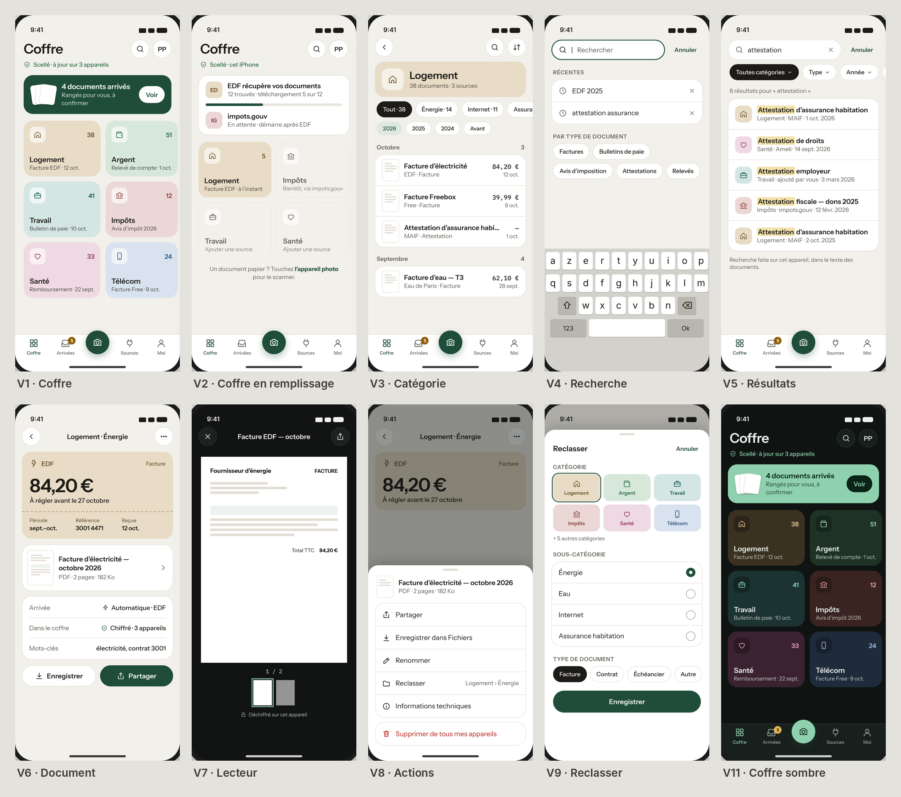
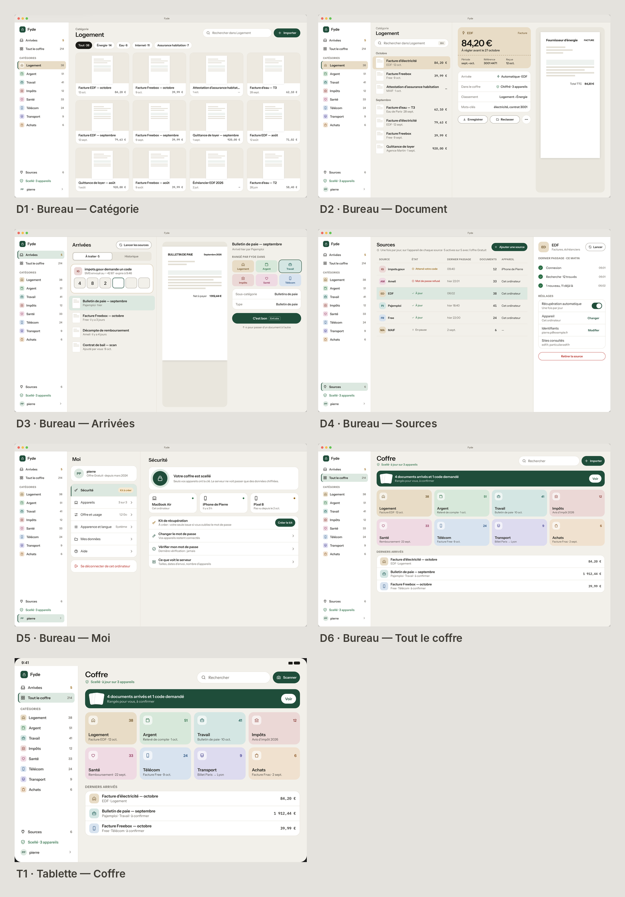
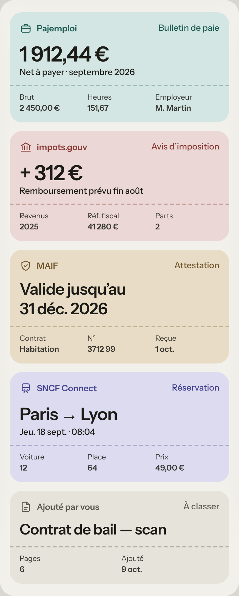
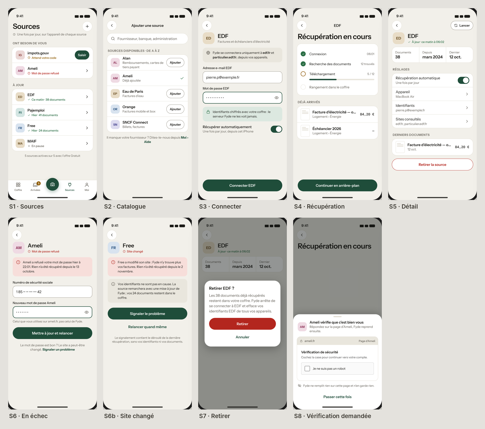
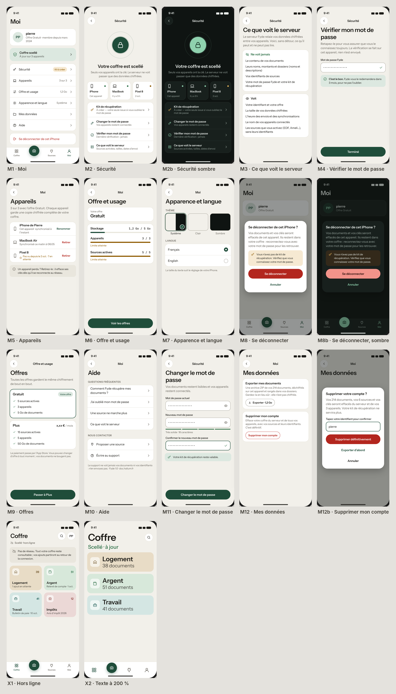

# Fyde Visual Design System

Fyde is a personal document wallet: it fetches documents from the user's providers by itself,
keeps them end-to-end encrypted and local-first, and syncs them across the user's devices. This
document is the source of truth for how the app looks and behaves on iOS, Android, desktop and
web. Values here win over the code; where they disagree, the code is behind.

## Status

**Not implemented yet.** The tokens under `shared/src/commonMain/kotlin/com/peltoche/fyde/theme/`
and the components under `shared/.../components/` still draw the previous visual language
(warm grays, teal accent, Public Sans, 2–10px radii, top navigation bar on desktop). Migrating
them is tracked in [Delivery](#delivery). New UI work follows this document, not the current code.

Screens built so far to a reference screen, on the current tokens until they're migrated (so in
the old palette and type, with the reference's layout, copy and proportions):

| ID | Screen | Code |
|---|---|---|
| O1 | Bienvenue | `WelcomeScreen.kt`, `SealHero` |

## Reference screens

Every screen of the app is drawn in `assets/screens/` (49 PNGs at 2×, phone frames at 390×844,
desktop at 1440×900, tablet at 1194×834), rendered from the HTML in `assets/mockups/` by
`render.py`; `sheets.py` assembles them into the contact sheets in `assets/sheets/`. To change a
reference screen, edit its HTML (values come from `assets/mockups/tokens.css`, which mirrors the
tables below), re-render, and commit the PNGs with the source.

Screen IDs are used throughout this document and in file names:
**O** onboarding and access · **V** vault and documents · **K** capture · **R** arrivals ·
**S** sources · **M** account (Moi) · **X** system states · **D** desktop · **T** tablet.

The copy in the reference screens is French, the product's first market; every string ships in
French and English.

---

## Principles

1. **The vault is organised the way life is.** Documents are browsed by the SDK's categories
   (Logement, Argent, Travail, Impôts, Santé, Télécom, Transport, Achats, Famille, Abonnements,
   Dons) and their subcategories, then by year. Search is always one tap away, but browsing is the
   default on a phone.
2. **The automation is visible.** Fetching documents is the reason to use Fyde, so its state is
   on screen at all times: what arrived, which source needs the user, when the next run is.
3. **Trust is shown, not claimed.** The encryption, the sync across devices and the single
   unrecoverable password are explained where they matter, in plain words, with what the server
   can and cannot see. Never a bare "secured" badge.
4. **Mobile first, density by input method.** Layouts are designed for a phone held in one hand,
   then reflowed for tablet and desktop, where pointer precision allows denser lists and
   master–detail. One visual language everywhere; interaction follows each platform.
5. **Honest UI.** Only controls that work are shown. Filter choices come from
   `FydeSdk.searchDocumentFacets`, never from a hard-coded list. A feature the SDK can't back yet
   is left out, not drawn disabled.
6. **Calm, warm, personal.** A wallet for payslips and tax notices should feel like a well-kept
   paper folder: soft paper background, category colours like file dividers, generous touch
   targets, one deep green for action. No gradients, no illustrations beyond the seal.

---

## Colour

### Roles

| Role (`AppColors`) | Light | Dark | Use |
|---|---|---|---|
| `background` | `#F2F0EA` | `#0F1412` | Page |
| `surface` | `#FFFFFF` | `#18201D` | Cards, groups, sheets, dialogs, tab bar, sidebar |
| `sunk` | `#E9E6DD` | `#202A26` | Segmented track, info notes, preview wells, progress tracks, skeletons |
| `border` | `#E2DED4` | `#2A3430` | Hairlines between rows, card edges |
| `borderStrong` | `#8C877B` | `#6E7C75` | Inputs, outlined buttons, unchecked controls |
| `text` | `#1C1B17` | `#EAF0EC` | Content |
| `textMuted` | `#66625A` | `#9AA8A1` | Secondary text, captions, placeholders |
| `primary` | `#1F4D3A` | `#8FD1AE` | Filled buttons, selection, scan button, arrivals banner, focus ring |
| `onPrimary` | `#FFFFFF` | `#0B2418` | Content on `primary` |
| `primaryWash` | `#DCE8E0` | `#1D3329` | Positive notes, selected sidebar row, avatar, check discs |
| `warning` | `#8F5B00` | `#E9B65A` | A source waiting for a code, limits reached, recovery kit missing |
| `warningWash` | `#F6E9D2` | `#33291A` | Warning notes |
| `error` | `#B3261E` | `#F2938A` | Failed source, destructive actions, field errors |
| `errorWash` | `#F7DEDA` | `#3A1F1C` | Error notes |
| `success` | `#2B6E45` | `#8FD1AE` | "À jour", "Scellé", checks |
| `scrim` | `#0F1412` at 45% | same | Behind sheets and dialogs |

Every Material 3 role is set from this table (`surfaceContainer*`, `surfaceTint` = `surface`,
`inverse*`, `outline` = `borderStrong`, `outlineVariant` = `border`) so no M3 baseline colour or
tonal tint ever leaks in.

### Category colours

Each category has a **fill** (backgrounds: category cards, passes, tiles, sidebar dots) and an
**ink** (its icon, count and accent text on that fill). They are file dividers, not status colours:
they never mean ok/warning/error, and they always come with the category's icon and name.

| Category | Icon | Fill / ink — light | Fill / ink — dark |
|---|---|---|---|
| Logement | home | `#E8DCC6` / `#6E5328` | `#3A3121` / `#E3C58F` |
| Argent | wallet | `#D7E8DA` / `#2B6E45` | `#1E3326` / `#9ED5AE` |
| Travail | briefcase | `#D4E6E3` / `#1D5C55` | `#1B3331` / `#8FD0C6` |
| Impôts | landmark | `#EBD8D6` / `#8A3B36` | `#3A2422` / `#EBA49E` |
| Santé | heart | `#EFDAE3` / `#8E3459` | `#3A2230` / `#EDA3C4` |
| Télécom | phone | `#D8E3EF` / `#2C5582` | `#1F2B3A` / `#9DBDE3` |
| Transport | train | `#DDDBEF` / `#45428F` | `#26253B` / `#B4B1EC` |
| Achats | bag | `#F0E1CF` / `#86501C` | `#3A2C1D` / `#E9B887` |
| Famille | users | `#E9E3CB` / `#6A5B1E` | `#33301C` / `#DCCB8A` |
| Abonnements | repeat | `#E3DCEC` / `#5D3F80` | `#2B2436` / `#C9B3E8` |
| Dons | gift | `#DDE8CF` / `#4A6326` | `#26301C` / `#BCD69A` |
| À classer | document | `#E6E3DB` / `#5B574F` | `#262A28` / `#B7B9B4` |

### Contrast

All text pairs meet WCAG AA (4.5:1), including small captions. Lowest pairs, so changes don't
slip under the floor: Argent ink on its fill 4.81:1, `warning` on `warningWash` 4.78:1,
`textMuted` on `sunk` 4.86:1, `success` on `primaryWash` 4.87:1. Dark category inks are ≥ 7:1 on
their fills. Re-check any value you change and record the new ratio here.

### Themes

Light and dark are one theme, picked in Moi › Apparence et langue (Système · Clair · Sombre,
persisted). Screens read `AppColors` only and never branch on the theme. Every screen has a dark
twin; V11 and M2 are the dark references.

---

## Typography

Two bundled, OFL-licensed families, identical on every platform:

- **Instrument Sans** (400, 500, 600) for all UI text.
- **IBM Plex Mono** (400, 500) for figures that must read as exact: amounts, references, codes,
  times, counts in meters. Tabular figures on.

| Role (`AppTypography`) | Size / line | Weight | Use |
|---|---|---|---|
| `display` | 32 / 38 | SemiBold, −0.02em | Screen titles on Compact (Coffre, Arrivées, Sources, Moi) |
| `title` | 24 / 30 | SemiBold, −0.01em | Detail and sheet titles, category band |
| `heading` | 18 / 24 | SemiBold | Dialog titles, card titles |
| `label` | 16 / 21 | SemiBold | Row titles, button text |
| `body` | 16 / 23 | Regular | Copy, field values |
| `secondary` | 14 / 19 | Regular | Row subtitles, helper text |
| `caption` | 13 / 17 | Regular | Timestamps, footnotes |
| `section` | 13 / 18 | SemiBold, uppercase, +0.05em | Section labels above groups |
| `tab` | 11 / 13 | Medium | Tab bar labels only |
| `passAmount` | 44 / 48 | SemiBold, −0.02em | The headline value of a document pass |
| `data` | 15 / 20 | Plex Mono Medium | Amounts and references in rows |
| `code` | 22 / 28 | Plex Mono SemiBold | One-time code boxes |

Rules: one line for a row title (ellipsis), full text on the detail screen. Bold (700) is not
used. Text scales with the OS setting up to 200%: rows grow, amounts never truncate, and the tab
bar keeps its labels by dropping to icons-only above 150%.

---

## Shape, spacing, elevation

| Token (`AppRadius`) | Value | Use |
|---|---|---|
| `sm` | 12 | Tiles, segmented items, OTP boxes |
| `md` | 14 | Inputs, notes |
| `lg` | 22 | Cards, groups, passes, category cards |
| `xl` | 24 | Sheet top corners, dialogs |
| `full` | pill | Buttons, chips, search field, avatar, status dots |

Buttons are pills: 52 tall (40 for small), 20 horizontal padding. Chips are 38-tall pills.

Spacing is a 4-based scale (`AppSpacing` 4, 8, 12, 16, 20, 24, 32, 40). Screen margin 20 on
Compact (16 for grouped lists), 24 Medium, 32 Expanded. 12 between cards, 20 above a section
label, 10 between buttons in a row.

Elevation is flat: surfaces sit on `background` with a `border` hairline. Shadows only on things
that float: the scan button (`0 6 16` primary at 35%), sheets (`0 −8 28` black at 18%), dialogs
(`0 12 40` at 25%), snackbars (`0 8 24` at 25%).

Touch targets: every tappable element is at least 44×44pt, including icon buttons, avatar,
chips and the trailing actions of a row; size the glyph for looks and centre it in the target.

### Iconography

Stroke icons, 1.7 stroke on a 24 grid, round caps and joins, drawn as `Canvas` glyphs in
`NavGlyphs.kt` / `DocumentGlyph.kt` (no icon font), traced from the matching `icons.svg` symbol
on its 24-unit grid (e.g. `BoltGlyph` ← `i-bolt`, `SyncGlyph` ← `i-sync`). Sizes (`AppIconSize`): 13 inline, 16 in
controls, 20 default, 24 tab bar and large tiles, 28+ only for heroes. Glyph colour is `text` at
rest, `primary` when selected, the category ink on a category fill. The icon set in use is
`assets/mockups/icons.svg`.

---

## Layout and navigation

### Compact (< 600dp — phones)

A tab bar of **Coffre · Arrivées · [Scanner] · Sources · Moi**. The centre item is a raised 56pt
`primary` scan button (on Android, the same action is also a FAB on Coffre and Arrivées). The
Arrivées badge counts what needs the user: codes asked, failed sources and documents waiting for
confirmation; hidden at 0. Drill-downs push inside their tab, with a 44pt circular back button,
so going back restores scroll and filters. Screen titles use `display`; drill-downs put their
title in the bar.

### Medium (600–839dp) and Expanded (≥ 840dp)

The tab bar becomes a sidebar: 260dp at Expanded, icons-only at Medium. From top: brand,
Arrivées (with count), Tout le coffre, CATÉGORIES (each with dot and count), then at the bottom
Sources and the seal ("Scellé · n appareils"). Moi moves to the avatar menu. Lists become
master–detail: a 400dp list column and a detail pane; phone sheets become inline panels. Scanner
becomes "Importer" (file picker, drag and drop) where there's no camera.

Keyboard on desktop and web: ⌘K / Ctrl+K search, ↑↓ move the selection, Enter opens, Space
previews, Esc closes the detail; in Arrivées, Enter confirms the classification and moves to the
next, E edits. Right-click opens the same actions as V8.

---

## Patterns

- **Sheet** for short, contextual tasks (verification code, document actions, reclassify, import
  from another app, insecure-storage warning). **Dialog** only to confirm something irreversible
  (remove a source, disconnect a device, log out); its confirm button is filled `error`.
- **Note** (`info`, `ok`, `warning`, `error`: wash fill, icon, rich text) explains a condition
  inline, next to what it concerns. There is no full-width banner.
- **Snackbar** (ink surface above the tab bar, optional progress and action, at most 2 stacked)
  confirms what finished and shows background progress ("Ajout de 2 documents · 1 sur 2").
- **Empty states** say what will appear and offer the one action that fills them; they never
  look like errors. **Loading** uses skeletons shaped like the content (`sunk` fill).
  **Offline** is a state, not an error (X1): everything local stays usable, additions queue.
- **Errors** use the SDK's localized wording (`FfiError` messages) or our own copy, never an
  exception message.
- **One primary action per screen**, filled; every other action is outlined or text.

### Source status

A source (an installed scraper; parsers never appear in the UI) always shows exactly one status,
identically in Sources, Arrivées, history and on desktop:

| Status | Colour, icon | Wording |
|---|---|---|
| Running | `primary`, spinner | "Récupération… 5 / 12" |
| Waiting for the user | `warning`, clock | "Attend votre code" + Saisir |
| Failed | `error`, alert | The reason in user words: mot de passe refusé · site changé · captcha · code expiré |
| Up to date | `success`, check | "Ce matin · 38 documents" |
| Paused | `textMuted`, pause | "En pause" |

### Verification code

`OneTimeCodeField`: 6 boxes 52pt tall, `code` type; paste fills all boxes; backspace moves left;
submits on the 6th digit; iOS `oneTimeCode` and Android SMS Retriever autofill; screen readers
announce "chiffre 4 sur 6". When a source asks a free-text question, the boxes become one text
field. Its context always shows the source, the masked destination and a step trail
Connecté → Code → Récupération (from `FfiProgressStep`). A code request while the app is in the
background raises a time-sensitive notification that opens straight into the field (R4).

### Document pass

The detail of a document is a pass in its category colours: issuer and type, a headline value
in `passAmount`, one line under it, a perforation, and up to three meta cells. Templates by
document type, each cell shown only when its attribute is set:

| Document type | Headline | Line under | Meta cells |
|---|---|---|---|
| Facture | Amount | "À régler avant le …" / "Payée le …" | Période · Référence · Reçue |
| Bulletin de paie | Net à payer | Month | Brut · Heures · Employeur |
| Avis d'imposition | Remboursement (+) or montant dû | Expected date | Revenus · Réf. fiscal · Parts |
| Attestation, carte | "Valide jusqu'au …" | — | Contrat · Numéro · Reçue |
| Réservation | Route or place | Date and time | Voiture · Place · Prix |
| Relevé, autre | Document name | Period | Pages · Reçu |
| À classer | Document name | "Ajouté par vous" | Pages · Ajouté |

### Classification suggestion

Every new document, fetched or added, shows where Fyde filed it ("Rangé dans Travail › Bulletins
de paie") with Modifier and C'est bon. Modifier opens the reclassify sheet (V9): category grid,
subcategories of the chosen category only, type chips.

### Trust

- The seal line under the vault title states the sync state: "Scellé · à jour sur 3 appareils",
  "Scellé · hors ligne", "Scellé · 7 en attente".
- Security (M2) lists what the server can and cannot read (M3), the recovery kit, and a periodic
  password check (M4).
- Any screen that handles a secret says where it goes in one line (O2: the password never leaves
  the device; S3: source credentials are encrypted with the vault).

---

## Screens

### Onboarding and access (O1–O9)

| ID | Screen | Content | States |
|---|---|---|---|
| O1 | Bienvenue | Seal hero, "Vos documents, sous scellé.", three promises (fetched, encrypted, on every device), Créer mon coffre / J'ai déjà un coffre | Only without an account on the device: first screen until signed in and after logging out; Créer mon coffre → O3, J'ai déjà un coffre → O2; an expired session goes to O2 instead |
| O2 | Connexion | Identifiant, Mot de passe (eye), "Il ne quitte jamais cet appareil", Ouvrir le coffre | Session expired → warning note. Loading → spinner, fields disabled (key stretching takes seconds) |
| O3 | Créer le coffre | Step 1/4; username; password with strength meter; confirm; warning "seule clé de votre coffre"; required "J'ai compris" | Mismatch and taken username as field errors |
| O4 | Stockage indisponible | Sheet: explanation, opt-in checkbox, Continuer quand même (enabled once checked) | On `SecureStorageUnavailable`; retries with `allowInsecureStorage` |
| O5 | Trop d'appareils | Plan limit, radio list of open sessions, "Déconnecter le MacBook Air" | Re-runs login with `replaceSessionId`; credentials kept only while open |
| O6 | Kit de récupération | Step 2/4; 12 words; Enregistrer le PDF / Imprimer; Je l'ai mis en lieu sûr / Plus tard | Screenshots blocked. Confirm asks two words back |
| O7 | Choisir ses sources | Step 3/4; search, category chips, popular public scrapers with checkboxes | Each pick opens S3 in turn |
| O8 | Notifications | Step 4/4; sample notifications; Autoriser / Plus tard | OS prompt only after the tap |
| O9 | Ouverture | Ring "142 sur 214", the device's name, "Vous pouvez déjà parcourir" | Replaces an empty vault on a new device |

### Coffre and documents (V1–V11)

| ID | Screen | Content | States |
|---|---|---|---|
| V1 | Coffre | Title, search, avatar; seal line; arrivals banner; 2-column category cards (icon, count, name, latest document) ordered by count | Banner only when something needs the user; pull to refresh = sync |
| V2 | Coffre en remplissage | Running sources with progress; filled cards for categories with documents; dashed cards for expected ones | Until each connected source ran once |
| V3 | Catégorie | Category band; subcategory chips with counts; year chips; month groups of document rows | Sort by date, amount, name; rows swipe to Partager / Reclasser |
| V4 | Recherche | Full-screen field, recent searches, type shortcuts | Opened from any search icon |
| V5 | Résultats | Facet chips Catégorie / Type / Année / Source; matched words highlighted; "Recherche faite sur cet appareil" | No result → clear filters |
| V6 | Document | Pass, file row with thumbnail, facts (arrivée, chiffré, mots-clés), Enregistrer / Partager | See [Document pass](#document-pass) |
| V7 | Lecteur | Full-screen dark viewer, zoom, pages, share | No preview → "Ouvrir avec…"; web downloads |
| V8 | Actions | Sheet: Partager, Enregistrer dans Fichiers, Renommer, Reclasser, Informations techniques, Supprimer de tous mes appareils | Delete confirms that it reaches every device |
| V9 | Reclasser | Category grid, subcategories, type, Enregistrer | Invalid category/subcategory pairs can't be picked |
| V10 | Cartes par type | Pass templates | — |
| V11 | Coffre sombre | Dark reference | — |

### Capture and arrivals (K1–K4, R1–R4)

| ID | Screen | Content | States |
|---|---|---|---|
| K1 | Scanner | Platform document scanner in Fyde chrome; edge overlay; page count; Terminer | Camera denied → explanation + settings |
| K2 | Vérifier le scan | Crop, rotate, delete, add page; name; suggested classification; Mettre au coffre | No suggestion → "À classer" and listed in Arrivées |
| K3 | Depuis une autre app | Share extension sheet: file, name, suggestion, "Chiffré sur cet iPhone avant d'être envoyé" | Signed out → "Ouvrez Fyde pour ajouter" |
| K4 | Ajout en cours | Row appears at once with "Chiffrement…"; progress snackbar; duplicate → "Déjà dans le coffre · Voir" | `DuplicateDocument` is never an error |
| R1 | Arrivées | À traiter / Historique; code card first; documents with their suggestion and Modifier / C'est bon | Swipe right = C'est bon |
| R2 | Tout est rangé | Check disc, next run, Lancer maintenant | Badge hidden |
| R3 | Historique | Run outcomes and user confirmations by day | — |
| R4 | Notification de code | Lock-screen notification with the deadline; new-document notifications hide titles while locked | Expired → "Code expiré" + Relancer |

### Sources (S1–S7)

| ID | Screen | Content | States |
|---|---|---|---|
| S1 | Sources | Next run; "Ont besoin de vous" then "À jour"; rows with initials tile and status; plan usage | Empty → Ajouter une source; limit → plan sheet |
| S2 | Catalogue | Search, category chips, suggested then by category; Ajouter or check | User's own scripts in a last group |
| S3 | Connecter | What it fetches; the sites it may reach (`allowedDomains`); one field per script parameter (secret → masked, number → numeric, boolean → switch); automatic switch | Connect installs and runs at once (S4) |
| S4 | Récupération en cours | Stepper Connexion → Recherche → Téléchargement i / n → Rangement; documents appear under it; Continuer en arrière-plan | Code or captcha → code sheet |
| S5 | Détail | Status, counts, schedule switch, identifiants, sites, latest documents, Lancer, Retirer la source | — |
| S6 | En échec | Error note with time; the failing field refocused; Mettre à jour et relancer; Signaler un problème | Report never includes credentials |
| S7 | Retirer | Dialog: documents stay, credentials erased everywhere | — |

### Moi and states (M1–M8, X1)

| ID | Screen | Content | States |
|---|---|---|---|
| M1 | Moi | Profile, seal card, Sécurité (pill "Kit à créer"), Appareils, Offre et usage, Apparence et langue, Aide, Se déconnecter | — |
| M2 | Sécurité | Seal hero, device tiles with sync dot, Kit de récupération, Vérifier mon mot de passe, Ce que voit le serveur | Dark reference |
| M3 | Ce que voit le serveur | "Ne voit jamais" / "Voit" lists | Keep in step with the wire format |
| M4 | Vérifier mon mot de passe | Local check, next reminder in 3 months | Wrong → link to the recovery kit |
| M5 | Appareils | Each device with last sync or "Pas vu depuis … · n en attente"; Déconnecter | Current device can't be disconnected here |
| M6 | Offre et usage | Plan; meters for storage, devices, active sources | 100% → warning, over → error |
| M7 | Apparence et langue | Theme tiles, language radios; text size follows the OS | Persisted |
| M8 | Se déconnecter | Dialog: what is erased here, what stays; warning if no recovery kit | Wipes keys and local data even offline |
| X1 | Hors ligne | Seal "hors ligne", info note, pending additions on cards | Never an error screen |

### Desktop and tablet (D1–D4, T1)

| ID | Screen | Layout |
|---|---|---|
| D1 | Catégorie | Sidebar · header, search, Ajouter · subcategory pills · 4-column cards with first-page thumbnails |
| D2 | Document | Sidebar · 400dp list · pass and facts · live preview |
| D3 | Arrivées | Sidebar · queue with inline code card · preview · classification panel with C'est bon (Enter) |
| D4 | Sources | Sidebar · sortable table (source, état, dernier passage, documents, automatique) · detail panel |
| T1 | Tablette | Sidebar · 4-column category cards · Scanner in the header · latest arrivals |

---

## Components

Screens compose `App*` components and never style a raw Material 3 component. Target inventory:

| Component | Change | Notes |
|---|---|---|
| `AppTheme`, `AppColors`, `AppTypography`, `AppShapes`, `AppSpacing`, `AppIconSize` | Rewrite values | Tables above; category colours as `AppCategoryColors` |
| `AppButton` (`Filled`, `Outlined`, `Text`, `destructive`, `loading`) | Restyle | Pill, 52 / 40 |
| `AppTextField`, `AppSearchField` | Restyle | 52 tall radius 14; search is a 48 pill |
| `AppChip` | Restyle | Pill 38, selected = `text` fill, optional count and chevron |
| `AppCheckbox`, `AppRadio`, `AppSwitch` | Restyle | 22pt marks, 51×31 switch |
| `AppBottomSheet`, `AppDialog`, `AppSnackbarHost`, `AppProgressBar` | Restyle | Patterns above |
| `AppSegmented` | New | 2–3 options on `sunk` |
| `AppNote` | New | Replaces inline `AppBanner` |
| `AppTabBar` | New | Replaces `AppNavigationBar` |
| `AppSidebar` | New | Replaces `AppNavigationTopBar` and `AppNavigationRail` |
| `CategoryCard`, `CategoryBand` | New | Normal and placeholder variants |
| `DocumentRow` | New | Thumbnail or tile, title, issuer · type, amount, date, highlight, pending |
| `DocumentPass` | New | Templates by type |
| `ArrivalsBanner`, `ClassificationSuggestion` | New | — |
| `OneTimeCodeField` | New | See [Verification code](#verification-code) |
| `SourceRow`, `SourceStatus`, `RunStepper` | New | See [Source status](#source-status) |
| `SealHero` | Landed (O1) | `primary` disc and lock, `primaryWash` disc, two `border` rings at 168 (`AppDimensions.sealHero`); reused by M2 |
| `DeviceTile`, `UsageMeter` | New / restyle | — |
| `AppIconTile` | Restyle | 44 default; 36 (`AppDimensions.iconTileSmall`) beside body text, as in O1's promises |

Every new or changed component lands in `DesignSystemScreen.kt` in the same change.

---

## SDK dependencies

Some screens need capabilities `fyde-sdk` doesn't expose yet; until they exist, those parts are
left out (principle 5), not faked.

| Capability | Screens |
|---|---|
| Per-source run record: last run, outcome, failure kind, new count | S1, S5, S6, R3, D4 |
| Scheduled runs and background execution | S3, S5, R2 |
| Provenance on document metadata (source script, device, fetched at) | V5 Source facet, V6, S5 |
| Unconfirmed-classification flag | R1, D3, Arrivées badge |
| Delete-document event | V8 |
| Recovery kit and local password check | O6, M2, M4 |
| Replay progress and per-device last seen | O9, M5, M2 |
| First-page thumbnails | V3, D1, D2 |

## Delivery

1. **New shell, no SDK change:** tokens, fonts, `AppTabBar` / `AppSidebar`, V1, V3–V7, V9, V11,
   S1–S4 with live run state only, M1, M5–M8, O1–O5, O7, O8, X1, code sheet, K1–K4.
2. **Automation visible:** run records and scheduling → S5, S6, R2–R4, V2, statuses everywhere.
3. **Trust:** recovery kit, password check, last seen → O6, O9, M2–M4.
4. **Triage:** provenance, unconfirmed flag, delete → R1 and D3 triage, Source facet, V8 delete,
   thumbnails.

---

## Accessibility and platforms

- WCAG AA contrast for all text (see [Contrast](#contrast)); colour never carries meaning alone.
- 44×44pt minimum targets; focus ring 2dp `primary` for keyboard focus only.
- Screen-reader labels on every icon-only button; a category card reads "Logement, 38 documents,
  dernier : Facture EDF du 12 octobre".
- Dynamic type to 200% (see [Typography](#typography)).
- iOS: large titles collapse on scroll, swipe back, haptic on code accepted, share extension.
- Android: predictive back, SMS Retriever, ML Kit document scanner, share target, autofill hints.
- Desktop and web: keyboard shortcuts above, hover states, right-click menus; web has no PDF
  preview yet and offers a download instead.

## Rules for AI coding agents

1. Read this document and the reference screen of the screen you're touching before writing UI;
   search `components/` before creating anything.
2. Never use a raw Material 3 component in a screen; extend or add an `App*` component.
3. No literal design values in screens: colours from `AppColors` / `AppCategoryColors`, text
   from `AppTypography`, gaps from `AppSpacing`, sizes from `AppDimensions` / `AppIconSize`,
   corners from `AppShapes`.
4. Filters, counts and category lists come from the SDK's search facets; never compute them in
   the app.
5. Every new or changed component lands in `DesignSystemScreen.kt` and in [Components](#components)
   in the same commit; a changed screen updates its reference HTML and PNG.
6. Verify visual changes by rendering them (`run-fyde-application` skill) and comparing with the
   reference screen.

## Open questions

- Bundling Instrument Sans in `composeResources/font/` and removing Public Sans.
- Category icons for Dons and Famille are not yet drawn as `Canvas` glyphs.
- Android-specific reference screens, tablet portrait and web are not drawn yet.
