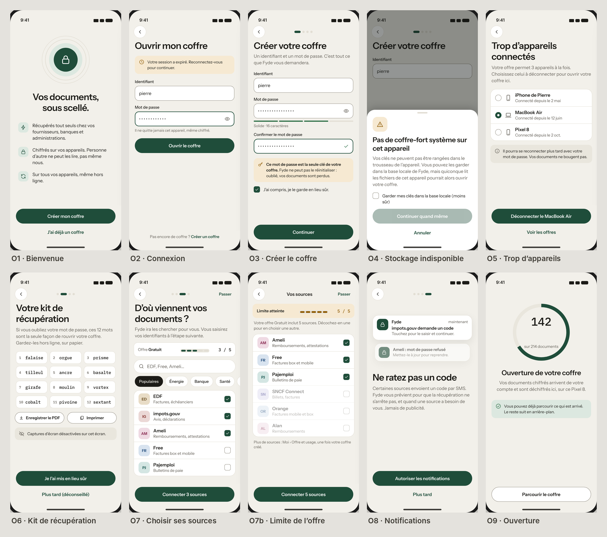
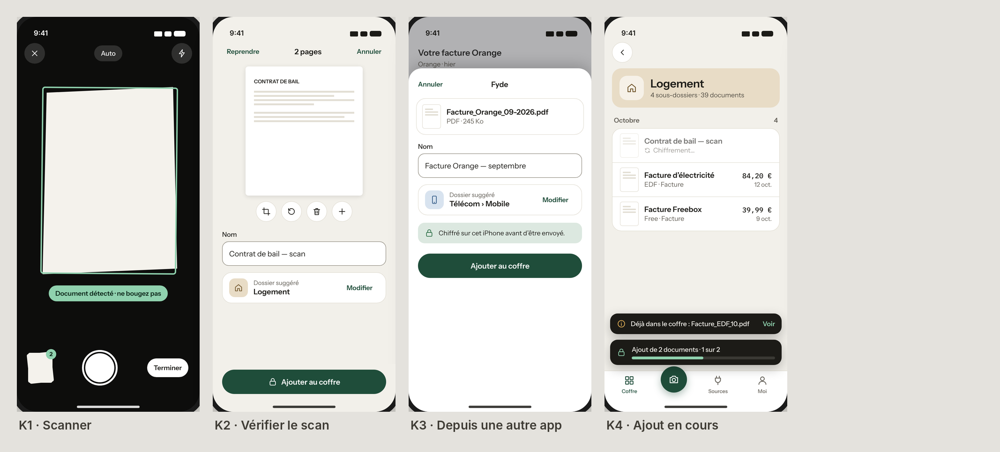

# Fyde Visual Design System

Fyde is a personal document wallet: it fetches documents from the user's providers by itself,
keeps them end-to-end encrypted and local-first, and syncs them across the user's devices. This
document is the source of truth for how the app looks and behaves on iOS, Android and desktop.
The web build is out of scope for now: fyde-sdk can't compile to WebAssembly, so the web app is
a stub with nothing to sign in to; it gets its own references once the SDK runs in a browser.
Values here win over the code; where they disagree, the code is behind.

## Status

**Not implemented yet.** The tokens under `shared/src/commonMain/kotlin/com/peltoche/fyde/theme/`
and the components under `shared/.../components/` still draw the previous visual language
(warm grays, teal accent, Public Sans, 2–10px radii, top navigation bar on desktop). Migrating
them is tracked in [Delivery](#delivery). New UI work follows this document, not the current code.

**Folders replace categories.** The vault is now browsed by user-owned folders (see
[Folders](#folders)): V1, V3, V9, D1, D6, T1, T2 and the sidebar are drawn with folders, and
V12–V15 and D7–D10 are new. The app's built V1, V3, D1, D6 and sidebar browse folders
(with V12–V15 / D7–D10 as sheets and dialogs, V9 and the filing card, the sidebar's "+" opening D10 for a top-level folder; drag and drop only between the vault's own folder
cards and sidebar rows; a folder page listing every document below it); the table below says what was built, not what is
drawn.

**Several accounts per source.** A source can be connected once per account the user has on the
provider's site (see [Accounts of a source](#accounts-of-a-source)): S1, S2, S5 and D4 are drawn
with them, and S3b, S5c and S7b are new. The app builds them (see the S1–S7 row below).

**A folder per source.** Each account of a source can file its documents into a folder the user
picks, or creates on the spot, instead of filing them automatically (see
[A source's folder](#a-sources-folder)): S3, S3b, S5, S5b, S5c, D4 and DO7b are drawn with its
"Ranger dans" row, and S3c, S9, S9b, D12 and DO7i are new. fyde-sdk keeps the folder in the
installation; the app builds it in the Sources tab (see the S1–S7 row below) and in
onboarding's connect step (S3c at Compact, DO7b and DO7i wider).

**Filing by folder content.** Folder descriptions are gone: automatic filing compares a new
document with the documents already in each folder, on the device (see [Folders](#folders)'s
Filing). V3, V12–V15, D1, D7–D10, S3, S9, S9b, D12, DO7i and M3 are redrawn without
descriptions, and the source's folder pattern words automatic filing by content; no screen is
new. Neither the app nor fyde-sdk files this way yet.

Screens built so far to a reference screen, on the current tokens until they're migrated (so in
the old palette and type, with the reference's layout, copy and proportions):

| ID | Screen | Code |
|---|---|---|
| O1, DO1 | Bienvenue (Compact; Medium and Expanded) | `WelcomeScreen.kt`, `SealHero`, `AuthBrandPanel.kt` |
| O2, DO2 | Connexion (Compact; Medium and Expanded, with DO2b and DO2c) | `LoginScreen.kt`, `AppBackButton`, `AppNote`, `AppTextField`, `AuthBrandPanel.kt` |
| DO3, DO3b | Créer le coffre (Medium and Expanded; the stepper is left out until steps 2–4 exist, and a taken username is an error note, not a field error, until `FydeSdkException` carries the SDK's code) | `RegisterScreen.kt`, `AuthBrandPanel.kt`, `AppCheckbox`, `AppNote` |
| O4, DO4b | Stockage indisponible (phone; desktop, at creation) | `InsecureStorageSheet.kt`, `AppBottomSheet`, `AlertTriangleGlyph` |
| M1, M2, M3, M5, M6, M7, M8 | Moi as the Settings tab (still named Paramètres, like the other tabs' current names): drill-downs at Compact, master–detail at Medium and Expanded (menu as the 360 list column, Sécurité open by default). M2's Kit de récupération row opens O6/DO6 as a page (its date or "À créer" from `recoveryKeyStatus`; no O6b yet). Left out until the SDK backs them: the profile card, M2's device tiles and the password-check row (so no M4), Aide, last-sync times in M5, Voir les offres in M6. M7 isn't persisted yet | `SettingsScreen.kt`, `RecoveryKitPage.kt`, `SessionsSection.kt`, `PlanUsageSection.kt`, `AppDialog`, `SealHero`, `AppNote`, `AppRadio` |
| T1, T2, sidebar | The shell beside every signed-in screen: the bottom bar at Compact, T2's 80dp icon rail at Medium (each category as its tile, a tooltip with its name and count), the 260dp sidebar at Expanded (D1–D6, T1): brand, Tout le coffre, À classer, DOSSIERS with its "+" (D10, a new top-level folder, over the vault page that's open or the vault's home from Sources and Paramètres) and the folder tree with counts, Sources, the seal, then a Paramètres row. The content beside it gets the size class of the width left to it, never below Medium, so T1 lays out as Expanded (4-column cards) and T2 as Medium (3 columns). Left out until the SDK backs them: Scanner (Importer stays: no camera), the avatar row (a Paramètres row instead) | `TopLevelScaffold.kt`, `AppSidebar.kt` |
| V1, V3–V7, D1, D2, D6 | Coffre as the Vault tab: the home's category cards and latest arrivals (V1 at Compact, D6 at Expanded), a category's chips and month groups (V3, D1's card grid), the search (V4's type shortcuts, V5's Catégorie / Type / Année chips and highlighted results; opened from a circle, or a 300 field in D1's and D6's headers, within the category from a category page), a document's pass, Informations, facts and Enregistrer (V6, a page below Expanded; D2 at Expanded, beside its category's list with the content previewed in the rest of the window), V7's full-screen viewer below Expanded, deleting from V8's sheet or D2b's menu (the "…" beside Enregistrer, a right-click on D2's list rows, ⌘⌫ / Suppr on the open document) into V10 / D2c (confirming publishes the deletion, then closes the document with a "Document supprimé" snackbar; the source note is left out). The pass and Informations come from the document's attributes (see [Document pass](#document-pass)), as do rows' issuer and amount. Rows, D1's cards and V6's file row show the document's first page (see `DocumentRow`, `DocumentCard`). Left out until the SDK backs them: keywords, the avatar, Partager, Reclasser, V8's other actions (it holds Enregistrer and Supprimer only), V9, swipe actions, the band's sources count, an "À classer" card, "à jour", page counts, V4's recent searches, V5's Source facet, ⌘K | `VaultScreen.kt`, `VaultCategoryPage.kt`, `VaultSearchPage.kt`, `VaultDocumentPage.kt`, `DocumentPreview.kt`, `CategoryCard`, `CategoryBand`, `DocumentRow`, `DocumentCard`, `DocumentPass`, `DocumentAttributes`, `AppChip`, `AppSearchField`, `AppDropdownMenu` |
| V6c, V16, V16b, V9b, V10b, D11, D11b | Similar documents and their selection: the document's DOCUMENTS SIMILAIRES section (V6c; in D2's pass column), the similar page (V16, a page below Expanded; D11 in D2's list column beside the open document), ticking with the selection bar (V16b), and V9 / V10 for several (V9b; V10b, D11b), each document's move or deletion published in turn. The starting document's row isn't refreshed after a move until the SDK can return one document's metadata | `VaultSimilarPage.kt`, `VaultFolderSheets.kt`, `VaultDocumentPage.kt`, `SimilarityBadge`, `SelectionBar`, `DocumentRow` |
| S1–S7, S3b, S3c, S5c, S7b, S9, S9b, D4, D12 | Sources as the Sources tab: S1–S6 as pages at Compact and Medium, D4 at Expanded (a table sortable by source and état beside a 380 detail panel, `AppDimensions.sourceDetailPanelWidth`), S7 as an `AppDialog`. Statuses are this app session's runs only. Arrêter on S4 (S4b once stopped), on S5 and D4's panel in Lancer's place, and on the code dialog (no S8 yet); the stopped disc is `surfaceElevated` until the tokens migrate. Accounts of a source: one row per account, S2's Autre compte, S3b (Nom du compte in the connect form), S5c (its other accounts listed under the settings, Nom du compte reopening the credentials form) and S7b; in D4 the panel shows the selected account. A source's folder: Ranger dans on S3, S3b (from the first account's folder) and S3c (À classer · Créer un dossier with no folder in the vault), in S5, S5b and S5c's Réglages and D4's panel; S9 / D12 as the `FolderPicker` sheet (a centred panel wider than Compact, so D12 browses by level rather than D8's searchable tree), S9b as D10's form titled "Nouveau dossier pour <source>", without S9b's description help line (descriptions are on their way out). Onboarding's `ConnectSourceScreen` (S3 / S3c at Compact, DO7b at Medium and Expanded) has the same row and sheets (DO7i as that form, in the centred panel). Rangement automatique reads "D'après les documents déjà dans vos dossiers" (filing will go by the documents already in folders), and S9's line drops "d'après leurs descriptions"; the new folder's name isn't preselected. Left out until the SDK backs them: S1's next run and per-row counts, S2's categories and "Le proposer", S3's Récupérer automatiquement, S5's stats, schedule, automatic switch, latest documents, pause and "Signaler un problème", S6's Saisir, D4's Dernier passage, Documents and Automatique columns | `SourcesTabScreen.kt`, `SourceAccounts.kt`, `SourceFolders.kt`, `VaultFolderSheets.kt`, `ConnectSourceScreen.kt`, `SourceFetchingScreen.kt`, `SourceFolderField`, `SourceStatus`, `RunStepper`, `StopGlyph`, `SparkleGlyph`, `AppCircleButton`, `AppDialog` |

## Reference screens

Every screen of the app is drawn in `assets/screens/` (114 PNGs at 2×, phone frames at 390×844,
desktop at 1440×900, tablet at 1194×834 or 834×1194 upright), rendered from the HTML in `assets/mockups/` by
`render.py`; `sheets.py` assembles them into the contact sheets in `assets/sheets/`. To change a
reference screen, edit its HTML (values come from `assets/mockups/tokens.css`, which mirrors the
tables below; `core.html` still carries its own copy, so change both), re-render, and commit the
PNGs with the source. `assets/maps/screen_map.py` checks that every PNG has a row in the tables
below and a node in the screen map.

How the screens lead to one another is mapped in [`screen-map.md`](screen-map.md).

Screen IDs are used throughout this document and in file names:
**O** onboarding and access · **V** vault and documents · **K** capture ·
**S** sources · **M** account (Moi) · **X** system states · **D** desktop · **DO** desktop
onboarding and access · **T** tablet. A letter suffix (`DO2b`) is another state of the same screen.

The copy in the reference screens is French, the product's first market; every string ships in
French and English.

---

## Principles

1. **The vault is organised the way its owner wants.** Documents live in folders the user owns:
   a folder holds documents, subfolders, or both, and can be created, renamed, moved and
   deleted. A new vault starts empty: onboarding doesn't propose folders, and everything arrives
   in À classer until the user creates folders and files documents into them by hand, which is
   what teaches Fyde where the next ones go. Search is always one tap away, but browsing is the
   default on a phone.
2. **The automation is visible.** Fetching documents is the reason to use Fyde, so its state is
   on screen at all times: what arrived, which source needs the user, when the next run is.
3. **Trust is shown, not claimed.** The encryption, the sync across devices and the single
   unrecoverable password are explained where they matter, in plain words, with what the server
   can and cannot see. Never a bare "secured" badge.
4. **Mobile first, density by input method.** Layouts are designed for a phone held in one hand,
   then reflowed for tablet and desktop, where pointer precision allows denser lists and
   master–detail. One visual language everywhere; interaction follows each platform.
5. **Honest UI.** Only controls that work are shown. Filter choices come from
   `FydeSdk.searchDocumentFacets`, never from a hard-coded list. A feature the SDK can't back yet
   is left out, not drawn disabled.
6. **Calm, warm, personal.** A wallet for payslips and tax notices should feel like a well-kept
   paper folder: soft paper background, folder colours like file dividers, generous touch
   targets, one deep green for action. No gradients, no illustrations beyond the seal.

---

## Colour

### Roles

| Role (`AppColors`) | Light | Dark | Use |
|---|---|---|---|
| `background` | `#F2F0EA` | `#0F1412` | Page |
| `surface` | `#FFFFFF` | `#18201D` | Cards, groups, sheets, dialogs, tab bar, sidebar |
| `sunk` | `#E9E6DD` | `#202A26` | Segmented track, info notes, preview wells, progress tracks, skeletons |
| `border` | `#E2DED4` | `#2A3430` | Hairlines between rows, card edges |
| `borderStrong` | `#8C877B` | `#6E7C75` | Inputs, outlined buttons, unchecked controls |
| `text` | `#1C1B17` | `#EAF0EC` | Content |
| `textMuted` | `#66625A` | `#9AA8A1` | Secondary text, captions, placeholders |
| `primary` | `#1F4D3A` | `#8FD1AE` | Filled buttons, selection, scan button, focus ring |
| `onPrimary` | `#FFFFFF` | `#0B2418` | Content on `primary` |
| `primaryWash` | `#DCE8E0` | `#1D3329` | Positive notes, selected sidebar row, avatar, check discs |
| `warning` | `#8F5B00` | `#E9B65A` | A source waiting for a code, limits reached, recovery kit missing |
| `warningWash` | `#F6E9D2` | `#33291A` | Warning notes |
| `error` | `#B3261E` | `#F2938A` | Failed source, destructive actions, field errors |
| `onError` | `#FFFFFF` | `#2B0B08` | Content on `error` (destructive buttons): 6.54:1 light, 8.07:1 dark |
| `errorWash` | `#F7DEDA` | `#3A1F1C` | Error notes |
| `success` | `#2B6E45` | `#8FD1AE` | "À jour", "Scellé", checks |
| `highlight` | `#F3E2A9` | `#5C4A12` | Matched words in search results (text stays `text`) |
| `badge` | `warning` | `warning` | Count badges (tab bar, sidebar); figure in `onPrimary` light, `#2B1C02` dark |
| `scrim` | `#0F1412` at 45% | same | Behind sheets and dialogs |

Every Material 3 role is set from this table (`surfaceContainer*`, `surfaceTint` = `surface`,
`inverse*`, `outline` = `borderStrong`, `outlineVariant` = `border`) so no M3 baseline colour or
tonal tint ever leaks in.

### Folder colours

Each top-level folder has a **colour** and an **icon**, picked when it's created (V12, D10) and
changed from its actions (V13). A colour is a **fill** (backgrounds: folder cards, passes, tiles,
sidebar dots) and an **ink** (its icon, count and accent text on that fill). They are file
dividers, not status colours: they never mean ok/warning/error, and they always come with the
folder's icon and name. A subfolder has no colour of its own: it shows its top-level folder's fill
with the folder glyph, and takes the new one's when it moves. A document's pass and tiles use its
top-level folder's colour; a document in À classer (at the root) uses À classer's.

The palette below is the one offered (the picker shows its first eight, then the rest); the names
are the kind of folder each colour and icon suits. À classer's colour is not
in the picker: a folder never looks like À classer. Any icon of `icons.svg`'s
folder set can go with any colour.

| Proposed folder | Icon | Fill / ink — light | Fill / ink — dark |
|---|---|---|---|
| Logement | home | `#E8DCC6` / `#6E5328` | `#3A3121` / `#E3C58F` |
| Argent | wallet | `#D7E8DA` / `#2B6E45` | `#1E3326` / `#9ED5AE` |
| Travail | briefcase | `#D4E6E3` / `#1D5C55` | `#1B3331` / `#8FD0C6` |
| Impôts | landmark | `#EBD8D6` / `#8A3B36` | `#3A2422` / `#EBA49E` |
| Santé | heart | `#EFDAE3` / `#8E3459` | `#3A2230` / `#EDA3C4` |
| Télécom | phone | `#D8E3EF` / `#2C5582` | `#1F2B3A` / `#9DBDE3` |
| Transport | train | `#DDDBEF` / `#45428F` | `#26253B` / `#B4B1EC` |
| Achats | bag | `#F0E1CF` / `#86501C` | `#3A2C1D` / `#E9B887` |
| Famille | users | `#E9E3CB` / `#6A5B1E` | `#33301C` / `#DCCB8A` |
| Identité | id card | `#D3E7EB` / `#1B5866` | `#1B3138` / `#8DCCDB` |
| Juridique | scale | `#DDE1E7` / `#3F4A5C` | `#252A33` / `#B5C0D2` |
| Éducation | graduation cap | `#DAEAD3` / `#3A6A2A` | `#213019` / `#A9D696` |
| Animaux | paw | `#EFDCD2` / `#8A4325` | `#3A261D` / `#EDAF92` |
| Loisirs | ticket | `#EDD9EE` / `#7A3580` | `#35223A` / `#E2A8E8` |
| Abonnements | repeat | `#E3DCEC` / `#5D3F80` | `#2B2436` / `#C9B3E8` |
| Dons | gift | `#DDE8CF` / `#4A6326` | `#26301C` / `#BCD69A` |
| À classer | document | `#E6E3DB` / `#5B574F` | `#262A28` / `#B7B9B4` |

### Contrast

All text pairs meet WCAG AA (4.5:1), including small captions. Lowest pairs, so changes don't
slip under the floor: Argent ink on its fill 4.81:1, `warning` on `warningWash` 4.78:1,
`textMuted` on `sunk` 4.86:1, `success` on `primaryWash` 4.87:1. Dark category inks are ≥ 7:1 on
their fills. Re-check any value you change and record the new ratio here.

States that aren't text need 3:1 or a second cue (WCAG 1.4.11). Tints alone don't reach it
(`primaryWash` on `background` is 1.11:1, `surface` on `sunk` about 1.15:1), so every selected
state adds one: a selected sidebar row gets a 3dp `primary` bar on its leading edge and a
SemiBold label; a selected segment gets a `borderStrong` hairline and a SemiBold label; a selected
theme or option tile gets a `primary` ring and a check disc. `borderStrong` on `background`
(3.14:1) is the floor for control outlines.

### Themes

Light and dark are one theme, picked in Moi › Apparence et langue (Système · Clair · Sombre,
persisted). Screens read `AppColors` only and never branch on the theme. Every screen works in both
themes from the roles alone; the dark references cover each kind of surface: V11 (the vault),
V6b (a pass), V8b (a sheet over the scrim), M2b (the seal hero)
and M8b (a dialog with a destructive action). A screen without a drawn dark twin follows these.

---

## Typography

Two bundled, OFL-licensed families, identical on every platform:

- **Instrument Sans** (400, 500, 600) for all UI text.
- **IBM Plex Mono** (400, 500) for figures that must read as exact: amounts, references, codes,
  times, counts in meters. Tabular figures on.

| Role (`AppTypography`) | Size / line | Weight | Use |
|---|---|---|---|
| `display` | 32 / 38 | SemiBold, −0.02em | Screen titles on Compact (Coffre, Sources, Moi) |
| `title` | 24 / 30 | SemiBold, −0.01em | Detail and sheet titles, category band |
| `heading` | 18 / 24 | SemiBold | Dialog titles, card titles |
| `label` | 16 / 21 | SemiBold | Row titles, button text |
| `body` | 16 / 23 | Regular | Copy, field values |
| `secondary` | 14 / 19 | Regular | Row subtitles, helper text |
| `caption` | 13 / 17 | Regular | Timestamps, footnotes |
| `section` | 13 / 18 | SemiBold, uppercase, +0.05em | Section labels above groups |
| `tab` | 11 / 13 | Medium | Tab bar labels only |
| `passAmount` | 44 / 48 | SemiBold, −0.02em | The headline value of a document pass |
| `data` | 15 / 20 | Plex Mono Medium | Amounts and references in rows |
| `code` | 22 / 28 | Plex Mono SemiBold | One-time code boxes |

Rules: one line for a row title (ellipsis), full text on the detail screen. Bold (700) is not
used. Text scales with the OS setting up to 200%: rows grow, amounts never truncate, the category
grid becomes one column, and above 150% the tab bar drops its visible labels (they stay as
accessibility labels) while the badge stays. X2 is the vault at 200%.

---

## Shape, spacing, elevation

| Token (`AppRadius`) | Value | Use |
|---|---|---|
| `sm` | 12 | Tiles, segmented items, OTP boxes |
| `md` | 14 | Inputs, notes |
| `lg` | 20 | Cards, groups, passes, category cards |
| `xl` | 28 | Sheet top corners, dialogs |
| `full` | pill | Buttons, chips, search field, avatar, status dots |

Buttons are pills: 52 tall (40 for small), 20 horizontal padding. Chips are 38-tall pills.

Spacing is a 4-based scale (`AppSpacing` 4, 8, 12, 16, 20, 24, 32, 40). Screen margin 20 on
Compact (16 for grouped lists), 24 Medium, 32 Expanded. 12 between cards, 20 above a section
label, 10 between buttons in a row.

Elevation is flat: surfaces sit on `background` with a `border` hairline. Shadows only on things
that float: the scan button (`0 6 16` primary at 35%), sheets (`0 −8 28` black at 18%), dialogs
(`0 12 40` at 25%), snackbars (`0 8 24` at 25%).

Touch targets: every tappable element is at least 44×44pt, including icon buttons, avatar,
chips and the trailing actions of a row; size the glyph for looks and centre it in the target.

### Iconography

Stroke icons, 1.7 stroke on a 24 grid, round caps and joins, drawn as `Canvas` glyphs in
`icons/NavGlyphs.kt` / `icons/DocumentGlyph.kt` (no icon font), traced from the matching `icons.svg` symbol
on its 24-unit grid (e.g. `BoltGlyph` ← `i-bolt`, `SyncGlyph` ← `i-sync`). Sizes (`AppIconSize`): 13 inline, 16 in
controls, 20 default, 24 tab bar and large tiles, 28+ only for heroes. Glyph colour is `text` at
rest, `primary` when selected, the category ink on a category fill. The icon set in use is
`assets/mockups/icons.svg`.

---

## Layout and navigation

### Compact (< 600dp — phones)

A tab bar of **Coffre · [Scanner] · Sources · Moi**. The scanner item is a raised 56pt
`primary` scan button (on Android, the same action is also a FAB on Coffre). Drill-downs push inside their tab, with a 44pt circular back button,
so going back restores scroll and filters. Screen titles use `display`; drill-downs put their
title in the bar.

### Medium (600–839dp) and Expanded (≥ 840dp)

The tab bar becomes a sidebar: 260dp at Expanded, icons-only at Medium. From top: brand,
Tout le coffre, À classer (when it holds documents), DOSSIERS with a "+"
(D10) and the folder tree: top-level folders by name, each with dot, count and a disclosure
chevron; the open folder's branch is expanded, subfolders indented with the folder glyph in their
ink. A folder's count includes everything under it. Then at the bottom
Sources and the seal ("Scellé · n appareils"). Moi moves to the avatar row at the foot of the sidebar (D5). Lists become
master–detail: a 400dp list column and a detail pane; phone sheets become inline panels. Scanner
becomes "Importer" (file picker, drag and drop) where there's no camera.

Keyboard on desktop: ⇧⌘N new folder (a subfolder of the open one), F2 renames the selected
folder or document, ⇧⌘M moves it (D8), ⌘⌫ deletes it (D9 / D2c); documents and folders also
move by drag and drop onto a folder card or a sidebar row. ⌘K / Ctrl+K search, ↑↓ move the selection, Enter opens, Space
previews, Esc closes the detail. Right-click opens the same actions as V8 (D2b); ⌘⌫ / Suppr on a selected document
opens D2c, as V8's delete does.

### Onboarding and access on Medium and Expanded

Without a session there's no sidebar. The window splits in two (DO1–DO10):

- **Brand panel**, 520dp at Expanded, full height, `primary` fill with `onPrimary` content: the
  Fyde mark at the top, a reassurance line at the bottom ("Votre mot de passe ne quitte jamais
  cet ordinateur."). In between, on the sign-in path (DO1, DO2, DO5, DO9, DO10): the seal on
  `onPrimary` (white disc, lock in `primary`, rings at 22% and 16% white), "Vos documents, sous
  scellé." in 38/44 SemiBold and the three promises. On the vault-creation path (DO3, DO7, DO7b–DO7h, DO8):
  "Créer votre coffre", "Trois étapes, environ deux minutes." and a vertical 3-step stepper
  (Votre compte, Vos sources, Notifications)
  (done = `success` disc with check, current = white disc, to do = outline at 35% white, joined
  by a 2dp line at 18% white).
- **Form pane**, `background`, the form centred horizontally and vertically in a 440dp column
  (600dp for the sources). Back is a 44 circle at the top left (40, 32); the
  cross-link ("Pas encore de coffre ? Créer un coffre", or "Passer") sits at the top right.
  Screen titles use `display`. Paired actions sit on one row, text action first, filled action
  twice as wide.
- **The phone's sheets become dialogs** (500dp, radius `xl` (28), actions right-aligned: Annuler ·
  secondary · primary). Enter submits the form.
- At **Medium** the brand panel narrows to a 96dp band at the top with only the mark and the
  stepper's current step; the form keeps its 440dp column.

---

## Patterns

- **Sheet** for short, contextual tasks (verification code, document actions, reclassify, import
  from another app, insecure-storage warning). **Dialog** only to confirm something irreversible
  (remove a source, disconnect a device, log out); its confirm button is filled `error`.
  Stopping a run isn't irreversible (what it fetched stays, Lancer starts another), so it takes
  no dialog.
- **Note** (`info`, `ok`, `warning`, `error`: wash fill, icon, rich text) explains a condition
  inline, next to what it concerns. There is no full-width banner.
- **Snackbar** (ink surface above the tab bar, optional progress and action, at most 2 stacked)
  confirms what finished and shows background progress ("Ajout de 2 documents · 1 sur 2").
- **Empty states** say what will appear and offer the one action that fills them; they never
  look like errors. **Loading** uses skeletons shaped like the content (`sunk` fill).
  **Offline** is a state, not an error (X1): everything local stays usable, additions queue.
- **Errors** use the SDK's localized wording (`FfiError` messages) or our own copy, never an
  exception message.
- **One primary action per screen**, filled; every other action is outlined or text. A screen
  whose only action is moving on (O9 Parcourir le coffre, M4 Terminé, S4 Continuer en
  arrière-plan) fills it too: it's still the primary action.

### Source status

A source (an installed scraper; parsers never appear in the UI) always shows exactly one status,
identically in Sources and on desktop. A source with several accounts shows one per account,
each on its own row (see [Accounts of a source](#accounts-of-a-source)):

| Status | Colour, icon | Wording |
|---|---|---|
| Running | `primary`, spinner | "Récupération… 5 / 12" |
| Waiting for the user | `warning`, clock | "Attend votre code" + Saisir |
| Failed | `error`, alert | The reason in user words, each with its next step: mot de passe refusé (S6: update and retry) · site changé (S6b: report it, credentials aren't at fault) · code expiré (Relancer) |
| Up to date | `success`, check | "Ce matin · 38 documents" |
| Stopped | `textMuted`, stop square | "Arrêtée · 5 documents gardés" + Lancer. The user stopped the last run: nothing failed, so it's neither red nor "En pause" (the next daily run still happens) |
| Paused | `textMuted`, pause | "En pause" |

### Source runs

Sources run on the user's devices, never on the server, and the design promises no clock time:
phones can't guarantee one (iOS runs background work when it chooses), and a code asked at night
would expire unseen.

- **One device per source.** A source runs on one device, the one that connected it unless the
  user picks another in S5 or D4 ("Appareil"). Running it everywhere would sign in to the
  provider once per device, which providers answer with codes or lockouts.
- **Once a day.** A source runs when its device opens Fyde and the last run is more than 24 h
  old, and in the background where the OS allows it (Android's WorkManager, desktop while Fyde is
  open, iOS when it grants time). The wording is "Une fois par jour", never "vers 22 h".
- **Codes come while the user is there.** A run that will likely ask a code (the last one did)
  waits for the app to be open rather than running in the background.
- **Lancer** (S5, D4) runs the source now, on the device where it's tapped: one sign-in,
  asked for by the user.
- **Arrêter** stops a run in progress, on the device running it. It's offered wherever that run
  is shown with room for an action: S4 (text button "Arrêter la récupération" under the
  primary, which stays "Continuer en arrière-plan"), S5 and D4's
  detail panel (Lancer's slot turns into an outlined Arrêter while it runs, S5b and D4b), the
  code sheet and S8 (text button "Arrêter la récupération"). Never in S1's rows or D4's table:
  a row stays one tap target, and stopping by mistake would throw away a sign-in.
  - Never confirmed by a dialog, and never filled `error`: it's a normal choice, not a
    destructive one. The word is "Arrêter", never "Annuler", which would suggest undoing.
  - The script stops at its next check (between two instructions, around a request or a
    browser wait, or a pending question), which can take a few seconds mid-download, so the
    button stays `loading` ("Arrêt…") until the run has really ended.
  - What the run already saved stays in the vault, and the next run skips it (scripts skip
    URLs they already saved), so Relancer picks up roughly where it stopped. The source's
    status becomes Stopped; its daily run isn't paused.
  - S4 becomes S4b (stepper frozen at the step it reached, that step in the stop glyph; a note
    that the documents stay; Revenir aux sources · Relancer). Stopped from S5, D4 or the code
    sheet, a snackbar confirms it ("EDF arrêtée · 5 documents gardés", action Relancer).

### Accounts of a source

A household often has several logins on the same provider (two Ameli accounts, a personal and a
joint bank account). Each is an **account** of the source: its own credentials, run, status,
device and documents. Accounts never share a sign-in or a session, and they run independently,
side by side.

- **Name.** Each account has a name, "Nom du compte" (Marie, Compte joint), at most 60
  characters. Left blank, it's the account's identifier as typed (the SDK picks the first non-secret
  field, the username first), so it's never empty. It's renamed from S5c's or D4's Nom du compte
  row, which reopens the credentials form with the name field focused.
- **Where the name shows.** Only once a source has more than one account: "Ameli · Marie" (the
  source's name, then the account's in `textMuted`, regular weight) on S1's rows, S5c's title,
  D4's table and panel, the code sheet, snackbars and dialogs. A source with a single account
  reads exactly as before: "EDF", never "EDF · pierre.p@exemple.fr".
- **Adding one.** "Ajouter un autre compte <source>" (a text button with a plus, above Retirer)
  on S5, S5c and D4's panel, and "Autre compte" in place of S2's Ajouter for a source already
  added, open **S3b**: S3's form titled "Un autre compte <source>", an `info` note naming the
  accounts already there, and the Nom du compte field after the credentials, with its help line.
  S3, the first account, has no name field.
- **Removing one.** With several accounts, S5c's "Retirer ce compte" opens **S7b**: that account's
  documents stay, its credentials are erased everywhere, the others keep running. Removing the
  last account is S7, "Retirer la source".
- **Rows.** S1 sorts accounts like any row (by what they need, then A to Z), so two accounts of
  a source aren't necessarily next to each other; S5c lists the source's other accounts under
  "Autres comptes <source>", each opening its own S5c.
- **The plan counts sources, not accounts.** A second account of an active source uses no
  slot: "Autre compte" is never dimmed at the plan's limit, and the counters ("5 sources actives
  sur 5") keep counting sources. The sidebar's Sources count is the number of rows: accounts.

### A source's folder

Where an account of a source files the documents it fetches, set by its **Ranger dans** row. Two
choices:

- **Rangement automatique** (the default): as any new document (see [Folders](#folders)'s
  Filing), against the documents already in every folder of the vault; with no clear winner, À
  classer. Its line is "D'après les documents déjà dans vos dossiers" ("Based on the documents
  already in your folders").
- **A folder** ("Logement › Énergie"): every document the account fetches goes into that folder.
  Below it, it's filed among the folder's subfolders by their content: into the subfolder, at any
  depth, whose documents are closest, with filing's usual margin over the runner-up; else into the
  folder itself; never outside it, never À classer. An empty subfolder attracts nothing, so a
  folder just made for a source takes everything until the user sorts some of its documents
  into subfolders.

Details:

- **Where it's set.** On the connect form (S3, S3b, S3c and DO7b, so in onboarding too), after the
  credentials and before the trust note: a field-like row with the choice's tile (the folder's
  own, or a `sunk` tile with the sparkle for Rangement automatique), its path or name, Changer
  and a help line. Later from S5, S5b and S5c's Réglages (after Nom du compte when there is one;
  the row opens S9) and D4's panel (Ranger dans · Changer, opening D12).
- **Picking** (S9, a sheet; D12, a 600dp dialog). The folder picker as in V9 / D8 (levels with a
  breadcrumb on phones, the searchable tree on desktop), titled "Ranger les documents d'<source>"
  ("d'Ameli · Marie" once a source has several accounts), with one line saying they'll go into
  the chosen folder, or the subfolder whose documents are closest ("Ils iront dans le dossier
  choisi, ou dans le sous-dossier aux documents les plus proches."). **Rangement automatique**
  is the first entry, in place of "À la racine du coffre": a source can't target À classer
  itself, it's where automatic filing puts what matches nothing. The current choice is tagged Actuel and isn't pickable; a line under
  the list says documents already there don't move. Confirm "Ranger dans <folder>" (or "Choisir
  le rangement automatique"), Nouveau dossier ici beside it.
- **Creating one** (S9b, DO7i): Nouveau dossier ici in the picker, or Créer un dossier on the row
  while the vault has no folder, opens V12 / D10 titled "Nouveau dossier pour <source>", saying
  the source will file all its documents there. The name is prefilled with the source's name
  ("EDF", selected so typing replaces it); the location is the picker's level (the root from the
  row); colour and icon as V12 (a random colour among the first eight, the folder glyph). Créer
  le dossier publishes the folder at once (as from V1), picks it for the source and closes back
  to the form or page it came from. Leaving the form without connecting keeps the folder, empty.
- **An empty vault** (S3c, DO7b: a new vault has no folder, so onboarding's first source always
  meets it): the row reads À classer, on À classer's tile, with **Créer un dossier** in place of
  Changer, and the help line "Votre coffre n'a pas encore de dossier : sans dossier, ses documents
  arrivent dans À classer." Rangement automatique isn't offered: with no folder to compare with, it
  would only mean À classer. Once a folder exists (one made for an earlier source in the queue
  included), the row is the usual one with Changer.
- **Per account.** Each account has its own. S3b starts from the folder of the source's first
  account ("Comme le compte Pierre."), changeable before connecting.
- **Changing it** only changes where later documents go: nothing already fetched moves.
- **The folder changes.** Renamed or moved, it stays the source's (it's kept by id). Deleted, the
  source goes back to Rangement automatique, and V15 / D9's dialog says so in an info note ("EDF
  y rangeait ses documents : ils seront rangés automatiquement.").
- **Elsewhere.** V2's dashed card for an empty folder chosen by a source names it ("Bientôt, via
  EDF"). The filing card on a fetched document reads as for any document ("Rangé dans
  Logement › Énergie").
- **Privacy.** The folder is kept in the account's installation, encrypted with its credentials:
  the server sees neither which folder nor whether one is set, so M3 doesn't change.

### Verification code

`OneTimeCodeField`: 6 boxes 52pt tall, `code` type; paste fills all boxes; backspace moves left;
submits on the 6th digit; iOS `oneTimeCode` and Android SMS Retriever autofill; screen readers
announce "chiffre 4 sur 6". When a source asks a free-text question, the boxes become one text
field. Its context always shows the source, the masked destination, the deadline ("expire à 9:46": entering
the code is timed, so the time left is always on screen) and a step trail
Connexion → Code → Téléchargement (from `FfiProgressStep`). A code request while the app is in the
background raises a time-sensitive notification that opens straight into the field.

The card says how the code was sent, because the user has to go and fetch it:

- **SMS** — "Code reçu par SMS", "Envoyé au •• •• •• 42 87". On phones the OS offers it above
  the keyboard (iOS `oneTimeCode`, Android SMS Retriever); on desktop it's typed or pasted.
- **E-mail** — "Code reçu par e-mail", "Envoyé à p•••@exemple.fr · regardez aussi dans les
  indésirables", and a line asking to copy the code from the mailbox and paste it. No autofill
  on any platform; Fyde never reads the user's mailbox.
- **Anything else** (an authenticator app, a question) — the provider's own wording as the
  title, one text field.

Leaving the card without a code stops the run ("Arrêter la récupération", see
[Source runs](#source-runs)) rather than failing it: an unanswered code only fails the run
(`MFA_FAILED`) when it expires.

Which one it is, and the masked destination, come from the scraper's question; until the SDK
passes them as structured data (channel, destination, length), the card shows the question text
as its title and a single field.

### Plan quota

`PlanQuota` shows how many of the plan's active sources a selection uses, wherever sources are
picked (O7, DO7, S2). One row on `surface` with a `border` hairline: the plan in words, one
segment per allowed source (16×6, `primary` when used, `border` otherwise), and "n / max" in
Plex Mono. Screen readers hear "3 sources choisies sur 5"; the count is announced as it changes.

- The count is sources, never accounts: a source with two accounts counts once (see
  [Accounts of a source](#accounts-of-a-source)), and adding an account to an active source
  takes no slot.
- The count is the sources already active plus the ones ticked on the screen
  (`Usage.enabled_scripts` + selection, against `Usage.max_scripts` from `getUsage`, read when the
  screen opens). During onboarding no source is active yet, so it's the selection alone.
- **At the limit** the row turns `warningWash` with its segments and count in `warning` and the
  text "Limite de l'offre … atteinte". Unticked sources dim to 45% and stop taking a tick
  (`aria-disabled`); ticked ones stay editable, so unticking one frees a slot at once. A note says
  how to swap and where to change plan. Fyde never blocks the button: the selection is always
  within the plan.
- On phones the row is pinned under the bar once the title scrolls away (O7b); its text shortens
  to "Offre Gratuit" / "Limite atteinte".
- A plan with no source limit hides the counter. If `getUsage` fails, the counter is hidden and
  the server's own refusal (`install_script`) is shown on that source's connect step instead.

### Document pass

The detail of a document is a pass in its category colours: issuer and type, a headline value
in `passAmount`, one line under it, a perforation, and up to three meta cells. Every slot is
filled from the document's attributes (`Metadata::attributes`, the server's default
definitions: `issuer`, `issued_on`, `reference`, `period_start`, `period_end`, `total_amount`,
`due_on`, `gross_pay`, `net_pay`, `tax_year`, `tax_amount`), never parsed from its name or
content. A template applies only when its headline attribute is set; otherwise the document
gets the "Autre" template. Cells are the first three set in the listed order; an unset one is
skipped, never shown as "—".

| Document type | Top left | Headline | Line under | Meta cells, in order |
|---|---|---|---|---|
| Facture, reçu, récapitulatif de frais | `issuer` | `total_amount` | "À régler avant le `due_on`", else "Émise le `issued_on`" | Période · Référence · Échéance · Revenus |
| Bulletin de paie | `issuer` | `net_pay` | "Net à payer · " + the month of `period_start` | Brut (`gross_pay`) · Référence · Revenus · Échéance |
| Avis d'imposition | `issuer` | `tax_amount`: negative → "+ 312 €" and "Remboursement", positive → "Montant dû" | That word · "prévu le" / "avant le" `due_on` | Revenus (`tax_year`) · Référence · Échéance |
| Relevé, décompte de remboursement | `issuer` | `total_amount` | Période | Référence · Émis · Échéance · Revenus |
| Attestation, carte | `issuer` | "Valide jusqu'au `period_end`" | — | Référence · Émise · Revenus |
| Autre, or headline unset | `issuer`, else the source | Document name (`title`) | Période, else "Émis le `issued_on`" | Référence · Échéance · Revenus · Format |
| À classer | "Ajouté par vous" | Document name | — | Pages · Format |

- **Période** is `period_start`–`period_end` as one value: a whole month is "septembre 2026",
  a whole year "2025", anything else "sept.–oct." (the year added only when they differ).
  One end alone shows as "depuis le …" / "jusqu'au …".
- **Échéance** is `due_on`, **Revenus** `tax_year`, **Émis(e)** `issued_on`; a cell never repeats
  what the line already says (a facture's due date). Labels agree with the type's gender in French
  ("Émise" for a facture, "Émis" for a relevé).
- The date a document reached the vault is never a cell: it says nothing about the document, and
  the facts already show it (Arrivée).
- Pass cells nobody can fill (hours, tax shares, reference tax income, a booking's route, car
  and seat) are dropped until a default attribute exists for them.
- Screen readers read the pass as one sentence: "Facture EDF, 84,20 €, à régler avant le 27
  octobre, période septembre–octobre, référence 3001 4471".

### Informations

Under the file row (V6) or the pass (D2), an "Informations" section lists, one `kv` row each,
every attribute of the document, including those the pass already shows: it is the complete
record, the pass a summary. `period_start` and `period_end`, when both are set, read as one
"Période" row. The section is hidden when the document has no attribute.

- Order: default attributes in the order above, then any other attribute (one a script or the
  user defined) by name.
- Labels: default attributes have wording in every language ("Émise le", "Référence",
  "Montant TTC", "Échéance", "Brut", "Net à payer", "Revenus", "Impôt", "Émetteur",
  "Période"). Any other attribute shows its name with underscores as spaces and the first
  letter capitalised (`contract` → "Contract"): the server's definition descriptions are
  English sentences, not labels.
- Values by type: an amount in IBM Plex Mono, in the locale's format with its currency, never
  rounded; a date in full ("10 octobre 2026"); an integer as a number (`tax_year` without
  grouping); a float in the locale's decimals; a boolean as "Oui" / "Non"; a select as its
  selected value; a string as is. Values never truncate: a long one wraps under its label.
- Read-only: editing an attribute is not designed yet.

### Folders

A folder holds documents, subfolders, or both, nested to any depth. Every document is in exactly
one folder, or at the root of the vault, shown as **À classer** (a fixed entry, not a folder: it
can't be renamed, moved or deleted, and is hidden while empty). Folder names are encrypted like
the documents: the server never sees them (M3).

- **Ordering.** Folders sort by name (locale collation), subfolders before documents; documents
  sort newest first (oldest first with the sort button), in month groups once there are more
  than ten.
- **Counts** include every document below the folder; a folder card or row shows that count, the
  folder page's band also "n sous-dossiers · n documents".
- **Filing.** A new document is compared, on the device, with the documents already in each
  folder: its content embedded as for search and [Similar documents](#similar-documents), each
  folder at any depth judged by how close its documents are. It goes to the closest folder if
  that one leads the runner-up by a margin; with no clear winner, to À classer. Folders have no
  description and no rule to set up: what's in a folder is all Fyde files by.
  - An empty folder never attracts anything, and neither does À classer: it's where documents
    that match no folder wait.
  - A new vault has no folder and nothing filed, so everything starts in À classer. Filing
    improves as the user files documents by hand (V9, drag and drop, the filing card's
    Modifier): filing by hand is what teaches Fyde. Every document in a folder counts, whoever
    put it there, so moving a misfiled document also corrects where the next ones go.
  - It only decides where a new document goes: nothing already filed moves when folders fill up,
    empty out or move.
  - A source's documents can go into one folder instead (see
    [A source's folder](#a-sources-folder)).
- **Create** (V12, D10): name (required, unique among its siblings, case-insensitive, 1–60
  characters), location (where it was asked from: the root from V1, the open folder from V3 or
  its "Nouveau sous-dossier"), and for a top-level folder a colour and an icon (preview at the
  top; the colour starts as one of the picker's first eight at random, the icon as the folder
  glyph). A subfolder picks neither.
- **Rename** inline: the name field in place of the title (phone: a sheet with the field);
  same rules as create.
- **Name clashes.** A name the user chooses or a move they make that would put two folders of the
  same name (ignoring case) side by side is refused with a field error ("Un dossier « Eau »
  existe déjà ici"). Where no one picks the name — Les garder moving a deleted folder's
  subfolders up, or two devices' changes meeting — the newcomer gets " (2)" (then " (3)"…),
  the same on every device.
- **Move** (V14, D8, drag and drop): the folder picker, browsable by level, with "À la racine du
  coffre", every folder except the moved one and its descendants (left out, never disabled), the
  current parent tagged "Actuel" and not pickable, and "Nouveau dossier ici". Moving a document
  (V9) uses the same picker. A folder moved under another takes that folder's colour; one moved
  to the root keeps the colour it showed. A move never touches the documents' type or
  attributes.
- **Delete** (V15, D9): an empty folder asks a plain confirmation. Otherwise the dialog says what
  it holds and offers **Les garder** (default: documents and subfolders move up to the parent,
  or to À classer from the root) or **Les supprimer aussi** (every document under it is deleted
  from all devices, as V10). Kept documents count among the parent's from then on, so documents
  like them go there (moved to À classer, they attract nothing). If a source filed into the
  folder, an info note says the source goes back to Rangement automatique. Supprimer stays busy until done; then the parent opens with a snackbar "Dossier supprimé".
- Every change is a changelog event like a document's, so it reaches every device; a move or
  rename made on two devices at once keeps the later one.

### Classification suggestion

Every new document, fetched or added, shows the folder Fyde put it in ("Rangé dans Travail ›
Bulletins de paie") with Modifier and C'est bon. Modifier opens the folder picker (V9) on that
folder's level; moving it is how the user corrects Fyde, since the document then counts among
its new folder's (see [Folders](#folders)'s Filing). C'est bon only closes the card: the document
already counts where it is. In a new vault, and whenever no folder's documents are close enough,
it reads "Dans À classer" and its primary action is "Ranger", the same picker.

### Similar documents

Documents whose text is close in meaning to the open one: last month's payslip next to this one,
the same invoice imported twice, every notice from one tax office. They come from the SDK's
`similar` (it compares the embeddings indexing stored on the device: nothing is sent, and no
content is loaded), most similar first; the app never ranks, scores or filters them itself.

- **Ressemblance.** Each one shows how close it is as a percentage in a `SimilarityBadge`
  ("94 %", `data` on `sunk`): the SDK's confidence (0 at the model's "unrelated" floor, 1 for
  identical text), rounded down so only identical text reads 100 %. It's never the raw cosine
  (the model puts unrelated documents around 0.8), and never a colour alone. Screen readers say
  "ressemblance 94 %".
- **On the document** (V6c, D2): a DOCUMENTS SIMILAIRES section after the actions, the three
  closest as rows (folder tile, title, its path · date, the badge in the amount's place) under a
  "Tout voir" action. A row opens that document. The section is hidden while it loads and when
  there's none (a document without text, or not indexed yet): an empty section would look like
  something failed.
- **The page** (V16, D11): the document it started from pinned first, tagged "Ce document" and
  without a badge, then every similar document the SDK returns, each with a checkbox, under
  "Comparés sur cet appareil, d'après leur texte" and DOCUMENTS · n with "Tout sélectionner".
  Its back returns to the document. Loading shows row skeletons; once its documents are deleted
  it says "Aucun document similaire" with nothing to do.

### Selection

Several documents ticked together for one action (only on V16 and D11 for now, so folder pages
and the search don't change).

- **Ticking.** The checkbox at a row's start ticks it. Below Expanded, once one is ticked, tapping
  anywhere on a row ticks or unticks it too; with nothing ticked a tap opens the document. At
  Expanded a row's tap always opens it beside the list; only the checkbox ticks. "Tout
  sélectionner" ticks every row shown, "Ce document" included, and reads "Tout désélectionner"
  once every row is ticked. Nothing is ticked when the page opens.
- **Selection bar** (`SelectionBar`, V16b, D11): while one or more are ticked, a `surface` bar
  with a top hairline at the foot of the list (above the tab bar on a phone, the list column's
  foot on desktop): "3 sélectionnés" with a close glyph that unticks everything, then
  **Déplacer** (filled, the screen's primary) and **Supprimer** (outlined, `error`).
- **Déplacer** opens V9b / the same 520dp dialog on desktop: V9 for several documents, "Déplacer
  3 documents", where they are now ("Dans Logement › Énergie", or "Depuis 2 dossiers"), the folder
  picker on the first ticked document's folder's level, that folder tagged Actuel only when they
  all share it. **Supprimer** opens V10b / D11b: V10 for several, "Supprimer 3 documents ?", the
  first three names then "et 2 autres", erased from the vault and every device, for good.
- Both publish one changelog event per document, one after another, and stay busy until the last
  is sent. All sent: the sheet or dialog closes, the ticks clear, and a snackbar says "3
  documents déplacés" / "3 documents supprimés". Some refused: it stays open on those left, with
  an error note giving how many went and the SDK's wording for the first refusal; the ones sent
  aren't undone. Deleting the document the page started from returns to the page it was
  opened from.

### Devices

A device is named when it signs in: the OS's name for it ("iPhone", "Pixel 8"), or "Ordinateur
(macOS)" on desktop, never a Java or browser version. The user can rename it in Appareils (M5);
the references show renamed devices ("iPhone de Pierre", "MacBook Air"). Lists of devices are
never pre-selected for removal.

### Glossary

One word per thing, in every screen and both languages. A new string uses these terms; a term
that needs changing changes here first.

| Concept | Français | English | Not |
|---|---|---|---|
| The encrypted store of documents | coffre | vault | coffre-fort, espace |
| The OS secret store | trousseau (système) | keychain / keyring | coffre-fort système |
| An installed scraper | source | source | connecteur, script |
| One login on a source's site | compte (Ajouter un autre compte, Retirer ce compte) | account (Add another account, Remove this account) | identifiant, connexion, profil |
| What tells a source's accounts apart | nom du compte | account name | libellé, alias |
| Where a source's documents go | Ranger dans <dossier>; Rangement automatique | File into <folder>; Automatic filing | destination, dossier cible, classement auto |
| The plan | offre (Gratuit) | plan (Free) | abonnement, forfait |
| Adding a file by hand | Ajouter au coffre; Importer for the desktop file picker | Add to vault; Import | Mettre au coffre, Ajouter à Fyde |
| A one-time code a source asks for | "<source> demande un code"; status "Attend votre code" | "<source> needs a code"; "Waiting for your code" | attend un code |
| A run's steps | Connexion · Recherche · Téléchargement · Rangement (Code when asked) | Signing in · Searching · Downloading · Filing (Code) | Connecté, Récupération as a step |
| Ending this device's session | Se déconnecter | Log out | Déconnecter |
| Ending another device's session | Retirer (cet appareil) | Remove (this device) | Déconnecter |
| A document's place | dossier › sous-dossier (its path), type | folder › subfolder, type | catégorie, classeur, répertoire |
| Documents with no folder | À classer | Unfiled | Non classé, Racine |
| Documents close in meaning to another | documents similaires | similar documents | doublons, apparentés |
| How close a similar document is | ressemblance, "94 %" | similarity, "94%" | confiance, score, pertinence |
| Ticked documents | "3 sélectionnés"; Tout sélectionner | "3 selected"; Select all | cochés, choisis |

The references show one plan everywhere, **Gratuit**: 5 active sources, 3 devices, 5 Go.

### Trust

- The seal line under the vault title states the sync state: "Scellé · à jour sur 3 appareils",
  "Scellé · hors ligne", "Scellé · 7 en attente".
- Security (M2) lists what the server can and cannot read (M3), the recovery kit, and a periodic
  password check (M4).
- Any screen that handles a secret says where it goes in one line (O2: the password never leaves
  the device; S3: source credentials are encrypted with the vault).

---

## Screens

The tables hold each screen's content and states; how screens lead to one another is in
[`screen-map.md`](screen-map.md), so a link changes in one place.

### Onboarding and access (O1–O10)

| ID | Screen | Content | States |
|---|---|---|---|
| O1 | Bienvenue | Seal hero, "Vos documents, sous scellé.", three promises (fetched, encrypted, on every device), Créer mon coffre / J'ai déjà un coffre | Only without an account on the device: first screen until signed in and after logging out; an expired session skips it |
| O2 | Connexion | Identifiant, Mot de passe (eye), "Il ne quitte jamais cet appareil", Ouvrir le coffre, Mot de passe oublié ? | Session expired → warning note. Loading → spinner, fields disabled (key stretching takes seconds). Failed attempt → error note |
| O3 | Créer le coffre | Step 1/3; username; password with strength meter (the SDK's `analyzePassword`; a Weak password can't be submitted); confirm; warning "seule clé de votre coffre", saying Fyde can't reset it (the recovery kit is made later, from Moi › Sécurité); required "J'ai compris" | Mismatch and taken username as field errors |
| O4 | Stockage indisponible | Sheet: explanation, opt-in checkbox, Continuer quand même (enabled once checked) | On `SecureStorageUnavailable`; retries with `allowInsecureStorage` |
| O5 | Trop d'appareils | Plan limit, radio list of open sessions with none picked, "Retirer l'appareil choisi" (disabled until one is picked, then "Retirer le Pixel 8") | Nothing is pre-selected, so one tap can't cut off a device in use. Re-runs login with `replaceSessionId`; credentials kept only while open |
| O6 | Kit de récupération | Reached from M2, not a vault-creation step (the mockup's step dots and "Plus tard" are dropped). Before any words: a warning note when the account has no kit, else a note that a new kit voids the previous one; Créer un kit de récupération. Then the 24 words (3 columns, Plex Mono, numbered); Enregistrer le PDF / Imprimer; "Captures d'écran désactivées"; Je l'ai noté | `generateRecoveryKey` only on that tap, confirmed in a dialog when a kit exists (it replaces it). Screenshots blocked. The words are shown once and dropped when the page closes. They are the SDK's English BIP39 words in every language |
| O6b | Vérifier le kit | Two of the words asked back by number ("Mot n° 7", "Mot n° 19", picked at random), each checked as typed; note that the kit is checked on the device; Vérifier (enabled once both match) / Revoir les mots | A wrong word shows a field error; Revoir les mots shows the same words again |
| O7 | Choisir ses sources | Step 2/3; plan counter "Offre Gratuit · 3 / 5"; search; public scrapers with checkboxes (no category chips: scripts have no category yet) | Each pick opens S3, then its first run (S4), in turn, inside onboarding; a code asked during that run opens the code sheet there |
| O7b | Limite de l'offre atteinte | O7 scrolled: the counter stays pinned under the bar, in `warning`, "Limite atteinte"; one line on unticking to swap; unticked sources dimmed and not tickable; pointer to Moi › Offre et usage | See [Plan quota](#plan-quota) |
| O8 | Notifications | Step 3/3; sample notifications; Autoriser / Plus tard | OS prompt only after the tap |
| O9 | Ouverture | Ring "142 sur 214 éléments" (`FydeSdk.syncProgress`: changelog events, not documents, since the server can't tell them apart), "sur cet appareil" (device names are OS names, not "Pixel 8"), "Vous pouvez déjà parcourir"; Parcourir le coffre | Follows every sign-in (logout and an expired session wipe the device's copy, so each one replays the history). Before the server has counted (or if it can't), a quarter arc turns and the caption reads "n éléments reçus". Caught up → the note says everything has arrived. An account with nothing to replay skips it |
| O10 | Récupérer mon coffre | Identifiant; the 24 words in one field (pasted or typed, case and spacing ignored, a live "n mots sur 24" count); note that the words stay on the device; Continuer | From O2's "Mot de passe oublié ?". Words that aren't BIP39 are caught locally as a field error; a key that isn't the account's (`InvalidRecoveryKey`) shows the SDK's wording on O10b's submit and returns here |
| O10b | Nouveau mot de passe | New password with strength meter, confirm; warning that the other devices will be signed out; ok note that the kit stays valid; Rouvrir mon coffre | Runs `recoverAccount`, then continues as a first sign-in on this device (O9). The missing-keyring sheet (O4) can open over it |

### Coffre and documents (V1–V11)

| ID | Screen | Content | States |
|---|---|---|---|
| V1 | Coffre | Title, search, avatar; seal line; DOSSIERS with "+ Nouveau dossier" (V12); 2-column folder cards (a divider tab on top, the folder's fill, icon, count, name, latest document): À classer first while it holds documents, then the top-level folders by name; an empty folder is a dashed card | Pull to refresh = sync |
| V2 | Coffre en remplissage | Running sources with progress; filled cards for folders with documents; dashed cards for empty ones, naming the source expected to fill them ("Bientôt, via impots.gouv") | Until each connected source ran once |
| V3 | Dossier | Back to the parent; search within the folder; "…" (V13); the path as a breadcrumb (each part tappable); the folder band (tile, name, "n sous-dossiers · n documents"); SOUS-DOSSIERS with "+ Nouveau", one row each (folder tile, name, count, chevron); DOCUMENTS · n with sort, the folder's own documents | A subfolder opens as another V3, pushed. Only subfolders or only documents → the other section is left out; an empty folder says "Dossier vide" with Nouveau dossier and Importer. Rows swipe to Partager / Déplacer, also in V8 |
| V4 | Recherche | Full-screen field, recent searches, type shortcuts | Opened from any search icon |
| V5 | Résultats | Facet chips Dossier / Type / Année / Source (Dossier lists folders with matches, as paths); rows say where each document is ("Logement › Assurance habitation"); matched words highlighted; "Recherche faite sur cet appareil" | No result → clear filters |
| V6 | Document | Pass, file row with thumbnail, Informations (every attribute), facts (arrivée, chiffré, mots-clés), Enregistrer / Partager | See [Document pass](#document-pass) and [Informations](#informations) |
| V6c | Document, documents similaires | V6 scrolled to its end: after Enregistrer, DOCUMENTS SIMILAIRES with Tout voir, the three closest as rows with their path, date and ressemblance ("94 %") | Hidden while loading and when there's none. See [Similar documents](#similar-documents) |
| V16 | Documents similaires | Back to the document; title; "Comparés sur cet appareil, d'après leur texte"; the document it started from tagged "Ce document"; DOCUMENTS · n with Tout sélectionner; each similar document with a checkbox, its path · date and its ressemblance, most similar first | Loading → row skeletons; none left → "Aucun document similaire". See [Selection](#selection) |
| V16b | Sélection | V16 with three ticked (Tout sélectionner stays until every row is); the selection bar above the tab bar, "3 sélectionnés" (close unticks all), Déplacer (filled) · Supprimer (outlined `error`) | A row's tap now ticks it |
| V9b | Déplacer les documents | V9 for the ticked documents: "Déplacer 3 documents", "Dans Logement › Énergie" (or "Depuis 2 dossiers"), the picker (their shared folder tagged Actuel), "Leur type (Facture) ne change pas" when they share one, Déplacer dans <folder> | Busy until the last move is sent; some refused → stays open on those, with an error note. Then the ticks clear and a snackbar "3 documents déplacés" |
| V10b | Supprimer les documents | V10 for the ticked documents: "Supprimer 3 documents ?", the first three names and "et n autres", erased from the vault and every device, for good (no source note, as V10 until the SDK backs it); Supprimer (`error`) · Annuler | As V10, then "3 documents supprimés"; some refused → stays open on those, with an error note. Deleting the document V16 started from returns to where it was opened |
| V6b | Document (sombre) | V6 in the dark theme: the pass on its folder's dark fill, Informations on `surface` | Dark reference for passes |
| V7 | Lecteur | Full-screen dark viewer, zoom, pages, share | No preview → "Ouvrir avec…" |
| V8 | Actions | Sheet: Partager, Enregistrer dans Fichiers, Renommer, Déplacer (with the current path), Informations techniques, Supprimer de tous mes appareils | Delete opens V10 |
| V8b | Actions (sombre) | V8 in the dark theme | Dark reference for sheets and the scrim |
| V10 | Supprimer le document | Dialog over V6: the document's title, erased from the vault and every device, for good; for a document a source fetched, an info note that the source won't fetch it again; Supprimer (`error`) · Annuler | Supprimer stays busy until the deletion is recorded, then back to the list it came from (V3, V5 or V1) with a snackbar "Document supprimé", no undo: other devices drop it at once. On failure the dialog stays open with the SDK's wording in an error note. Never offered as a swipe action |
| V9 | Déplacer le document | Sheet: where the document is now; the folder picker opened on its folder's level (breadcrumb with back, "Dans <folder> même", subfolders, the current one tagged Actuel), the type left as it is; Déplacer dans <folder> · Nouveau dossier ici | See [Folders](#folders) |
| V12 | Nouveau dossier | Sheet over V1 (or V3): Nom with the tile it will have; Emplacement with Changer (the folder picker); for a top-level folder COULEUR (palette swatches) and ICÔNE; a line that a subfolder takes its folder's colour; Créer le dossier | A subfolder's sheet has no colour or icon. A taken name is a field error |
| V13 | Actions du dossier | Sheet over V3: the folder's tile, name, where it is and what it holds; Nouveau sous-dossier, Renommer, Couleur et icône (top-level only), Déplacer (with the current parent); Supprimer le dossier in `error` | — |
| V14 | Déplacer le dossier | Sheet: "Déplacer « Internet »", what moves with it and that it takes the chosen folder's colour; the folder picker at the root (À la racine du coffre, every folder, the current parent tagged Actuel, the selected one ticked; a chevron opens a folder's subfolders); Déplacer dans <folder> · Nouveau dossier ici | The moved folder and its descendants aren't listed |
| V15 | Supprimer le dossier | Dialog over V3: the folder's name and content; Les garder (into the parent, pre-selected) or Les supprimer aussi (from every device); an info note, when a source filed into it, that the source goes back to automatic filing ("EDF y rangeait ses documents : ils seront rangés automatiquement."); Supprimer le dossier (`error`) · Annuler | An empty folder: a one-line confirmation. Deleting documents too behaves as V10 |
| V11 | Coffre sombre | Dark reference | — |

### Capture (K1–K4)

| ID | Screen | Content | States |
|---|---|---|---|
| K1 | Scanner | Platform document scanner in Fyde chrome; edge overlay; page count; Terminer | Camera denied → explanation + settings |
| K2 | Vérifier le scan | Crop, rotate, delete, add page; name; suggested folder with Modifier (the picker); Ajouter au coffre | No suggestion → "À classer" |
| K3 | Depuis une autre app | Share extension sheet: file, name, suggestion, "Chiffré sur cet iPhone avant d'être envoyé" | Signed out → "Ouvrez Fyde pour ajouter" |
| K4 | Ajout en cours | Row appears at once with "Chiffrement…"; progress snackbar; duplicate → "Déjà dans le coffre · Voir" | `DuplicateDocument` is never an error |

### Sources (S1–S7)

| ID | Screen | Content | States |
|---|---|---|---|
| S1 | Sources | "Une fois par jour, sur l'appareil de chaque source"; "Ont besoin de vous" then "À jour"; rows with the source's tile and status, one per account ("Ameli · Marie") when a source has several; plan usage, counting sources | Empty → Ajouter une source |
| S2 | Catalogue | Search; every public scraper from A to Z; Ajouter, or for a source already added "n comptes ajoutés" (or "Déjà ajoutée") and Autre compte (→ S3b); "Il manque votre fournisseur ?" points to Aide | User's own scripts in a last group. No category chips or "often added" group until the SDK has script categories and popularity |
| S3 | Connecter | What it fetches; the sites it may reach (`allowedDomains`); one field per script parameter (secret → masked, number → numeric, boolean → switch); Ranger dans (Rangement automatique by default, "D'après les documents déjà dans vos dossiers."; Changer → S9); automatic switch, "Une fois par jour, depuis cet iPhone" | Connect installs and runs at once (S4). See [A source's folder](#a-sources-folder) |
| S3c | Connecter, coffre sans dossier | S3 inside vault creation ("Source 1 sur 3", Passer) while the vault has no folder: Ranger dans reads À classer, with Créer un dossier and "Votre coffre n'a pas encore de dossier : sans dossier, ses documents arrivent dans À classer." | Créer un dossier → S9b; once created, the row shows it with Changer |
| S3b | Connecter un autre compte | S3 for one more account of a source already added: "Un autre compte <source>", an info note naming the accounts already there, its fields, then Nom du compte (help: "Pour reconnaître ce compte parmi vos sources. Laissé vide : l'identifiant saisi plus haut."), Ranger dans starting from the first account's folder ("Comme le compte Pierre."); Connecter ce compte | Connecter ce compte → S4 |
| S4 | Récupération en cours | Stepper Connexion → Recherche → Téléchargement i / n → Rangement; documents appear under it; Continuer en arrière-plan; Arrêter la récupération (text) | Code or captcha → code sheet; Arrêter → S4b |
| S4b | Récupération arrêtée | S4 once stopped: stepper frozen at the step reached (stop glyph, "Téléchargement arrêté 5 / 12"), later steps idle; info note "Les 5 documents déjà récupérés restent dans votre coffre…"; documents already arrived; Revenir aux sources · Relancer | Relancer → S4 |
| S5 | Détail | Status, counts, automatic switch, Ranger dans (the folder's path, or Rangement automatique; → S9), Appareil (the device it runs on, changeable), identifiants, sites, latest documents, Lancer, Ajouter un autre compte <source> (text), Retirer la source | Ajouter un autre compte → S3b |
| S5c | Détail d'un compte | S5 for one of a source's accounts: "Ameli · Marie", Nom du compte first in Réglages, then Ranger dans, then "Autres comptes <source>" (each with its status, opening its own S5c), Ajouter un autre compte, Retirer ce compte | Retirer ce compte → S7b; the last account left reads as S5 |
| S5b | Détail, en cours | S5 while the source runs: status "Récupération… 5 / 12", Lancer's slot turned into an outlined Arrêter | Arrêter keeps S5b busy until the run ends, then S5 with the Stopped status and a snackbar |
| S9 | Ranger les documents | Sheet over S3, S3b or S5: "Ranger les documents d'EDF", that they go into the chosen folder or the subfolder whose documents are closest; the picker at the root: Rangement automatique first, with its line (tagged Actuel when it's the choice), then the folders, the picked one ticked; "Les documents déjà là ne bougent pas."; Ranger dans <folder> · Nouveau dossier ici | A chevron opens a folder's subfolders, as V9. Nouveau dossier ici → S9b |
| S9b | Nouveau dossier pour une source | V12 over S3c (or S9): "Nouveau dossier pour EDF", "EDF y rangera tous ses documents."; Nom prefilled "EDF" and selected; Emplacement; Couleur, Icône; Créer le dossier | Créer le dossier publishes the folder, picks it for the source and closes back to the form. A taken name is a field error |
| S6 | En échec | Error note with time; the failing field refocused; Mettre à jour et relancer; Signaler un problème | The report is the run's debug report, which never records headers, bodies or form values; a sheet shows what's sent before sending |
| S7 | Retirer | Dialog: documents stay, credentials erased everywhere | — |
| S7b | Retirer un compte | Dialog over S5c: "Retirer le compte <source> « <nom> » ?"; its documents stay, its credentials are erased everywhere, the other accounts keep running; Retirer ce compte | — |
| S6b | Site changé | Error note (the site changed, nothing fetched since …); info note that the credentials aren't at fault and the documents stay; Signaler le problème (filled) · Relancer quand même; what the report holds | No credential field: there's nothing for the user to fix |
| S8 | Vérification demandée | Sheet over S4 (or a window on desktop): the provider's own page in an embedded browser (`fyde.browser`), with its address and "Page d'Ameli"; a line that Fyde fills nothing in and keeps nothing; Arrêter la récupération | Opens when a script hands a step to the browser (a captcha, a consent page); the run resumes when the page lets it through. Arrêter → S4b |

### Moi and states (M1–M12, X1, X2)

How the account screens connect is in [`screen-map.md`](screen-map.md#moi-m1m12).

| ID | Screen | Content | States |
|---|---|---|---|
| M1 | Moi | Profile, seal card, Sécurité (pill "Kit à créer"), Appareils, Offre et usage, Apparence et langue, Mes données, Aide, Se déconnecter | — |
| M2 | Sécurité | Seal hero, device tiles with sync dot, Kit de récupération (its date from `recoveryKeyStatus`, or "À créer"), Changer le mot de passe, Vérifier mon mot de passe, Ce que voit le serveur | — |
| M2b | Sécurité (sombre) | M2 in the dark theme | Dark reference for the seal hero |
| M3 | Ce que voit le serveur | "Ne voit jamais": document contents; their names, amounts and folders (folder names included); source credentials; the Fyde password and the recovery kit. "Voit": username and plan; encrypted size; when things are sent and synced; device names; which sources are enabled (`enableScript` goes to the server by script id), never their credentials | Keep in step with the wire format: anything sent in clear (an id, a count, a time) is listed under "Voit" |
| M4 | Vérifier mon mot de passe | Local check, next reminder in 3 months | Wrong → link to the recovery kit |
| M5 | Appareils | Each device with last sync or "Pas vu depuis … · n en attente"; Retirer; Renommer on this device | The current device can't be removed here (Se déconnecter, M8) |
| M6 | Offre et usage | Plan; meters for storage, devices, active sources | 100% → warning, over → error |
| M7 | Apparence et langue | Theme tiles, language radios; text size follows the OS | Persisted |
| M8 | Se déconnecter | Dialog: what is erased here, what stays; warning if no recovery kit | Wipes keys and local data even offline |
| M8b | Se déconnecter (sombre) | M8 in the dark theme | Dark reference for dialogs and `onError` |
| M9 | Offres | Each plan as a card: name, active sources, devices, storage, price; the current one ringed and tagged "Votre offre"; one line on how payment works on this platform; Passer à … | From M6, O5, DO5 (read-only without a session: no purchase button). Plans, limits and prices come from the server; the reference's "Plus" values and "x,xx €" are placeholders |
| M10 | Aide | Questions fréquentes (how fetching works, forgotten password, a broken source, what the server sees); Proposer une source; Écrire au support; a line that support never sees documents or credentials; version and server | Each question opens a page of text |
| M11 | Changer le mot de passe | Current password, new with strength meter, confirm; ok note that the kit stays valid; Changer le mot de passe | `changePassword`; the other devices stay signed in |
| M12 | Mes données | Exporter mes documents (a ZIP decrypted on the device, in the vault's folders, with its size and a warning that it isn't encrypted); Supprimer mon compte | Export runs on the device, document by document |
| M12b | Supprimer mon compte | Dialog: what is erased (documents, sources, keys, on the server and every device), the kit stops working; type the username to confirm; Supprimer définitivement · Exporter d'abord · Annuler | Needs account deletion in the SDK |
| X1 | Hors ligne | Seal "hors ligne", info note, pending additions on cards | Never an error screen |
| X2 | Texte à 200 % | V1 with the OS text size at 200%: one-column folder cards, icons-only tab bar | See [Typography](#typography) |

### Desktop and tablet (D1–D10, T1, T2)

| ID | Screen | Layout |
|---|---|---|
| D1 | Dossier | Sidebar (the folder's branch open) · breadcrumb and title with the folder's tile; search within, Nouveau dossier, Importer, "…" · SOUS-DOSSIERS · n as 4-column folder cards · DOCUMENTS · n as 4-column cards with first-page thumbnails, with a hint that dragging onto a folder moves |
| D7 | Actions du dossier | D1 with a folder's menu (right-click on a card or sidebar row, or "…"): Ouvrir, Nouveau sous-dossier, Renommer, Déplacer…, Couleur et icône (top-level only), a divider and Supprimer le dossier in `error`, each with its shortcut |
| D8 | Déplacer le dossier | 520dp dialog over D1: what moves and the colour rule; a search field over the folder tree (À la racine, every folder with disclosure, the current parent tagged and muted, the target selected); Nouveau dossier ici · Annuler · Déplacer dans <folder>. Dropping a card on a folder moves it without the dialog, with an Annuler snackbar |
| D9 | Supprimer le dossier | V15 as a 500dp dialog: `error` trash tile, title, the two radio rows, the source's info note; Annuler (focused) · Supprimer le dossier |
| D10 | Nouveau dossier | 560dp dialog: preview tile with name and location; Nom (focused), Emplacement · Changer, Couleur and Icône for a top-level folder; Annuler · Créer le dossier (Enter) |
| D2 | Document | Sidebar · 400dp list of the document's folder (breadcrumb, name) · pass, Informations and facts (Dossier: its path), Enregistrer · Déplacer · "…", then DOCUMENTS SIMILAIRES as V6c (below the fold, so not in the drawing) · live preview |
| D2b | Actions du document | D2 with "…" open: a menu with what the row's buttons don't hold (Partager, Renommer, Informations techniques), then a divider and Supprimer de tous mes appareils in `error`, each with its shortcut; right-click on a row opens the same menu |
| D2c | Supprimer le document | V10 as a 500dp dialog over D2: `error` trash tile, title, the same text and note; Annuler · Supprimer, focus on Annuler so Enter never deletes; Esc cancels. Afterwards the list's next document opens, or the folder if it was the last |
| D11 | Documents similaires | D2 with its list column turned into V16 (back to the document's folder, "Documents similaires", the trust line, "Ce document" first, checkboxes, ressemblances), two ticked and the selection bar at the column's foot; the open document's pass, Informations and facts (its similar section left out: the list column already is it), and its preview beside. A row's tap opens it beside; only the checkbox ticks. Déplacer opens V9b as a 520dp dialog |
| D11b | Supprimer les documents | V10b as a 500dp dialog over D11: `error` trash tile, title, names, text; Annuler (focused) · Supprimer |
| D4 | Sources | Sidebar · sortable table (source, état, dernier passage, documents, appareil), one row per account ("Ameli · Marie") · detail panel with Nom du compte · Renommer (several accounts only), Ranger dans · Changer (D12), Appareil · Changer, Ajouter un autre compte, Retirer ce compte (Retirer la source for a single account) |
| D12 | Ranger les documents | S9 as a 600dp dialog over D4: "Ranger les documents d'Ameli · Marie", the line, D8's search field and tree with Rangement automatique first, the current folder (Santé) tagged Actuel and muted, the target (Santé › Marie) selected; "Les documents déjà là ne bougent pas."; Nouveau dossier ici · Annuler · Ranger dans <folder> |
| D4b | Source en cours | D4 with the selected source running: "Récupération… 5 / 12" in the table, the panel's live stepper ("En cours · lancée à 14:58") and an outlined Arrêter in Lancer's place; another row shows the Stopped status ("Arrêtée · 3 gardés") |
| D5 | Moi | Sidebar (avatar row selected) · the M1 menu as a 360dp column · the open page beside it (Sécurité by default), with the phone pages' content |
| D6 | Tout le coffre | Sidebar · header with search and Importer · DOSSIERS with Nouveau dossier · 4-column folder cards as V1 · latest arrivals (with their folder path) |
| T1 | Tablette | As D6 on a tablet: Scanner instead of Importer |
| T2 | Tablette portrait | Medium: icons-only 80dp sidebar (each top-level folder as its tile, selected = tint + leading bar), 3-column cards, latest arrivals |

### Desktop onboarding and access (DO1–DO10)

Same flows, content and SDK calls as O1–O9; layout in
[Onboarding and access on Medium and Expanded](#onboarding-and-access-on-medium-and-expanded).

| ID | Screen | Content | States |
|---|---|---|---|
| DO1 | Bienvenue | "Bienvenue", one line on creating or opening a vault, Créer mon coffre (filled) / J'ai déjà un coffre (outlined), the server name in `caption` | — |
| DO2 | Connexion | As O2; "Entrée pour valider" hint under the button | Session expired → warning note |
| DO2b | Connexion en cours | Fields disabled at 55%, button spinner "Ouverture du coffre…", info note on key derivation taking a few seconds | — |
| DO2c | Échec de connexion | Error note with the SDK's wording, password emptied and focused, button disabled until it's typed again, "Mot de passe oublié ? Utiliser mon kit de récupération" | The link opens DO10 |
| DO3 | Créer le coffre | Step 1 of 3: as O3 | — |
| DO3b | Créer le coffre — erreurs | Username taken (field error, red 2dp border), weak password (meter in `warning`), mismatch, checkbox unticked, Continuer disabled | Errors appear on blur or submit, not while typing |
| DO4b | Trousseau absent | Dialog over DO3 (drawn) or DO2: warning tile, "Pas de trousseau système sur cet ordinateur", which keyrings were tried (GNOME Keyring, KWallet), the risk, opt-in checkbox, Annuler · Réessayer · "Créer quand même" over DO3 or "Ouvrir quand même" over DO2 (enabled once ticked; drawn ticked) | On `SecureStorageUnavailable`; Réessayer re-runs the call without the opt-in (for after installing a keyring); the confirm re-runs it with `allowInsecureStorage` |
| DO5 | Trop d'appareils | As O5; Voir les offres · Retirer le MacBook Air | — |
| DO6 | Kit de récupération | As O6, opened from M2 beside the Moi menu (the mockup's step-2 brand panel is dropped): the 24 words in 4×6, Enregistrer le PDF / Imprimer, note that the words are never copied or sent | No copy to clipboard on desktop |
| DO6b | Vérifier le kit | As O6b, beside the Moi menu | — |
| DO7 | Choisir ses sources | Step 2 of 3: plan counter ("Votre offre Gratuit inclut 5 sources", 3 / 5), search, 2-column source cards (selected = 2dp `primary` border + ticked box), Connecter n sources; Passer at the top right | — |
| DO7h | Limite de l'offre atteinte | Counter in `warning` ("Limite de l'offre Gratuit atteinte", 5 / 5); unticked cards dimmed and not tickable; warning note on unticking to swap and upgrading later from Moi › Offre et usage | See [Plan quota](#plan-quota) |
| DO7b | Connecter une source | "Source 1 sur 3"; the source's tile and what it fetches; info note naming the only sites Fyde will contact (`allowedDomains`); one field per script parameter (here e-mail and password, with "Celui de votre espace client EDF, pas celui de Fyde."); Ranger dans (drawn with the vault still empty: À classer, Créer un dossier → DO7i; Changer → D12 once a folder exists); ok note "Chiffrés avec votre coffre"; Récupérer automatiquement; Connecter EDF; "Passer cette source" at the top right. The brand panel lists the ticked sources under step 2 with their state | Connect installs the script and starts its first run |
| DO7i | Nouveau dossier pour une source | D10 over DO7b: "Nouveau dossier pour EDF", "Dans Coffre · EDF y rangera tous ses documents"; Nom "EDF" selected; Emplacement · Changer; Couleur, Icône; Annuler · Créer le dossier | Créer le dossier picks it for the source and returns to DO7b, whose row then shows it with Changer |
| DO7c | Récupération en cours | Run stepper (Connexion → Recherche → Téléchargement i / n → Rangement) in a card; note that the run goes on in the background and Fyde will say if a code is asked; Attendre ici / Source suivante | Moving on doesn't stop the run; its state stays in the brand panel. No Arrêter here: the first run is short, and it can be stopped from DO7d or, later, D4 |
| DO7d | Code reçu par SMS | "impots.gouv demande un code"; code card (SMS, masked number, six boxes, step trail); "Collez le code ou tapez-le : il est envoyé dès le 6ᵉ chiffre."; Arrêter la récupération / Valider. An e-mail code uses the same card: "Code reçu par e-mail", the masked address, a spam hint, "Ouvrez votre messagerie, copiez le code et collez-le ici" | Valider stays disabled until 6 digits; wrong code → field error with the provider's wording, boxes emptied |
| DO7f | Mot de passe refusé | Error note "Ameli a refusé ces identifiants"; the failing secret emptied and focused; Passer cette source / Réessayer; "Vous pourrez la reconnecter plus tard depuis Sources." | Skipping keeps the source installed but paused, with its failure, in S1 |
| DO7g | Sources connectées | "Vos sources sont prêtes", one row per ticked source (documents fetched, still running with i / n, stopped with "Arrêtée · n documents gardés" and Relancer, or skipped with Réessayer), Continuer, "Ajouter une autre source" | — |
| DO8 | Notifications | Step 3 of 3: a sample system notification at the top right of the pane, the promise, a note that on a computer Fyde notifies while it's open | — |
| DO9 | Ouverture sur cet ordinateur | As O9 in the 440dp column, "sur cet ordinateur", sign-in brand panel | As O9 |
| DO10 | Récupérer mon coffre | As O10 in the 440dp form, sign-in brand panel | From DO2 and DO2c |
| DO10b | Nouveau mot de passe | As O10b | Then DO9 |

The missing keyring is mostly a Linux case (only the Secret Service store has been exercised by
the SDK), so DO4b is drawn in a Linux window; on macOS and Windows the same dialog names
the platform store instead.

---

## Components

Screens compose `App*` components and never style a raw Material 3 component. Target inventory:

| Component | Change | Notes |
|---|---|---|
| `AppTheme`, `AppColors`, `AppTypography`, `AppShapes`, `AppSpacing`, `AppIconSize` | Rewrite values | Tables above; category colours as `AppCategoryColors` |
| `AppButton` (`Filled`, `Outlined`, `Text`, `destructive`, `loading`) | Restyle | Pill, 52 / 40 |
| `AppTextField` | Layout landed (O2) | Label above (medium), `surface` box, `borderStrong` hairline, 2 `primary` when focused, help or error flush under it; a password field carries the eye. Still M3's 56 tall (not 52) and the current input radius |
| `AppSearchField` | Restyle | 48 pill |
| `AppBackButton`, `AppCircleButton` | Landed (O2, S1, D2b) | 44 `surface` circle, `border` hairline, chevron; "Back" for screen readers. `AppCircleButton` is the same circle around any glyph (S1's +), named for screen readers by its caller; `active` fills it with the `primary` wash while what it opens is open (D2b's "…") |
| `AppChip` | Restyle | Pill 38, selected = `text` fill, optional count and chevron |
| `AppCheckbox`, `AppSwitch` | Restyle | 22pt marks, 51×31 switch |
| `AppRadio` | Landed (O5) | 22 mark: 1.5 `borderStrong` ring, selected = 7 `primary` ring around a `surface` dot. Mark only — the row is the `selectable` target |
| `AppBottomSheet` | Layout landed (O4) | Modal bottom sheet opened fully, with grab handle, at Compact; a centred panel (`sheetPanelMaxWidth`, no drag) at Medium and Expanded and always on desktop. Still the current radius and surface, not `xl` / `surface` |
| `AppDialog` | Layout landed (M8) | `surfaceElevated`, `section` title, muted body, up to `sheetPanelMaxWidth`; actions stacked full width at Compact (confirm first), right-aligned wider (cancel · confirm); `destructive` fills the confirm in `error`, `confirmLoading` keeps it up and busy; an optional `icon` heads it (D2c's trash tile), `focusDismiss` focuses the cancel (D2c), `content` sits under the body (an `AppErrorNote`). Still the current dialog radius, not `xl` (28) |
| `AppDropdownMenu`, `AppDropdownMenuItem` | Landed (D2b) | Items take an optional leading glyph tinted like the label, a trailing `shortcut` in `textMuted` ("⌘⌫" on macOS, "Suppr" elsewhere) and `destructive` (`error` label and glyph). `Modifier.onSecondaryClick` opens one on right-click. `TrashGlyph` ← `i-trash` |
| `AppSnackbarHost`, `AppProgressBar` | Restyle | Patterns above |
| `AppSegmented` | New | 2–3 options on `sunk`; selected = `surface`, `borderStrong` hairline, SemiBold |
| `AppNote` | Landed (O2) | `Info` / `Ok` / `Warning` / `Error`: wash, icon in the kind's colour, text; replaces inline `AppBanner`, which screens drop as they're rebuilt |
| `AppTabBar` | New | Replaces `AppNavigationBar` |
| `AppSidebar` | Landed (D6, T1, T2) | `AppSidebar` (260, Expanded) and `AppSidebarRail` (80, Medium) in `AppSidebar.kt`, replacing `AppNavigationTopBar` and `AppNavigationRail` in the app (both stay in the catalogue); selected row = `selectionSurface` + 3dp `primary` leading bar + SemiBold |
| `FolderCard`, `FolderBand` | Landed (V1, V3, D1) | Card: 132 tall (`AppDimensions.folderCardHeight`) on the top-level folder's fill, a 38 `categoryTile` square with the icon in ink and the count in ink above the name (`section`) and the newest document (`caption`, `categoryCaption`); an empty folder (`empty`) is a dashed `borderStrong` outline on the page instead of the fill; one control for screen readers; `FolderCardPlaceholder` while loading. No divider tab yet. Band: 52 tile, name in `title`, "n sous-dossiers · n documents" under it. Glyphs in `icons/CategoryGlyphs.kt`, the folder → fill, ink and icon mapping in `VaultFolders.kt`. Still the current card radius |
| `DocumentRow`, `DocumentCard` | Landed (V3, V5, D1, D2) | Row: the document's first page as a `DocumentPage` (white, hairline edge, fitting 40 × 52) when the SDK draws one (`FydeSdk.documentThumbnail`: PDFs only), else the category's tile (fill and ink), title (`bodyEmphasis`, matched words on `highlight`), subtitle (`issuer` · date, the date alone without an issuer), the pass's headline amount at the end in `data` (nothing when the template has no amount); `selected` fills it with the category (D2). With `checked` (V16, D11), an `AppCheckbox` leads it, before the tile; `trailing` replaces the amount (a `SimilarityBadge`, or the "Ce document" tag in `caption` `textMuted`). Pending is left out until the SDK carries it. Card: D1's grid cell, a preview well holding the first page 104 wide from its top (the well's bottom cutting it), or the tile without one, then title and date |
| `SimilarityBadge` | Landed (V6c, V16, D11) | A similar document's ressemblance: "94 %" in `data`, `text` on a `sunk` pill (`AppRadius.full`; `surfaceElevated` until the tokens migrate), `space3` × `space1` padding; read as "ressemblance 94 %". In `DocumentRow`'s amount slot |
| `SelectionBar` | Landed (V16b, D11) | `surface`, `border` top hairline, `space5` × `space3`: a close circle and "n sélectionnés" (`bodyEmphasis`), then the caller's actions (V16b: Déplacer filled, Supprimer outlined `destructive`), full width at Compact, at the end wider |
| `DocumentPass` | Landed (V6, D2) | Issuer and type in ink, headline in `passAmount` (`DocumentPassHeadline.Value`) or `title` for a name, the line under it, a dashed perforation in ink at 40%, up to three `DocumentPassCell`s. The caller picks the template from the document's type and attributes (see [Document pass](#document-pass)) |
| `DocumentAttributes` | Landed (V6, D2) | The [Informations](#informations) section: a `section` heading and a `surface` group of label / value rows, values formatted by attribute type, amounts in `data` |
| `ClassificationSuggestion` | New | K2, K3 |
| `FolderPicker` | New | V9, V14, D8, S9, D12: levels with breadcrumb (phone) or a tree (desktop), the root entry (Rangement automatique in S9 / D12), the current folder tagged, "Nouveau dossier ici"; the confirm names the target |
| `SourceFolderField` | Landed (S3, S3b, S3c) | The Ranger dans row of S3, S3b, S3c and DO7b: the label above a field-like box (`surface`, `borderStrong` hairline, `AppTextField`'s shape and 56 height) with the choice's 28 tile (the folder's own, Rangement automatique's sparkle on `sunk` — À classer's neutral fill until the tokens migrate — or À classer's document), its path or name, Changer (Créer un dossier with a plus in an empty vault) and a help line. The caller maps the choice to the tile and words (`SourceFolders.kt`). `SparkleGlyph` ← `i-sparkle` |
| `FolderRow`, `FolderTree` | New | V3's subfolder rows; the sidebar's tree (disclosure, indented subfolders) |
| `ColorIconPicker` | New | V12, D10: 8 swatches per row and the icon grid, selected = 2.5 `primary` outline |
| `OneTimeCodeField` | New | See [Verification code](#verification-code) |
| `SourceStatus`, `RunStepper` | Landed (S1, DO7c) | See [Source status](#source-status). `SourceStatus`: 12 glyph and caption Medium in the state's colour (spinner `primary`, clock `warning`, alert `error`, check `success`, muted stop square when stopped, muted clock when queued). `RunStepper`'s stopped step: the dot on `sunk` with a `borderStrong` ring and the stop square in `textMuted`, later steps idle |
| `SourceRow` | New | Private to `SourcesTabScreen.kt` until another screen needs it. One row per account: the account's name follows the source's in `textMuted`, regular weight, once the source has several (see [Accounts of a source](#accounts-of-a-source)). The tile shows the script's icon (`fetchIcon`, cached) on `surface`; without one, its initials on the fill of its main category. The references show the fallback (the app still falls back to a puzzle glyph: scripts have no category yet) |
| `PlanQuota` | New | See [Plan quota](#plan-quota) |
| `SealHero` | Landed (O1) | `primary` disc and lock, `primaryWash` disc, two `border` rings at 168 (`AppDimensions.sealHero`); reused by M2 |
| `DeviceTile` | New | Device glyph, name, sync dot |
| `UsageMeter` | Landed (M6) | Label (`bodyEmphasis`) and `used / limit` in `data`, the bar under them: `primary`, `warning` from 90% and at the limit (with a caption), `error` over. Private to `PlanUsageSection.kt` until another screen needs it |
| `AppIconTile` | Restyle | 44 default; 36 (`AppDimensions.iconTileSmall`) beside body text, as in O1's promises; 52 (`iconTileLarge`) heading a sheet, as in O4 |
| `AppImageTile` | Extracted | A neutral `AppIconTile` around a third-party logo (decoded by the caller, `ScriptIcon` for scripts), inset to 72%; the puzzle glyph at 45% without one |
| `AppGroup`, `AppGroupCard`, `AppGroupRow` | Extracted | The `surface` group with a hairline border at `AppRadius.lg` that lists, settings and facts sit in (the screens' former `SettingsGroup`/`SettingsCard`); `AppGroupCard` pads it by `space5`. `AppGroupRow`: `space5` × `space3` padding, `space4` gaps, a min height from the density tiers; with `onClick` a button, with `selected` too a radio choice filled `selectionSurface`. `AppCard` and `AppListItem` still draw the previous card and row: they meet when the tokens migrate |
| `AppSectionTitle` | Extracted | `section`, `space7` above (none when first on its page), `space3` below |
| `AppErrorNote`, `AppRetryButton` | Extracted | `AppNote` `Error` with the alert glyph; an outlined Retry `space4` under it |
| `AppListSkeleton` | Extracted | A list's place while it loads: an `AppGroup` of rows, a tile beside two bars, each list passing its own proportions |
| `AppSegmentedMeter` | Extracted | N equal 4dp bars (`segmentedMeterHeight`), the first ones lit; O3's password strength |
| `AppPageBar` | Extracted | The reference screens' centred bar below Expanded: the back circle, the title in `bodyEmphasis` centred, an optional trailing action. Not `AppTopBar` |
| `CenteredScrollColumn` | Extracted (`layout/`) | Centred vertically, scrolling once taller: every sign-in and vault-creation form |

Every new or changed component lands in `DesignSystemScreen.kt` in the same change.

---

## SDK dependencies

Some screens need capabilities `fyde-sdk` doesn't expose yet; until they exist, those parts are
left out (principle 5), not faked.

| Capability | Screens |
|---|---|
| Per-source run record: last run, outcome, failure kind, new count | S1, S5, S6, D4 |
| Runs on a chosen device: once a day on open, in the background where the OS allows | S1, S3, S5, D4, DO7b |
| Provenance on document metadata (source script, device, fetched at) | V5 Source facet, V6, S5 |
| Folders: create, rename, recolour, move, delete (as encrypted changelog events), a document's folder, folder facets and counts, searching within a folder | V1–V3, V5, V9, V12–V15, D1, D6–D10, sidebar |
| Filing by folder content: a new document compared on the device with the embeddings of the documents already in each folder, the closest folder kept if it leads the runner-up by a margin, else À classer; empty folders and À classer never attract anything; no folder descriptions | K2, K3, the filing card (V6, D2), S3, S9, V15, D9 |
| A folder per source account: kept in the installation (encrypted with it), its fetched documents filed into that folder, or the subfolder whose documents are closest, back to automatic filing when the folder is deleted | S3, S3b, S3c, S5, S5b, S5c, S9, S9b, D4, D12, DO7b, DO7i, V2 |
| Remembering a deleted document so its source doesn't fetch it again (scrapers skip only what is still saved) | V10, D2c note |
| Account recovery (`recoverAccount`, in fyde-sdk, not yet in the bindings) | O10, DO10 |
| Per-device last seen | M5, M2 |
| Sorting by amount or name | V3, D1 |
| Default attributes for the dropped pass cells (hours, tax shares, reference tax income, a booking's route, car and seat) | V6, D2 |
| Script categories and popularity | O7, DO7, S2 chips and groups |
| Renaming a session | M5 |
| Plan catalogue and purchase | M9 |
| Deleting the account | M12b |

## Delivery

1. **New shell, no SDK change:** tokens, fonts, `AppTabBar` / `AppSidebar`, V1, V3–V7, V9, V11,
   S1–S4 with live run state only, M1, M5–M8, O1–O5, O7, O8, X1, code sheet, K1–K4; Arrêter
   (S4b, S5b, D4b and the stop actions on S4, S8, DO7d).
2. **Automation visible:** run records and scheduling → S5, S6, V2, statuses everywhere.
3. **Trust:** recovery kit, password check, last seen → O6, O9, M2–M4.
4. **Triage:** provenance → Source facet; thumbnails (landed).

---

## Accessibility and platforms

- WCAG AA contrast for all text (see [Contrast](#contrast)); colour never carries meaning alone.
- 44×44pt minimum targets; focus ring 2dp `primary` for keyboard focus only.
- Screen-reader labels on every icon-only button; a folder card reads "Dossier Logement, 38 documents,
  dernier : Facture EDF du 12 octobre"; a breadcrumb reads as "Emplacement : Coffre, Logement".
- Dynamic type to 200% (see [Typography](#typography)).
- iOS: large titles collapse on scroll, swipe back, haptic on code accepted, share extension.
- Android: predictive back, SMS Retriever, ML Kit document scanner, share target, autofill hints.
- Desktop: keyboard shortcuts above, hover states, right-click menus.

## Rules for AI coding agents

1. Read this document and the reference screen of the screen you're touching before writing UI;
   search `components/` before creating anything.
2. Never use a raw Material 3 component in a screen; extend or add an `App*` component.
3. No literal design values in screens: colours from `AppColors` / `AppCategoryColors`, text
   from `AppTypography`, gaps from `AppSpacing`, sizes from `AppDimensions` / `AppIconSize`,
   corners from `AppShapes`.
4. Filters, counts and folder lists come from the SDK (search facets, folder tree); never compute them in
   the app.
5. Every new or changed component lands in `DesignSystemScreen.kt` and in [Components](#components)
   in the same commit; a changed screen updates its reference HTML and PNG.
6. Verify visual changes by rendering them (`run-fyde-application` skill) and comparing with the
   reference screen.

## Open questions

- Bundling Instrument Sans in `composeResources/font/` and removing Public Sans.
- The Dons icon (`GiftGlyph`) has no symbol in `icons.svg`; it's drawn in the same hand until one is.
- Android-specific reference screens are not drawn yet.
- How plans are sold: through the App Store and Google Play on phones (their rules apply to M9's
  wording and links) and how on desktop; the server has no plan catalogue yet, so M9's "Plus"
  values are placeholders.
- Which device a newly connected source runs on when it was connected on an iPhone, where
  background time is scarce: keep it there, or suggest a desktop or Android device if there is one.
- Whether the server should stop seeing which scripts are enabled (an opaque or encrypted id), or
  M3 keeps saying so.
