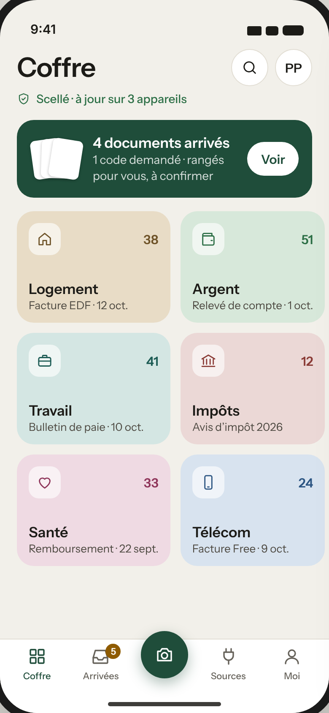
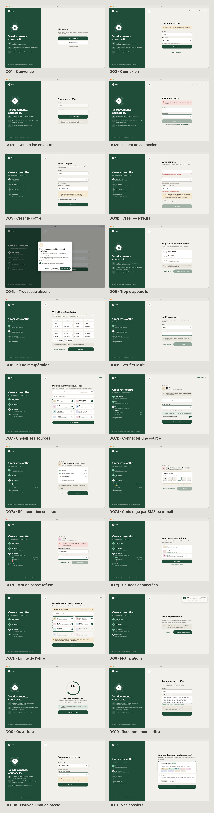
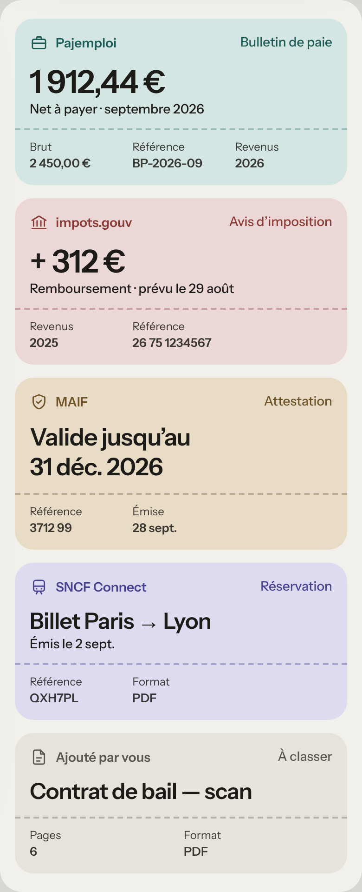
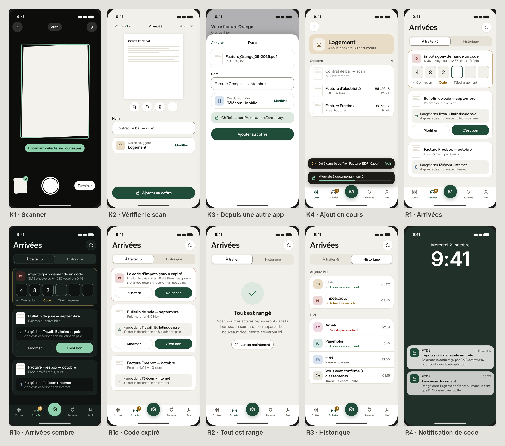

# Fyde Visual Design System

Fyde is a personal document wallet: it fetches documents from the user's providers by itself,
keeps them end-to-end encrypted and local-first, and syncs them across the user's devices. This
document is the source of truth for how the app looks and behaves on iOS, Android and desktop.
The web build is out of scope for now: fyde-sdk can't compile to WebAssembly, so the web app is
a stub with nothing to sign in to; it gets its own references once the SDK runs in a browser.
Values here win over the code; where they disagree, the code is behind.

## Status

**Not implemented yet.** The tokens under `shared/src/commonMain/kotlin/com/peltoche/fyde/theme/`
and the components under `shared/.../components/` still draw the previous visual language
(warm grays, teal accent, Public Sans, 2–10px radii, top navigation bar on desktop). Migrating
them is tracked in [Delivery](#delivery). New UI work follows this document, not the current code.

Screens built so far to a reference screen, on the current tokens until they're migrated (so in
the old palette and type, with the reference's layout, copy and proportions):

| ID | Screen | Code |
|---|---|---|
| O1, DO1 | Bienvenue (Compact; Medium and Expanded) | `WelcomeScreen.kt`, `SealHero`, `AuthBrandPanel.kt` |
| O2, DO2 | Connexion (Compact; Medium and Expanded, with DO2b and DO2c) | `LoginScreen.kt`, `AppBackButton`, `AppNote`, `AppTextField`, `AuthBrandPanel.kt` |
| DO3, DO3b | Créer le coffre (Medium and Expanded; the stepper is left out until steps 2–4 exist, and a taken username is an error note, not a field error, until `FydeSdkException` carries the SDK's code) | `RegisterScreen.kt`, `AuthBrandPanel.kt`, `AppCheckbox`, `AppNote` |
| O4, DO4b | Stockage indisponible (phone; desktop, at creation) | `InsecureStorageSheet.kt`, `AppBottomSheet`, `AlertTriangleGlyph` |
| M1, M2, M3, M5, M6, M7, M8 | Moi as the Settings tab (still named Paramètres, like the other tabs' current names): drill-downs at Compact, master–detail at Medium and Expanded (menu as the 360 list column, Sécurité open by default). Left out until the SDK backs them: the profile card, M2's device tiles and the recovery-kit and password-check rows (so no M4), Aide, last-sync times in M5, Voir les offres in M6. M7 isn't persisted yet | `SettingsScreen.kt`, `SessionsSection.kt`, `PlanUsageSection.kt`, `AppDialog`, `SealHero`, `AppNote`, `AppRadio` |
| V1, V3, V6, V7, D1, D2, D6 | Coffre as the Vault tab: the home's category cards and latest arrivals (V1 at Compact, D6 at Expanded), a category's chips and month groups (V3, D1's card grid), a document's pass, facts and Enregistrer (V6, a page below Expanded; D2 at Expanded, beside its category's list with the content previewed in the rest of the window), V7's full-screen viewer below Expanded. The pass uses the name template, the SDK knowing no issuer or amount. Left out until the SDK backs them: amounts, issuers, keywords and thumbnails, the arrivals banner, the avatar, Partager, Reclasser, V8, V9 and swipe actions, the band's sources count, an "À classer" card, "à jour", the desktop sidebar, page counts | `VaultScreen.kt`, `VaultCategoryPage.kt`, `VaultDocumentPage.kt`, `DocumentPreview.kt`, `CategoryCard`, `CategoryBand`, `DocumentRow`, `DocumentCard`, `DocumentPass`, `AppChip` |
| S1–S7, D4 | Sources as the Sources tab: S1–S6 as pages at Compact and Medium, D4 at Expanded (a table sortable by source and état beside a 380 detail panel, `AppDimensions.sourceDetailPanelWidth`), S7 as an `AppDialog`. Statuses are this app session's runs only. Left out until the SDK backs them: S1's next run and per-row counts, S2's categories and "Le proposer", S3's Récupérer automatiquement, S5's stats, schedule, automatic switch, latest documents, pause and "Signaler un problème", S6's Saisir, D4's Dernier passage, Documents and Automatique columns | `SourcesTabScreen.kt`, `ConnectSourceScreen.kt`, `SourceFetchingScreen.kt`, `SourceStatus`, `RunStepper`, `AppCircleButton`, `AppDialog` |

## Reference screens

Every screen of the app is drawn in `assets/screens/` (90 PNGs at 2×, phone frames at 390×844,
desktop at 1440×900, tablet at 1194×834 or 834×1194 upright), rendered from the HTML in `assets/mockups/` by
`render.py`; `sheets.py` assembles them into the contact sheets in `assets/sheets/`. To change a
reference screen, edit its HTML (values come from `assets/mockups/tokens.css`, which mirrors the
tables below; `core.html` still carries its own copy, so change both), re-render, and commit the
PNGs with the source. `assets/maps/screen_map.py` checks that every PNG has a row in the tables
below and a node in the screen map.

How the screens lead to one another is mapped in [`screen-map.md`](screen-map.md).

Screen IDs are used throughout this document and in file names:
**O** onboarding and access · **V** vault and documents · **K** capture · **R** arrivals ·
**S** sources · **M** account (Moi) · **X** system states · **D** desktop · **DO** desktop
onboarding and access · **T** tablet. A letter suffix (`DO2b`) is another state of the same screen.

The copy in the reference screens is French, the product's first market; every string ships in
French and English.

---

## Principles

1. **The vault is organised the way life is.** Documents are browsed by the SDK's categories
   (Logement, Argent, Travail, Impôts, Santé, Télécom, Transport, Achats, Famille, Abonnements,
   Dons) and their subcategories, then by year. Search is always one tap away, but browsing is the
   default on a phone.
2. **The automation is visible.** Fetching documents is the reason to use Fyde, so its state is
   on screen at all times: what arrived, which source needs the user, when the next run is.
3. **Trust is shown, not claimed.** The encryption, the sync across devices and the single
   unrecoverable password are explained where they matter, in plain words, with what the server
   can and cannot see. Never a bare "secured" badge.
4. **Mobile first, density by input method.** Layouts are designed for a phone held in one hand,
   then reflowed for tablet and desktop, where pointer precision allows denser lists and
   master–detail. One visual language everywhere; interaction follows each platform.
5. **Honest UI.** Only controls that work are shown. Filter choices come from
   `FydeSdk.searchDocumentFacets`, never from a hard-coded list. A feature the SDK can't back yet
   is left out, not drawn disabled.
6. **Calm, warm, personal.** A wallet for payslips and tax notices should feel like a well-kept
   paper folder: soft paper background, category colours like file dividers, generous touch
   targets, one deep green for action. No gradients, no illustrations beyond the seal.

---

## Colour

### Roles

| Role (`AppColors`) | Light | Dark | Use |
|---|---|---|---|
| `background` | `#F2F0EA` | `#0F1412` | Page |
| `surface` | `#FFFFFF` | `#18201D` | Cards, groups, sheets, dialogs, tab bar, sidebar |
| `sunk` | `#E9E6DD` | `#202A26` | Segmented track, info notes, preview wells, progress tracks, skeletons |
| `border` | `#E2DED4` | `#2A3430` | Hairlines between rows, card edges |
| `borderStrong` | `#8C877B` | `#6E7C75` | Inputs, outlined buttons, unchecked controls |
| `text` | `#1C1B17` | `#EAF0EC` | Content |
| `textMuted` | `#66625A` | `#9AA8A1` | Secondary text, captions, placeholders |
| `primary` | `#1F4D3A` | `#8FD1AE` | Filled buttons, selection, scan button, arrivals banner, focus ring |
| `onPrimary` | `#FFFFFF` | `#0B2418` | Content on `primary` |
| `primaryWash` | `#DCE8E0` | `#1D3329` | Positive notes, selected sidebar row, avatar, check discs |
| `warning` | `#8F5B00` | `#E9B65A` | A source waiting for a code, limits reached, recovery kit missing |
| `warningWash` | `#F6E9D2` | `#33291A` | Warning notes |
| `error` | `#B3261E` | `#F2938A` | Failed source, destructive actions, field errors |
| `onError` | `#FFFFFF` | `#2B0B08` | Content on `error` (destructive buttons): 6.54:1 light, 8.07:1 dark |
| `errorWash` | `#F7DEDA` | `#3A1F1C` | Error notes |
| `success` | `#2B6E45` | `#8FD1AE` | "À jour", "Scellé", checks |
| `highlight` | `#F3E2A9` | `#5C4A12` | Matched words in search results (text stays `text`) |
| `badge` | `warning` | `warning` | Count badges (tab bar, sidebar); figure in `onPrimary` light, `#2B1C02` dark |
| `scrim` | `#0F1412` at 45% | same | Behind sheets and dialogs |

Every Material 3 role is set from this table (`surfaceContainer*`, `surfaceTint` = `surface`,
`inverse*`, `outline` = `borderStrong`, `outlineVariant` = `border`) so no M3 baseline colour or
tonal tint ever leaks in.

### Category colours

Each category has a **fill** (backgrounds: category cards, passes, tiles, sidebar dots) and an
**ink** (its icon, count and accent text on that fill). They are file dividers, not status colours:
they never mean ok/warning/error, and they always come with the category's icon and name.

| Category | Icon | Fill / ink — light | Fill / ink — dark |
|---|---|---|---|
| Logement | home | `#E8DCC6` / `#6E5328` | `#3A3121` / `#E3C58F` |
| Argent | wallet | `#D7E8DA` / `#2B6E45` | `#1E3326` / `#9ED5AE` |
| Travail | briefcase | `#D4E6E3` / `#1D5C55` | `#1B3331` / `#8FD0C6` |
| Impôts | landmark | `#EBD8D6` / `#8A3B36` | `#3A2422` / `#EBA49E` |
| Santé | heart | `#EFDAE3` / `#8E3459` | `#3A2230` / `#EDA3C4` |
| Télécom | phone | `#D8E3EF` / `#2C5582` | `#1F2B3A` / `#9DBDE3` |
| Transport | train | `#DDDBEF` / `#45428F` | `#26253B` / `#B4B1EC` |
| Achats | bag | `#F0E1CF` / `#86501C` | `#3A2C1D` / `#E9B887` |
| Famille | users | `#E9E3CB` / `#6A5B1E` | `#33301C` / `#DCCB8A` |
| Abonnements | repeat | `#E3DCEC` / `#5D3F80` | `#2B2436` / `#C9B3E8` |
| Dons | gift | `#DDE8CF` / `#4A6326` | `#26301C` / `#BCD69A` |
| À classer | document | `#E6E3DB` / `#5B574F` | `#262A28` / `#B7B9B4` |

### Contrast

All text pairs meet WCAG AA (4.5:1), including small captions. Lowest pairs, so changes don't
slip under the floor: Argent ink on its fill 4.81:1, `warning` on `warningWash` 4.78:1,
`textMuted` on `sunk` 4.86:1, `success` on `primaryWash` 4.87:1. Dark category inks are ≥ 7:1 on
their fills. Re-check any value you change and record the new ratio here.

States that aren't text need 3:1 or a second cue (WCAG 1.4.11). Tints alone don't reach it
(`primaryWash` on `background` is 1.11:1, `surface` on `sunk` about 1.15:1), so every selected
state adds one: a selected sidebar row gets a 3dp `primary` bar on its leading edge and a
SemiBold label; a selected segment gets a `borderStrong` hairline and a SemiBold label; a selected
theme or option tile gets a `primary` ring and a check disc. `borderStrong` on `background`
(3.14:1) is the floor for control outlines.

### Themes

Light and dark are one theme, picked in Moi › Apparence et langue (Système · Clair · Sombre,
persisted). Screens read `AppColors` only and never branch on the theme. Every screen works in both
themes from the roles alone; the dark references cover each kind of surface: V11 (the vault),
V6b (a pass), V8b (a sheet over the scrim), R1b (the code card and segments), M2b (the seal hero)
and M8b (a dialog with a destructive action). A screen without a drawn dark twin follows these.

---

## Typography

Two bundled, OFL-licensed families, identical on every platform:

- **Instrument Sans** (400, 500, 600) for all UI text.
- **IBM Plex Mono** (400, 500) for figures that must read as exact: amounts, references, codes,
  times, counts in meters. Tabular figures on.

| Role (`AppTypography`) | Size / line | Weight | Use |
|---|---|---|---|
| `display` | 32 / 38 | SemiBold, −0.02em | Screen titles on Compact (Coffre, Arrivées, Sources, Moi) |
| `title` | 24 / 30 | SemiBold, −0.01em | Detail and sheet titles, category band |
| `heading` | 18 / 24 | SemiBold | Dialog titles, card titles |
| `label` | 16 / 21 | SemiBold | Row titles, button text |
| `body` | 16 / 23 | Regular | Copy, field values |
| `secondary` | 14 / 19 | Regular | Row subtitles, helper text |
| `caption` | 13 / 17 | Regular | Timestamps, footnotes |
| `section` | 13 / 18 | SemiBold, uppercase, +0.05em | Section labels above groups |
| `tab` | 11 / 13 | Medium | Tab bar labels only |
| `passAmount` | 44 / 48 | SemiBold, −0.02em | The headline value of a document pass |
| `data` | 15 / 20 | Plex Mono Medium | Amounts and references in rows |
| `code` | 22 / 28 | Plex Mono SemiBold | One-time code boxes |

Rules: one line for a row title (ellipsis), full text on the detail screen. Bold (700) is not
used. Text scales with the OS setting up to 200%: rows grow, amounts never truncate, the category
grid becomes one column, and above 150% the tab bar drops its visible labels (they stay as
accessibility labels) while the badge stays. X2 is the vault at 200%.

---

## Shape, spacing, elevation

| Token (`AppRadius`) | Value | Use |
|---|---|---|
| `sm` | 12 | Tiles, segmented items, OTP boxes |
| `md` | 14 | Inputs, notes |
| `lg` | 20 | Cards, groups, passes, category cards |
| `xl` | 28 | Sheet top corners, dialogs |
| `full` | pill | Buttons, chips, search field, avatar, status dots |

Buttons are pills: 52 tall (40 for small), 20 horizontal padding. Chips are 38-tall pills.

Spacing is a 4-based scale (`AppSpacing` 4, 8, 12, 16, 20, 24, 32, 40). Screen margin 20 on
Compact (16 for grouped lists), 24 Medium, 32 Expanded. 12 between cards, 20 above a section
label, 10 between buttons in a row.

Elevation is flat: surfaces sit on `background` with a `border` hairline. Shadows only on things
that float: the scan button (`0 6 16` primary at 35%), sheets (`0 −8 28` black at 18%), dialogs
(`0 12 40` at 25%), snackbars (`0 8 24` at 25%).

Touch targets: every tappable element is at least 44×44pt, including icon buttons, avatar,
chips and the trailing actions of a row; size the glyph for looks and centre it in the target.

### Iconography

Stroke icons, 1.7 stroke on a 24 grid, round caps and joins, drawn as `Canvas` glyphs in
`NavGlyphs.kt` / `DocumentGlyph.kt` (no icon font), traced from the matching `icons.svg` symbol
on its 24-unit grid (e.g. `BoltGlyph` ← `i-bolt`, `SyncGlyph` ← `i-sync`). Sizes (`AppIconSize`): 13 inline, 16 in
controls, 20 default, 24 tab bar and large tiles, 28+ only for heroes. Glyph colour is `text` at
rest, `primary` when selected, the category ink on a category fill. The icon set in use is
`assets/mockups/icons.svg`.

---

## Layout and navigation

### Compact (< 600dp — phones)

A tab bar of **Coffre · Arrivées · [Scanner] · Sources · Moi**. The centre item is a raised 56pt
`primary` scan button (on Android, the same action is also a FAB on Coffre and Arrivées). The
Arrivées badge counts what needs the user: codes asked, failed sources and documents waiting for
confirmation; hidden at 0. Drill-downs push inside their tab, with a 44pt circular back button,
so going back restores scroll and filters. Screen titles use `display`; drill-downs put their
title in the bar.

### Medium (600–839dp) and Expanded (≥ 840dp)

The tab bar becomes a sidebar: 260dp at Expanded, icons-only at Medium. From top: brand,
Arrivées (with count), Tout le coffre, CATÉGORIES (each with dot and count, in the fixed order of Principle 1; a category with no document is
hidden until its first one arrives), then at the bottom
Sources and the seal ("Scellé · n appareils"). Moi moves to the avatar row at the foot of the sidebar (D5). Lists become
master–detail: a 400dp list column and a detail pane; phone sheets become inline panels. Scanner
becomes "Importer" (file picker, drag and drop) where there's no camera.

Keyboard on desktop: ⌘K / Ctrl+K search, ↑↓ move the selection, Enter opens, Space
previews, Esc closes the detail; in Arrivées, Enter confirms the classification and moves to the
next, E edits. Right-click opens the same actions as V8.

### Onboarding and access on Medium and Expanded

Without a session there's no sidebar. The window splits in two (DO1–DO10):

- **Brand panel**, 520dp at Expanded, full height, `primary` fill with `onPrimary` content: the
  Fyde mark at the top, a reassurance line at the bottom ("Votre mot de passe ne quitte jamais
  cet ordinateur."). In between, on the sign-in path (DO1, DO2, DO5, DO9, DO10): the seal on
  `onPrimary` (white disc, lock in `primary`, rings at 22% and 16% white), "Vos documents, sous
  scellé." in 38/44 SemiBold and the three promises. On the vault-creation path (DO3, DO6–DO8, DO6b, DO7b–DO7g):
  "Créer votre coffre", "Quatre étapes, environ trois minutes." and a vertical 4-step stepper
  (done = `success` disc with check, current = white disc, to do = outline at 35% white, joined
  by a 2dp line at 18% white).
- **Form pane**, `background`, the form centred horizontally and vertically in a 440dp column
  (600dp for the recovery words and sources). Back is a 44 circle at the top left (40, 32); the
  cross-link ("Pas encore de coffre ? Créer un coffre", or "Passer") sits at the top right.
  Screen titles use `display`. Paired actions sit on one row, text action first, filled action
  twice as wide.
- **The phone's sheets become dialogs** (500dp, radius `xl` (28), actions right-aligned: Annuler ·
  secondary · primary). Enter submits the form.
- At **Medium** the brand panel narrows to a 96dp band at the top with only the mark and the
  stepper's current step; the form keeps its 440dp column.

---

## Patterns

- **Sheet** for short, contextual tasks (verification code, document actions, reclassify, import
  from another app, insecure-storage warning). **Dialog** only to confirm something irreversible
  (remove a source, disconnect a device, log out); its confirm button is filled `error`.
- **Note** (`info`, `ok`, `warning`, `error`: wash fill, icon, rich text) explains a condition
  inline, next to what it concerns. There is no full-width banner.
- **Snackbar** (ink surface above the tab bar, optional progress and action, at most 2 stacked)
  confirms what finished and shows background progress ("Ajout de 2 documents · 1 sur 2").
- **Empty states** say what will appear and offer the one action that fills them; they never
  look like errors. **Loading** uses skeletons shaped like the content (`sunk` fill).
  **Offline** is a state, not an error (X1): everything local stays usable, additions queue.
- **Errors** use the SDK's localized wording (`FfiError` messages) or our own copy, never an
  exception message.
- **One primary action per screen**, filled; every other action is outlined or text. A screen
  whose only action is moving on (O9 Parcourir le coffre, M4 Terminé, S4 Continuer en
  arrière-plan) fills it too: it's still the primary action.

### Source status

A source (an installed scraper; parsers never appear in the UI) always shows exactly one status,
identically in Sources, Arrivées, history and on desktop:

| Status | Colour, icon | Wording |
|---|---|---|
| Running | `primary`, spinner | "Récupération… 5 / 12" |
| Waiting for the user | `warning`, clock | "Attend votre code" + Saisir |
| Failed | `error`, alert | The reason in user words, each with its next step: mot de passe refusé (S6: update and retry) · site changé (S6b: report it, credentials aren't at fault) · code expiré (R1c: Relancer) |
| Up to date | `success`, check | "Ce matin · 38 documents" |
| Paused | `textMuted`, pause | "En pause" |

### Source runs

Sources run on the user's devices, never on the server, and the design promises no clock time:
phones can't guarantee one (iOS runs background work when it chooses), and a code asked at night
would expire unseen.

- **One device per source.** A source runs on one device, the one that connected it unless the
  user picks another in S5 or D4 ("Appareil"). Running it everywhere would sign in to the
  provider once per device, which providers answer with codes or lockouts.
- **Once a day.** A source runs when its device opens Fyde and the last run is more than 24 h
  old, and in the background where the OS allows it (Android's WorkManager, desktop while Fyde is
  open, iOS when it grants time). The wording is "Une fois par jour", never "vers 22 h".
- **Codes come while the user is there.** A run that will likely ask a code (the last one did)
  waits for the app to be open rather than running in the background.
- **Lancer** (S5, D4, R2) runs the source now, on the device where it's tapped: one sign-in,
  asked for by the user.

### Verification code

`OneTimeCodeField`: 6 boxes 52pt tall, `code` type; paste fills all boxes; backspace moves left;
submits on the 6th digit; iOS `oneTimeCode` and Android SMS Retriever autofill; screen readers
announce "chiffre 4 sur 6". When a source asks a free-text question, the boxes become one text
field. Its context always shows the source, the masked destination, the deadline ("expire à 9:46": entering
the code is timed, so the time left is always on screen) and a step trail
Connexion → Code → Téléchargement (from `FfiProgressStep`). A code request while the app is in the
background raises a time-sensitive notification that opens straight into the field (R4).

The card says how the code was sent, because the user has to go and fetch it:

- **SMS** — "Code reçu par SMS", "Envoyé au •• •• •• 42 87". On phones the OS offers it above
  the keyboard (iOS `oneTimeCode`, Android SMS Retriever); on desktop it's typed or pasted.
- **E-mail** — "Code reçu par e-mail", "Envoyé à p•••@exemple.fr · regardez aussi dans les
  indésirables", and a line asking to copy the code from the mailbox and paste it. No autofill
  on any platform; Fyde never reads the user's mailbox.
- **Anything else** (an authenticator app, a question) — the provider's own wording as the
  title, one text field.

Which one it is, and the masked destination, come from the scraper's question; until the SDK
passes them as structured data (channel, destination, length), the card shows the question text
as its title and a single field.

### Plan quota

`PlanQuota` shows how many of the plan's active sources a selection uses, wherever sources are
picked (O7, DO7, S2). One row on `surface` with a `border` hairline: the plan in words, one
segment per allowed source (16×6, `primary` when used, `border` otherwise), and "n / max" in
Plex Mono. Screen readers hear "3 sources choisies sur 5"; the count is announced as it changes.

- The count is the sources already active plus the ones ticked on the screen
  (`Usage.enabled_scripts` + selection, against `Usage.max_scripts` from `getUsage`, read when the
  screen opens). During onboarding no source is active yet, so it's the selection alone.
- **At the limit** the row turns `warningWash` with its segments and count in `warning` and the
  text "Limite de l'offre … atteinte". Unticked sources dim to 45% and stop taking a tick
  (`aria-disabled`); ticked ones stay editable, so unticking one frees a slot at once. A note says
  how to swap and where to change plan. Fyde never blocks the button: the selection is always
  within the plan.
- On phones the row is pinned under the bar once the title scrolls away (O7b); its text shortens
  to "Offre Gratuit" / "Limite atteinte".
- A plan with no source limit hides the counter. If `getUsage` fails, the counter is hidden and
  the server's own refusal (`install_script`) is shown on that source's connect step instead.

### Document pass

The detail of a document is a pass in its category colours: issuer and type, a headline value
in `passAmount`, one line under it, a perforation, and up to three meta cells. Templates by
document type, each cell shown only when its attribute is set:

| Document type | Headline | Line under | Meta cells |
|---|---|---|---|
| Facture | Amount | "À régler avant le …" / "Payée le …" | Période · Référence · Reçue |
| Bulletin de paie | Net à payer | Month | Brut · Heures · Employeur |
| Avis d'imposition | Remboursement (+) or montant dû | Expected date | Revenus · Réf. fiscal · Parts |
| Attestation, carte | "Valide jusqu'au …" | — | Contrat · Numéro · Reçue |
| Réservation | Route or place | Date and time | Voiture · Place · Prix |
| Relevé, autre | Document name | Period | Pages · Reçu |
| À classer | Document name | "Ajouté par vous" | Pages · Ajouté |

### Classification suggestion

Every new document, fetched or added, shows where Fyde filed it ("Rangé dans Travail › Bulletins
de paie") with Modifier and C'est bon. Modifier opens the reclassify sheet (V9): category grid,
subcategories of the chosen category only, type chips.

### Devices

A device is named when it signs in: the OS's name for it ("iPhone", "Pixel 8"), or "Ordinateur
(macOS)" on desktop, never a Java or browser version. The user can rename it in Appareils (M5);
the references show renamed devices ("iPhone de Pierre", "MacBook Air"). Lists of devices are
never pre-selected for removal.

### Glossary

One word per thing, in every screen and both languages. A new string uses these terms; a term
that needs changing changes here first.

| Concept | Français | English | Not |
|---|---|---|---|
| The encrypted store of documents | coffre | vault | coffre-fort, espace |
| The OS secret store | trousseau (système) | keychain / keyring | coffre-fort système |
| An installed scraper | source | source | connecteur, script |
| The plan | offre (Gratuit) | plan (Free) | abonnement, forfait |
| Adding a file by hand | Ajouter au coffre; Importer for the desktop file picker | Add to vault; Import | Mettre au coffre, Ajouter à Fyde |
| A one-time code a source asks for | "<source> demande un code"; status "Attend votre code" | "<source> needs a code"; "Waiting for your code" | attend un code |
| A run's steps | Connexion · Recherche · Téléchargement · Rangement (Code when asked) | Signing in · Searching · Downloading · Filing (Code) | Connecté, Récupération as a step |
| Ending this device's session | Se déconnecter | Log out | Déconnecter |
| Ending another device's session | Retirer (cet appareil) | Remove (this device) | Déconnecter |
| A document's place | catégorie › sous-catégorie, type | category › subcategory, type | dossier |

The references show one plan everywhere, **Gratuit**: 5 active sources, 3 devices, 5 Go.

### Trust

- The seal line under the vault title states the sync state: "Scellé · à jour sur 3 appareils",
  "Scellé · hors ligne", "Scellé · 7 en attente".
- Security (M2) lists what the server can and cannot read (M3), the recovery kit, and a periodic
  password check (M4).
- Any screen that handles a secret says where it goes in one line (O2: the password never leaves
  the device; S3: source credentials are encrypted with the vault).

---

## Screens

The tables hold each screen's content and states; how screens lead to one another is in
[`screen-map.md`](screen-map.md), so a link changes in one place.

### Onboarding and access (O1–O10)

| ID | Screen | Content | States |
|---|---|---|---|
| O1 | Bienvenue | Seal hero, "Vos documents, sous scellé.", three promises (fetched, encrypted, on every device), Créer mon coffre / J'ai déjà un coffre | Only without an account on the device: first screen until signed in and after logging out; an expired session skips it |
| O2 | Connexion | Identifiant, Mot de passe (eye), "Il ne quitte jamais cet appareil", Ouvrir le coffre, Mot de passe oublié ? | Session expired → warning note. Loading → spinner, fields disabled (key stretching takes seconds). Failed attempt → error note |
| O3 | Créer le coffre | Step 1/4; username; password with strength meter (the SDK's `analyzePassword`; a Weak password can't be submitted); confirm; warning "seule clé de votre coffre", saying the kit (next step) is the only way back; required "J'ai compris" | Mismatch and taken username as field errors |
| O4 | Stockage indisponible | Sheet: explanation, opt-in checkbox, Continuer quand même (enabled once checked) | On `SecureStorageUnavailable`; retries with `allowInsecureStorage` |
| O5 | Trop d'appareils | Plan limit, radio list of open sessions with none picked, "Retirer l'appareil choisi" (disabled until one is picked, then "Retirer le Pixel 8") | Nothing is pre-selected, so one tap can't cut off a device in use. Re-runs login with `replaceSessionId`; credentials kept only while open |
| O6 | Kit de récupération | Step 2/4; the 24 words (3 columns, Plex Mono, numbered); Enregistrer le PDF / Imprimer; "Captures d'écran désactivées"; Je l'ai noté / Plus tard (déconseillé) | Screenshots blocked. The words are the SDK's English BIP39 words in every language |
| O6b | Vérifier le kit | Two of the words asked back by number ("Mot n° 7", "Mot n° 19", picked at random), each checked as typed; note that the kit is checked on the device; Vérifier (enabled once both match) / Revoir les mots | A wrong word shows a field error; Revoir les mots shows the same words again |
| O7 | Choisir ses sources | Step 3/4; plan counter "Offre Gratuit · 3 / 5"; search; public scrapers with checkboxes (no category chips: scripts have no category yet) | Each pick opens S3, then its first run (S4), in turn, inside onboarding; a code asked during that run opens the code sheet there |
| O7b | Limite de l'offre atteinte | O7 scrolled: the counter stays pinned under the bar, in `warning`, "Limite atteinte"; one line on unticking to swap; unticked sources dimmed and not tickable; pointer to Moi › Offre et usage | See [Plan quota](#plan-quota) |
| O8 | Notifications | Step 4/4; sample notifications; Autoriser / Plus tard | OS prompt only after the tap |
| O9 | Ouverture | Ring "142 sur 214", the device's name, "Vous pouvez déjà parcourir" | Replaces an empty vault on a new device |
| O10 | Récupérer mon coffre | Identifiant; the 24 words in one field (pasted or typed, case and spacing ignored, a live "n mots sur 24" count); note that the words stay on the device; Continuer | From O2's "Mot de passe oublié ?". Words that aren't BIP39 are caught locally as a field error; a key that isn't the account's (`InvalidRecoveryKey`) shows the SDK's wording on O10b's submit and returns here |
| O10b | Nouveau mot de passe | New password with strength meter, confirm; warning that the other devices will be signed out; ok note that the kit stays valid; Rouvrir mon coffre | Runs `recoverAccount`, then continues as a first sign-in on this device (O9). The missing-keyring sheet (O4) can open over it |

### Coffre and documents (V1–V11)

| ID | Screen | Content | States |
|---|---|---|---|
| V1 | Coffre | Title, search, avatar; seal line; arrivals banner; 2-column category cards (icon, count, name, latest document) in the fixed order of Principle 1, categories with no document hidden | Banner only when something needs the user, counting what the Arrivées badge counts ("4 documents arrivés", "1 code demandé · …"); pull to refresh = sync |
| V2 | Coffre en remplissage | Running sources with progress; filled cards for categories with documents; dashed cards for expected ones | Until each connected source ran once |
| V3 | Catégorie | Category band; subcategory chips with counts; year chips; month groups of document rows | Sort newest or oldest first (`SearchOrder`; amount and name need the SDK); rows swipe to Partager / Reclasser, also in V8 |
| V4 | Recherche | Full-screen field, recent searches, type shortcuts | Opened from any search icon |
| V5 | Résultats | Facet chips Catégorie / Type / Année / Source; matched words highlighted; "Recherche faite sur cet appareil" | No result → clear filters |
| V6 | Document | Pass, file row with thumbnail, facts (arrivée, chiffré, mots-clés), Enregistrer / Partager | See [Document pass](#document-pass) |
| V6b | Document (sombre) | V6 in the dark theme: the pass on its dark category fill | Dark reference for passes |
| V7 | Lecteur | Full-screen dark viewer, zoom, pages, share | No preview → "Ouvrir avec…" |
| V8 | Actions | Sheet: Partager, Enregistrer dans Fichiers, Renommer, Reclasser, Informations techniques, Supprimer de tous mes appareils | Delete confirms that it reaches every device |
| V8b | Actions (sombre) | V8 in the dark theme | Dark reference for sheets and the scrim |
| V9 | Reclasser | Category grid, subcategories, type, Enregistrer | Invalid category/subcategory pairs can't be picked |
| V11 | Coffre sombre | Dark reference | — |

### Capture and arrivals (K1–K4, R1–R4)

| ID | Screen | Content | States |
|---|---|---|---|
| K1 | Scanner | Platform document scanner in Fyde chrome; edge overlay; page count; Terminer | Camera denied → explanation + settings |
| K2 | Vérifier le scan | Crop, rotate, delete, add page; name; suggested classification; Ajouter au coffre | No suggestion → "À classer" and listed in Arrivées |
| K3 | Depuis une autre app | Share extension sheet: file, name, suggestion, "Chiffré sur cet iPhone avant d'être envoyé" | Signed out → "Ouvrez Fyde pour ajouter" |
| K4 | Ajout en cours | Row appears at once with "Chiffrement…"; progress snackbar; duplicate → "Déjà dans le coffre · Voir" | `DuplicateDocument` is never an error |
| R1 | Arrivées | À traiter / Historique; code card first; documents with their suggestion and Modifier / C'est bon | Swipe right = C'est bon |
| R1b | Arrivées (sombre) | R1 in the dark theme | Dark reference for the code card and segments |
| R1c | Code expiré | R1 with the code card replaced: "Le code d'impots.gouv a expiré", the deadline it missed, Plus tard · Relancer | Relancer runs the source again on this device; the card leaves the queue once a new code is asked or the run ends |
| R2 | Tout est rangé | Check disc, "repasseront dans la journée, chacune sur son appareil", Lancer maintenant | Badge hidden |
| R3 | Historique | Run outcomes and user confirmations by day | — |
| R4 | Notification de code | Lock-screen notification with the deadline; new-document notifications hide titles while locked | Expired → "Code expiré" + Relancer |

### Sources (S1–S7)

| ID | Screen | Content | States |
|---|---|---|---|
| S1 | Sources | "Une fois par jour, sur l'appareil de chaque source"; "Ont besoin de vous" then "À jour"; rows with the source's tile and status; plan usage | Empty → Ajouter une source |
| S2 | Catalogue | Search; every public scraper from A to Z; Ajouter or a check if already added; "Il manque votre fournisseur ?" points to Aide | User's own scripts in a last group. No category chips or "often added" group until the SDK has script categories and popularity |
| S3 | Connecter | What it fetches; the sites it may reach (`allowedDomains`); one field per script parameter (secret → masked, number → numeric, boolean → switch); automatic switch, "Une fois par jour, depuis cet iPhone" | Connect installs and runs at once (S4) |
| S4 | Récupération en cours | Stepper Connexion → Recherche → Téléchargement i / n → Rangement; documents appear under it; Continuer en arrière-plan | Code or captcha → code sheet |
| S5 | Détail | Status, counts, automatic switch, Appareil (the device it runs on, changeable), identifiants, sites, latest documents, Lancer, Retirer la source | — |
| S6 | En échec | Error note with time; the failing field refocused; Mettre à jour et relancer; Signaler un problème | The report is the run's debug report, which never records headers, bodies or form values; a sheet shows what's sent before sending |
| S7 | Retirer | Dialog: documents stay, credentials erased everywhere | — |
| S6b | Site changé | Error note (the site changed, nothing fetched since …); info note that the credentials aren't at fault and the documents stay; Signaler le problème (filled) · Relancer quand même; what the report holds | No credential field: there's nothing for the user to fix |
| S8 | Vérification demandée | Sheet over S4 (or a window on desktop): the provider's own page in an embedded browser (`fyde.browser`), with its address and "Page d'Ameli"; a line that Fyde fills nothing in and keeps nothing; Passer cette fois | Opens when a script hands a step to the browser (a captcha, a consent page); the run resumes when the page lets it through |

### Moi and states (M1–M12, X1, X2)

How the account screens connect is in [`screen-map.md`](screen-map.md#moi-m1m12).

| ID | Screen | Content | States |
|---|---|---|---|
| M1 | Moi | Profile, seal card, Sécurité (pill "Kit à créer"), Appareils, Offre et usage, Apparence et langue, Mes données, Aide, Se déconnecter | — |
| M2 | Sécurité | Seal hero, device tiles with sync dot, Kit de récupération (its date from `recoveryKeyStatus`, or "À créer"), Changer le mot de passe, Vérifier mon mot de passe, Ce que voit le serveur | — |
| M2b | Sécurité (sombre) | M2 in the dark theme | Dark reference for the seal hero |
| M3 | Ce que voit le serveur | "Ne voit jamais": document contents; their names, amounts and categories; source credentials; the Fyde password and the recovery kit. "Voit": username and plan; encrypted size; when things are sent and synced; device names; which sources are enabled (`enableScript` goes to the server by script id), never their credentials | Keep in step with the wire format: anything sent in clear (an id, a count, a time) is listed under "Voit" |
| M4 | Vérifier mon mot de passe | Local check, next reminder in 3 months | Wrong → link to the recovery kit |
| M5 | Appareils | Each device with last sync or "Pas vu depuis … · n en attente"; Retirer; Renommer on this device | The current device can't be removed here (Se déconnecter, M8) |
| M6 | Offre et usage | Plan; meters for storage, devices, active sources | 100% → warning, over → error |
| M7 | Apparence et langue | Theme tiles, language radios; text size follows the OS | Persisted |
| M8 | Se déconnecter | Dialog: what is erased here, what stays; warning if no recovery kit | Wipes keys and local data even offline |
| M8b | Se déconnecter (sombre) | M8 in the dark theme | Dark reference for dialogs and `onError` |
| M9 | Offres | Each plan as a card: name, active sources, devices, storage, price; the current one ringed and tagged "Votre offre"; one line on how payment works on this platform; Passer à … | From M6, O5, DO5 (read-only without a session: no purchase button). Plans, limits and prices come from the server; the reference's "Plus" values and "x,xx €" are placeholders |
| M10 | Aide | Questions fréquentes (how fetching works, forgotten password, a broken source, what the server sees); Proposer une source; Écrire au support; a line that support never sees documents or credentials; version and server | Each question opens a page of text |
| M11 | Changer le mot de passe | Current password, new with strength meter, confirm; ok note that the kit stays valid; Changer le mot de passe | `changePassword`; the other devices stay signed in |
| M12 | Mes données | Exporter mes documents (a ZIP decrypted on the device, by category, with its size and a warning that it isn't encrypted); Supprimer mon compte | Export runs on the device, document by document |
| M12b | Supprimer mon compte | Dialog: what is erased (documents, sources, keys, on the server and every device), the kit stops working; type the username to confirm; Supprimer définitivement · Exporter d'abord · Annuler | Needs account deletion in the SDK |
| X1 | Hors ligne | Seal "hors ligne", info note, pending additions on cards | Never an error screen |
| X2 | Texte à 200 % | V1 with the OS text size at 200%: one-column category cards, banner stacked, icons-only tab bar with the badge | See [Typography](#typography) |

### Desktop and tablet (D1–D4, T1)

| ID | Screen | Layout |
|---|---|---|
| D1 | Catégorie | Sidebar · header, search, Importer · subcategory pills · 4-column cards with first-page thumbnails |
| D2 | Document | Sidebar · 400dp list · pass and facts · live preview |
| D3 | Arrivées | Sidebar · queue with inline code card · preview · classification panel with C'est bon (Enter) |
| D4 | Sources | Sidebar · sortable table (source, état, dernier passage, documents, appareil) · detail panel with Appareil · Changer |
| D5 | Moi | Sidebar (avatar row selected) · the M1 menu as a 360dp column · the open page beside it (Sécurité by default), with the phone pages' content |
| D6 | Tout le coffre | Sidebar · header with search and Importer · arrivals banner · 4-column category cards · latest arrivals |
| T1 | Tablette | As D6 on a tablet: Scanner instead of Importer |
| T2 | Tablette portrait | Medium: icons-only 80dp sidebar (each category as its tile, selected = tint + leading bar), 3-column cards, latest arrivals |

### Desktop onboarding and access (DO1–DO10)

Same flows, content and SDK calls as O1–O9; layout in
[Onboarding and access on Medium and Expanded](#onboarding-and-access-on-medium-and-expanded).

| ID | Screen | Content | States |
|---|---|---|---|
| DO1 | Bienvenue | "Bienvenue", one line on creating or opening a vault, Créer mon coffre (filled) / J'ai déjà un coffre (outlined), the server name in `caption` | — |
| DO2 | Connexion | As O2; "Entrée pour valider" hint under the button | Session expired → warning note |
| DO2b | Connexion en cours | Fields disabled at 55%, button spinner "Ouverture du coffre…", info note on key derivation taking a few seconds | — |
| DO2c | Échec de connexion | Error note with the SDK's wording, password emptied and focused, button disabled until it's typed again, "Mot de passe oublié ? Utiliser mon kit de récupération" | The link opens DO10 |
| DO3 | Créer le coffre | Step 1 of 4: as O3 | — |
| DO3b | Créer le coffre — erreurs | Username taken (field error, red 2dp border), weak password (meter in `warning`), mismatch, checkbox unticked, Continuer disabled | Errors appear on blur or submit, not while typing |
| DO4b | Trousseau absent | Dialog over DO3 (drawn) or DO2: warning tile, "Pas de trousseau système sur cet ordinateur", which keyrings were tried (GNOME Keyring, KWallet), the risk, opt-in checkbox, Annuler · Réessayer · "Créer quand même" over DO3 or "Ouvrir quand même" over DO2 (enabled once ticked; drawn ticked) | On `SecureStorageUnavailable`; Réessayer re-runs the call without the opt-in (for after installing a keyring); the confirm re-runs it with `allowInsecureStorage` |
| DO5 | Trop d'appareils | As O5; Voir les offres · Retirer le MacBook Air | — |
| DO6 | Kit de récupération | Step 2 of 4: the 24 words in 4×6, Enregistrer le PDF / Imprimer, note that the words are never copied or sent | No copy to clipboard on desktop |
| DO6b | Vérifier le kit | Step 2 of 4: as O6b in the 440dp form | — |
| DO7 | Choisir ses sources | Step 3 of 4: plan counter ("Votre offre Gratuit inclut 5 sources", 3 / 5), search, 2-column source cards (selected = 2dp `primary` border + ticked box), Connecter n sources; Passer at the top right | — |
| DO7h | Limite de l'offre atteinte | Counter in `warning` ("Limite de l'offre Gratuit atteinte", 5 / 5); unticked cards dimmed and not tickable; warning note on unticking to swap and upgrading later from Moi › Offre et usage | See [Plan quota](#plan-quota) |
| DO7b | Connecter une source | "Source 1 sur 3"; the source's tile and what it fetches; info note naming the only sites Fyde will contact (`allowedDomains`); one field per script parameter (here e-mail and password, with "Celui de votre espace client EDF, pas celui de Fyde."); ok note "Chiffrés avec votre coffre"; Récupérer automatiquement; Connecter EDF; "Passer cette source" at the top right. The brand panel lists the ticked sources under step 3 with their state | Connect installs the script and starts its first run |
| DO7c | Récupération en cours | Run stepper (Connexion → Recherche → Téléchargement i / n → Rangement) in a card; note that the run goes on in the background and Fyde will say if a code is asked; Attendre ici / Source suivante | Moving on doesn't stop the run; its state stays in the brand panel |
| DO7d | Code reçu par SMS | "impots.gouv demande un code"; code card (SMS, masked number, six boxes, step trail); "Collez le code ou tapez-le : il est envoyé dès le 6ᵉ chiffre."; Annuler / Valider. An e-mail code uses the same card: "Code reçu par e-mail", the masked address, a spam hint, "Ouvrez votre messagerie, copiez le code et collez-le ici" | Valider stays disabled until 6 digits; wrong code → field error with the provider's wording, boxes emptied |
| DO7f | Mot de passe refusé | Error note "Ameli a refusé ces identifiants"; the failing secret emptied and focused; Passer cette source / Réessayer; "Vous pourrez la reconnecter plus tard depuis Sources." | Skipping keeps the source installed but paused, with its failure, in S1 |
| DO7g | Sources connectées | "Vos sources sont prêtes", one row per ticked source (documents fetched, still running with i / n, or skipped with Réessayer), Continuer, "Ajouter une autre source" | — |
| DO8 | Notifications | Step 4 of 4: a sample system notification at the top right of the pane, the promise, a note that on a computer Fyde notifies while it's open | — |
| DO9 | Ouverture sur cet ordinateur | Ring with the replayed count, names this computer, Parcourir le coffre | Needs the replay total (SDK) |
| DO10 | Récupérer mon coffre | As O10 in the 440dp form, sign-in brand panel | From DO2 and DO2c |
| DO10b | Nouveau mot de passe | As O10b | Then DO9 |

The missing keyring is mostly a Linux case (only the Secret Service store has been exercised by
the SDK), so DO4b is drawn in a Linux window; on macOS and Windows the same dialog names
the platform store instead.

---

## Components

Screens compose `App*` components and never style a raw Material 3 component. Target inventory:

| Component | Change | Notes |
|---|---|---|
| `AppTheme`, `AppColors`, `AppTypography`, `AppShapes`, `AppSpacing`, `AppIconSize` | Rewrite values | Tables above; category colours as `AppCategoryColors` |
| `AppButton` (`Filled`, `Outlined`, `Text`, `destructive`, `loading`) | Restyle | Pill, 52 / 40 |
| `AppTextField` | Layout landed (O2) | Label above (medium), `surface` box, `borderStrong` hairline, 2 `primary` when focused, help or error flush under it; a password field carries the eye. Still M3's 56 tall (not 52) and the current input radius |
| `AppSearchField` | Restyle | 48 pill |
| `AppBackButton`, `AppCircleButton` | Landed (O2, S1) | 44 `surface` circle, `border` hairline, chevron; "Back" for screen readers. `AppCircleButton` is the same circle around any glyph (S1's +), named for screen readers by its caller |
| `AppChip` | Restyle | Pill 38, selected = `text` fill, optional count and chevron |
| `AppCheckbox`, `AppSwitch` | Restyle | 22pt marks, 51×31 switch |
| `AppRadio` | Landed (O5) | 22 mark: 1.5 `borderStrong` ring, selected = 7 `primary` ring around a `surface` dot. Mark only — the row is the `selectable` target |
| `AppBottomSheet` | Layout landed (O4) | Modal bottom sheet opened fully, with grab handle, at Compact; a centred panel (`sheetPanelMaxWidth`, no drag) at Medium and Expanded and always on desktop. Still the current radius and surface, not `xl` / `surface` |
| `AppDialog` | Layout landed (M8) | `surfaceElevated`, `section` title, muted body, up to `sheetPanelMaxWidth`; actions stacked full width at Compact (confirm first), right-aligned wider (cancel · confirm); `destructive` fills the confirm in `error`, `confirmLoading` keeps it up and busy. Still the current dialog radius, not `xl` (28) |
| `AppSnackbarHost`, `AppProgressBar` | Restyle | Patterns above |
| `AppSegmented` | New | 2–3 options on `sunk`; selected = `surface`, `borderStrong` hairline, SemiBold |
| `AppNote` | Landed (O2) | `Info` / `Ok` / `Warning` / `Error`: wash, icon in the kind's colour, text; replaces inline `AppBanner`, which screens drop as they're rebuilt |
| `AppTabBar` | New | Replaces `AppNavigationBar` |
| `AppSidebar` | New | Replaces `AppNavigationTopBar` and `AppNavigationRail`; selected row = fill + 3dp `primary` leading bar + SemiBold |
| `CategoryCard`, `CategoryBand` | Landed (V1, V3) | Card: 132 tall (`AppDimensions.categoryCardHeight`) on the category's fill, a 38 `categoryTile` square (white at 62%, both themes) with the icon in ink and the count in ink above the name (`section`) and the newest document (`caption`, `categoryCaption`); one control for screen readers; `CategoryCardPlaceholder` while loading. Band: 52 tile, name in `title`, count under it. Glyphs in `CategoryGlyphs.kt`, the category → fill, ink and icon mapping in `VaultCategories.kt`. Still the current card radius |
| `DocumentRow`, `DocumentCard` | Landed (V3, V5, D1, D2) | Row: the category's tile (fill and ink; no thumbnails yet), title (`bodyEmphasis`, matched words on `highlight`), subtitle, date; `selected` fills it with the category (D2). Amount and pending are left out until the SDK carries them. Card: D1's grid cell, a preview well holding the tile, then title and date |
| `DocumentPass` | Landed (V6, D2) | Issuer and type in ink, headline in `passAmount` (`DocumentPassHeadline.Value`) or `title` for a name, the line under it, a dashed perforation in ink at 40%, up to three `DocumentPassCell`s. The caller picks the template; today only "Relevé, autre" (the SDK has no amounts, issuers or references yet) |
| `ArrivalsBanner`, `ClassificationSuggestion` | New | — |
| `OneTimeCodeField` | New | See [Verification code](#verification-code) |
| `SourceStatus`, `RunStepper` | Landed (S1, DO7c) | See [Source status](#source-status). `SourceStatus`: 12 glyph and caption Medium in the state's colour (spinner `primary`, clock `warning`, alert `error`, check `success`, muted clock when queued) |
| `SourceRow` | New | Private to `SourcesTabScreen.kt` until another screen needs it. The tile shows the script's icon (`fetchIcon`, cached) on `surface`; without one, its initials on the fill of its main category. The references show the fallback (the app still falls back to a puzzle glyph: scripts have no category yet) |
| `PlanQuota` | New | See [Plan quota](#plan-quota) |
| `SealHero` | Landed (O1) | `primary` disc and lock, `primaryWash` disc, two `border` rings at 168 (`AppDimensions.sealHero`); reused by M2 |
| `DeviceTile` | New | Device glyph, name, sync dot |
| `UsageMeter` | Landed (M6) | Label (`bodyEmphasis`) and `used / limit` in `data`, the bar under them: `primary`, `warning` from 90% and at the limit (with a caption), `error` over. Private to `PlanUsageSection.kt` until another screen needs it |
| `AppIconTile` | Restyle | 44 default; 36 (`AppDimensions.iconTileSmall`) beside body text, as in O1's promises; 52 (`iconTileLarge`) heading a sheet, as in O4 |

Every new or changed component lands in `DesignSystemScreen.kt` in the same change.

---

## SDK dependencies

Some screens need capabilities `fyde-sdk` doesn't expose yet; until they exist, those parts are
left out (principle 5), not faked.

| Capability | Screens |
|---|---|
| Per-source run record: last run, outcome, failure kind, new count | S1, S5, S6, R3, D4 |
| Runs on a chosen device: once a day on open, in the background where the OS allows | S1, S3, S5, R2, D4, DO7b |
| Provenance on document metadata (source script, device, fetched at) | V5 Source facet, V6, S5 |
| Unconfirmed-classification flag | R1, D3, Arrivées badge |
| Delete-document event | V8 |
| Recovery key status, account recovery and password change (in fyde-sdk, not yet in the bindings) | M2, M4, O10, DO10 |
| Replay progress and per-device last seen | O9, M5, M2 |
| First-page thumbnails | V3, D1, D2 |
| Sorting by amount or name | V3, D1 |
| Script categories and popularity | O7, DO7, S2 chips and groups |
| Renaming a session | M5 |
| Plan catalogue and purchase | M9 |
| Deleting the account | M12b |

## Delivery

1. **New shell, no SDK change:** tokens, fonts, `AppTabBar` / `AppSidebar`, V1, V3–V7, V9, V11,
   S1–S4 with live run state only, M1, M5–M8, O1–O5, O7, O8, X1, code sheet, K1–K4.
2. **Automation visible:** run records and scheduling → S5, S6, R2–R4, V2, statuses everywhere.
3. **Trust:** recovery kit, password check, last seen → O6, O9, M2–M4.
4. **Triage:** provenance, unconfirmed flag, delete → R1 and D3 triage, Source facet, V8 delete,
   thumbnails.

---

## Accessibility and platforms

- WCAG AA contrast for all text (see [Contrast](#contrast)); colour never carries meaning alone.
- 44×44pt minimum targets; focus ring 2dp `primary` for keyboard focus only.
- Screen-reader labels on every icon-only button; a category card reads "Logement, 38 documents,
  dernier : Facture EDF du 12 octobre".
- Dynamic type to 200% (see [Typography](#typography)).
- iOS: large titles collapse on scroll, swipe back, haptic on code accepted, share extension.
- Android: predictive back, SMS Retriever, ML Kit document scanner, share target, autofill hints.
- Desktop: keyboard shortcuts above, hover states, right-click menus.

## Rules for AI coding agents

1. Read this document and the reference screen of the screen you're touching before writing UI;
   search `components/` before creating anything.
2. Never use a raw Material 3 component in a screen; extend or add an `App*` component.
3. No literal design values in screens: colours from `AppColors` / `AppCategoryColors`, text
   from `AppTypography`, gaps from `AppSpacing`, sizes from `AppDimensions` / `AppIconSize`,
   corners from `AppShapes`.
4. Filters, counts and category lists come from the SDK's search facets; never compute them in
   the app.
5. Every new or changed component lands in `DesignSystemScreen.kt` and in [Components](#components)
   in the same commit; a changed screen updates its reference HTML and PNG.
6. Verify visual changes by rendering them (`run-fyde-application` skill) and comparing with the
   reference screen.

## Open questions

- Bundling Instrument Sans in `composeResources/font/` and removing Public Sans.
- The Dons icon (`GiftGlyph`) has no symbol in `icons.svg`; it's drawn in the same hand until one is.
- Android-specific reference screens are not drawn yet.
- How plans are sold: through the App Store and Google Play on phones (their rules apply to M9's
  wording and links) and how on desktop; the server has no plan catalogue yet, so M9's "Plus"
  values are placeholders.
- Which device a newly connected source runs on when it was connected on an iPhone, where
  background time is scarce: keep it there, or suggest a desktop or Android device if there is one.
- Whether the server should stop seeing which scripts are enabled (an opaque or encrypted id), or
  M3 keeps saying so.
