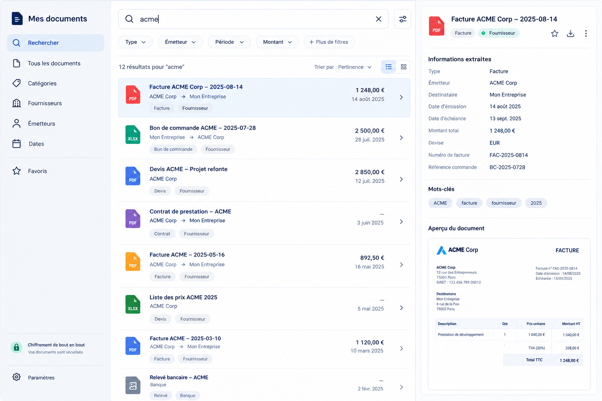

# Fyde Visual Design System

## Visual reference

The UI must look like the reference screenshot below (`assets/design-reference.png`):
a light, neutral-gray document search/management screen — left icon-label nav
rail, a search bar with pill filter chips above a dense results list (file-type
icon, title, breadcrumb path, tags, amount, date), and a right-hand detail
panel showing extracted fields and a rendered document preview.

**Status: largely implemented.** Tokens (color, type, shape, spacing,
elevation) live under `shared/src/commonMain/kotlin/com/peltoche/fyde/theme/`,
both bundled typefaces are in place (`shared/src/commonMain/composeResources/
font/`, licenses in `shared/THIRD_PARTY_LICENSES.md` — the font-bundling open
question below is resolved), and most components/screens this document
describes exist under `shared/.../components/` and the top-level screen
files (`DocumentListScreen.kt`, `AppSidebar.kt`, etc.). This document remains
the source of truth for new work and for reconciling drift between the code
and the reference screenshot, not a pre-implementation proposal only. This
document is the next iteration of the earlier `application/DESIGN.md` spec,
written against a new, more specific brief — see *Relationship to
`DESIGN.md`* below before treating the two as agreeing with each other.

## Brief

The application is a cross-platform **document management** tool. The UI
should read as: professional, calm, trustworthy, information-dense without
feeling cluttered, fast and functional, comfortable for long sessions, and
visually consistent across Android, iOS, and desktop. Explicitly not a
generic "modern SaaS dashboard."

## Direction

Translating those adjectives into design consequences, in priority order:

1. **Neutral-first, one disciplined accent.** The palette is built from warm,
   low-chroma grays (the "paper" of a document tool); a single accent color
   carries all primary emphasis. No gradients, no multi-color marketing
   flourishes — calm comes from restraint, not from added decoration.
2. **Density is a feature, not a compromise.** Long sessions triaging many
   documents reward tight, well-aligned information over generous marketing
   whitespace. Hierarchy — not size — is what keeps density from reading as
   clutter (see Typography, Layout).
3. **Structure over ornament.** Flat tonal surfaces and hairline borders do
   most of the "this is a separate region" work; shadows are reserved for
   things that genuinely float above the page. Corners are barely rounded —
   geometric and precise, not the soft pill/rounded-2xl shape language of
   generic SaaS.
4. **One typeface system, bundled — not borrowed from the OS.** Roboto
   (Android) and San Francisco (iOS) have different metrics; text tuned for
   one will not measure or wrap the same in the other. True cross-platform
   consistency requires shipping our own type, not defaulting to the
   platform's.
5. **Density flexes by input method, not by platform.** "Consistent across
   Android, iOS, desktop" means one visual language — it does not mean
   identical row heights regardless of whether the pointer is a finger or a
   mouse. See *Layout § density* and *Responsive behavior*.

### Relationship to the current `DESIGN.md`

The existing spec is dark-only, built around a lime accent on near-black,
with underline-style text fields and no bundled font. Given this brief, three
things change and three carry forward:

| Keeps | Changes | Why |
|---|---|---|
| Flat tonal elevation over shadows | Dark-**only** → light **and** dark | Brief requires both |
| Non-pill, geometric corner radii | Lime `#D7EE5B` accent → a deep teal accent | Lime reads energetic/creative-tool, not calm/trustworthy/serious |
| The 4px spacing grid's logic | System-default font → one bundled type family | Cross-platform consistency needs identical metrics, not per-OS substitutes |
| — | Underline text fields → bordered fields | Bounded fields read as more precise/form-like for a denser, more form-heavy tool |

Where this document is silent on something `DESIGN.md` already covers well
(e.g. the empty-state icon-in-circle layout), assume it still applies —
this is a revision of the token layer, not a rewrite of every pattern.

---

## Typography

### Family

Two typefaces, both open-licensed (OFL) and bundled as Compose resources on
every target — no platform default is used anywhere, so text measures
identically on Android, iOS, desktop, and web.

- **UI & body — Public Sans.** Developed for the U.S. Web Design System
  specifically to be neutral, highly legible, and free of decorative
  personality in official/high-trust contexts. That mandate is a near-exact
  match for "professional, calm, trustworthy" — it carries no trend
  signature (it is not Inter, not a geometric grotesk) and won't date the
  way a fashionable display face would.
- **Data & metadata — IBM Plex Mono.** Used narrowly, wherever digits must
  align in a column: file sizes, dates, page counts, version/ID strings.
  Tabular figures on by default. Signals "this number is exact" the way a
  ledger or invoice does.

No serif is introduced. The app never typesets long-form document *content*
itself (PDFs render through each platform's native engine — see the audit,
§05); a third face would be decoration with no job to do.

### Scale

One scale, 8 roles. Line-heights are tighter on headings (density) and more
open on body/caption (long-session reading comfort).

| Role | Size / Line height | Weight | Tracking | Usage |
|---|---|---|---|---|
| Display | 30 / 38sp | SemiBold | 0 | Rare — empty-state or onboarding headlines only, not screen titles |
| Title | 22 / 28sp | SemiBold | 0 | Screen titles ("Documents", "Settings") |
| Section | 17 / 24sp | SemiBold | 0 | Group/section headers, dialog titles |
| Body emphasis | 15 / 22sp | Medium | 0 | Primary list content — document names, key values |
| Body | 15 / 22sp | Regular | 0 | Standard copy, descriptions, dialog body |
| Caption | 13 / 18sp | Regular | 0.1sp | Secondary/metadata text, helper text, timestamps |
| Micro | 11 / 16sp | Medium | 0.3sp | Status labels, badges, overline text |
| Data (mono) | 13 / 18sp | Regular | 0, tabular figures | Sizes, dates, page counts, IDs — anywhere digits must align |

### Weights

Exactly three working weights: **Regular, Medium, SemiBold.** True Bold
(700) is deliberately unused below Display size — bolding body/caption text
is what makes dense UI feel like it's shouting. SemiBold is the ceiling for
anything read at length.

### Heading hierarchy & metadata text

Four heading levels (Display → Title → Section) is the full depth the app
needs — it matches the audit's finding that navigation is a shallow
single-level stack, not a deep tree. **Metadata/secondary text always uses
`text-muted` (see Color) and either Caption or Data role, never full `text`
color or Body weight** — that color+role pairing is what visually separates
"this is the content" from "this is context about the content," which is
the actual mechanism behind "information-dense without clutter."

**A scannable row's title is one line, always.** Found via review: a list
row's headline with no `maxLines`/truncation wrapped to two lines for one
filename and stayed one line for a shorter one in the exact same list,
making row height inconsistent both within a list and across breakpoints
for identical content. Any title in a row meant to be scanned (a list item,
not a detail-pane header) truncates with an ellipsis at one line — the full
text is always available where the item is opened, so nothing is lost.

---

## Color

Warm, low-chroma neutrals (paper, not sterile blue-gray or generic SaaS
gray) carry the interface; one deep teal accent carries emphasis; one muted
umber secondary carries lower-key emphasis (tags, folder affordances) without
competing with it.

| Role | Light | Dark | Usage |
|---|---|---|---|
| `background` | `#F5F4F1` | `#16140F` | App background — the "desk" the content sits on |
| `surface` | `#FFFFFF` | `#1E1B16` | Cards, list rows, panels — the "paper" |
| `surface-elevated` | `#FFFFFF` | `#282420` | Menus, dialogs, popovers — see Elevation for how light mode differentiates this from `surface` |
| `border` | `#E3E0DA` | `#35302A` | Hairline dividers, card edges |
| `border-strong` | `#8F8A7C` | `#7A7364` | Input field outlines, anywhere a border must read as interactive, not just structural |
| `text` | `#211E18` | `#EDE9E1` | Primary text and icons |
| `text-muted` | `#6B6558` | `#9B9484` | Metadata, captions, placeholders, disabled content |
| `primary` | `#1B5E63` | `#5FBFC4` | Primary actions, links, focus, selection |
| `on-primary` | `#FFFFFF` | `#06232A` | Content on filled-primary surfaces |
| `secondary` | `#6B5636` | `#B99569` | Lower-emphasis actions, tags, folder/document-type accents |
| `on-secondary` | `#FFFFFF` | `#2B1B08` | Content on filled-secondary surfaces |
| `error` | `#B3261E` | `#F2938A` | Destructive actions, invalid state |
| `on-error` | `#FFFFFF` | `#3A0F0B` | Content on filled-error surfaces |
| `warning` | `#95610A` | `#E8B34D` | Caution states — expiring access, unsynced changes |
| `on-warning` | `#FFFFFF` | `#2B1C02` | Content on filled-warning surfaces |
| `success` | `#2E7D46` | `#7FD98A` | Confirmation — upload complete, verified |
| `on-success` | `#FFFFFF` | `#0F2A17` | Content on filled-success surfaces |
| `selection-surface` | `#E7EFEF` | `#1F3638` | Background wash for selected rows/items (multi-select) |
| `selection-text-bg` | `#BFE0E1` | `#2C5457` | Inline text-selection highlight |

Values above are proposed starting points; verify exact contrast ratios
against final hex values before implementation. Target: WCAG AA — 4.5:1 for
body text, 3:1 for text ≥ 18sp/14sp-bold and for icons, matching the bar the
current spec already holds itself to.

`border-strong` has been verified and corrected: the originally-proposed
`#C9C4B8`/`#4A4438` measured ~1.5:1 / ~1.9:1 against `background` — well
under the 3:1 a UI component boundary needs, and visually confirmed via a
real render (the search field's outline was essentially invisible). The
values above replace them, clearing ~3.1–3.9:1 in both themes.

**`secondary` is intentionally a muted umber/olive, not amber** — close
enough to `warning`'s orange family to feel like the same "paper/kraft"
world, far enough in hue and saturation that the two are never confusable
in the same screen (a tag using `secondary` must never be mistaken for a
warning state).

**Focus ring:** 2px `primary`, 2px outside the element's own border, both
themes — the one place `primary` is allowed to outline rather than fill.

### Why teal, not blue or the current lime

Lime-on-near-black (the current spec) reads energetic and creative-tool —
right for a dev/design tool, wrong for "calm, trustworthy, serious
document management." Generic SaaS blue (`#4F46E5`-family indigo/violet) was
avoided deliberately — it's the single most common accent in the category
we're explicitly not trying to look like. A deep, desaturated teal sits
adjacent to "trustworthy blue" without being the exact blue every dashboard
uses, and it pairs cleanly with the umber secondary (ink + kraft paper is a
real, physical reference point for a document tool, not an abstract color
pick).

---

## Shape

Radii stay small on purpose — precise and structured rather than the
soft/pill geometry of generic SaaS (which starts at 8px and often runs to
full pills on buttons). Nothing in this system is a pill except literal
circles.

| Token | Value | Usage |
|---|---|---|
| `radius-none` | 0 | Dividers, full-bleed content, PDF page edges |
| `radius-xs` | 2px | Checkboxes, small tags/badges |
| `radius-sm` | 4px | Input fields, small/icon buttons |
| `radius-md` | 6px | Default buttons, cards, list-item containers |
| `radius-lg` | 10px | Dialogs, sheets, popovers |
| `radius-full` | circular | Avatars, status dots — nothing else |

**Navigation list items** — `radius-sm`, not M3's own stadium-pill default
for `NavigationDrawerItem`/`NavigationBarItem`. Stock M3 components default
to a fully-rounded selected-state container; left unoverridden, that's a
pill shape sneaking back in through a component this document didn't
originally call out, so the shape parameter is set explicitly wherever one
of these components is used.

**Buttons** — `radius-md`, never a pill. Minimum height 48dp/pt (clears both
Android's 48dp and iOS's 44pt touch-target minimums with one shared value —
see Direction §5 on why platform minimums, not visual style, are allowed to
differ). Filled (primary/secondary), Outlined (`border-strong`, transparent
fill — the default for secondary actions in a form-heavy app), Text/ghost,
and Icon variants; no additional shape rules per variant beyond radius and
height.

**Inputs** — `radius-sm`, `border-strong` at rest, `primary` border on
focus (2px), transparent-to-`surface` fill. This is the one deliberate break
from the current spec's underline style (see *Relationship to `DESIGN.md`*):
a document-management tool is heavier on structured forms and metadata
fields than an auth-only v1 was, and a fully bounded field reads as more
precise/form-like than a floating underline.

**Cards** — `radius-md`, no border by default (light mode's `surface` vs
`background` contrast already defines the edge); add a `border` hairline
only when two cards of equal weight sit adjacent with no gap between them.
Never combine a visible border with a shadow on the same card.

**Dialogs / sheets** — `radius-lg`, always `surface-elevated`, always
shadowed (see Elevation) — the largest radius in the system, reserved for
the most clearly "floating above everything else" surfaces.

**Touch target minimum is a rule about tap area, not about buttons
specifically.** Found via review: an avatar-triggered menu button had
shrunk its tappable circle to match its 18dp glyph (32dp total), well under
the 48dp/44pt minimum above — nobody had checked a *non-button* trigger
against the same rule. Any tappable element — icon buttons, avatar/menu
triggers, custom row affordances — gets the full 48dp/44pt hit area
regardless of how small its visible content is; size the glyph for how it
should look, then center it in a target sized for how it should be tapped.

---

## Spacing

One 4px-based scale. Denser at the low end than a typical marketing-site
scale, because the tightest gaps (icon-to-label, metadata pairs) are used
constantly in a document list; the largest step is deliberately modest,
because this app is built from lists and forms, not hero sections.

| Token | Value | Typical use |
|---|---|---|
| `space-1` | 2px | Icon-to-adjacent-label micro gaps |
| `space-2` | 4px | Tight metadata pairs (label above value) |
| `space-3` | 8px | Icon-to-text gap, chip internal padding |
| `space-4` | 12px | List-row vertical padding (desktop density) |
| `space-5` | 16px | List-row vertical padding (mobile density), mobile screen margin |
| `space-6` | 20px | Form field vertical gap |
| `space-7` | 24px | Section-to-section gap, tablet screen margin |
| `space-8` | 32px | Desktop screen margin, dialog internal padding |
| `space-9` | 40px | Rare — large empty-state gaps |
| `space-10` | 56px | Rare — full-page centered-content vertical rhythm |

---

## Elevation

Three mechanisms, used for three different jobs — never interchangeably:

1. **Borders** (`border`, 1px) signal *adjacency between equal-weight
   regions* — a table row divider, a sidebar/content split. They do not mean
   "this is above the page."
2. **Tonal steps** (`surface` → `surface-elevated`) signal *resting
   elevation* — content that's conceptually above the background but still
   inline, not floating: cards, panels, persistent chrome. Dark mode steps
   lighter at each level (`#16140F → #1E1B16 → #282420`); light mode cannot
   step lighter than white, so `surface` and `surface-elevated` share the
   same `#FFFFFF` and are differentiated by shadow instead (see below )— an
   intentional asymmetry between the two themes' mechanics, not an
   oversight.
3. **Shadows** are reserved for content that genuinely floats and can be
   dismissed or moved: dropdown menus, popovers, tooltips, dialogs/sheets,
   toasts, an item mid-drag. Kept small and tight — not the diffuse glow
   that makes generic SaaS cards look like they're hovering a centimeter
   above the page, which would be fatiguing across a long session repeated
   on every list row.

| Level | Treatment | Shadow | Usage |
|---|---|---|---|
| 0 | `background` | none | Page background |
| 1 | `surface`, no border | none | Cards, list rows, panels |
| 2 | `surface`, `border` hairline | none | Adjacent equal-weight cards with no gap |
| 3 | `surface-elevated` | `shadow-sm` | Dropdown menus, popovers, tooltips |
| 4 | `surface-elevated` | `shadow-md` | Dialogs, sheets, toasts |

Shadow values (ink-tinted, not pure black — slightly warmer and less
generic than a default black shadow):

- `shadow-sm` — light `0 2px 6px rgba(33,30,24,0.14)` · dark `0 2px 6px rgba(0,0,0,0.55)`
- `shadow-md` — light `0 8px 24px rgba(33,30,24,0.18)` · dark `0 8px 28px rgba(0,0,0,0.65)`

---

## Layout

### Content max width

Two different rules, because a list and a document aren't the same shape of
content:

- **List/table views** (document list, search results): fluid, no tight
  cap — density and "see more documents at once" outrank prose measure
  here. On very wide desktop monitors, cap at **1280px** centered so rows
  don't stretch to absurd widths; below that, fill the available width.
- **Detail/form views** (document detail, settings, dialogs): cap at
  **720px** — wide enough for real metadata forms (unlike the old spec's
  480px auth-only cap), narrow enough that a field or description never
  becomes an uncomfortable reading line.

### Screen padding (edge margin)

| Breakpoint | Margin |
|---|---|
| Compact (mobile) | `space-5` (16px) |
| Medium (tablet) | `space-7` (24px) |
| Expanded (desktop) | `space-8` (32px), then the max-width cap absorbs the rest on ultra-wide |

**The content container wraps a screen's entire content, not just its list
or its primary pane.** Found via review: a search field and a status banner
sat outside `AppContentContainer` while the list below them sat inside it,
so at Medium/Expanded — where the container's margin and max-width cap
actually engage — the search field's edge visibly drifted out of alignment
with the list edge beneath it. A screen composes exactly one content
container around its whole column (banner + search/filter row + list/empty/
error state, in order), never one around the list alone with sibling
elements left outside — otherwise every sibling above or below the wrapped
element is one design-system update away from silently drifting out of
alignment again.

### List spacing & density

Desktop is mouse/pointer-precise and has more vertical room to spend on
*showing more rows*; mobile needs touch-safe targets. Rather than one row
height everywhere (which either wastes desktop screen space or makes mobile
rows too small to tap), density is explicit and platform-driven:

| Density | Row min-height | Vertical padding | Where |
|---|---|---|---|
| Comfortable | 56px | `space-5` (16px) | Compact (mobile, touch) |
| Standard | 48px | `space-4`–`space-5` | Medium (tablet) |
| Compact | 40px | `space-4` (12px) | Expanded (desktop, pointer) |

Icon-to-text gap within a row is `space-3`/`space-4` regardless of density.

**These row-min-heights are floors, verify them against real content before
trusting them.** Found via review: the original 56/48/40dp progression never
actually bound at any density — a row's natural height (icon/avatar chip +
headline + supporting text + `ListItem`'s own content padding) already comes
to ~60dp, so Standard and Compact sat *under* natural size and did nothing,
while only Comfortable's 56dp was even in the right neighborhood. Corrected
to 72/64/56dp so Comfortable (mobile/touch) adds real breathing room above
natural size, and Standard/Compact sit at/near it rather than below it. A
`heightIn(min = ...)` floor can only grow a row, never shrink one — when
adding or changing a density tier, measure the natural height of the actual
content first, or the new value will silently be a no-op exactly like the
old ones were.

### List toolbar

A results count sits above the list itself: a document count (or, while a
search query is active, "N results for "query""). An earlier iteration of
this toolbar also drew a static "Sort by: Relevance" control and a
list/grid view toggle, but both were purely decorative — there is no grid
layout and results are always relevance-ordered — and a non-functional
control that looks clickable reads as broken, not as restraint, once a user
actually tries it. Removed rather than kept as inert chrome; re-add only
once the underlying feature (a real sort order, a real grid layout) exists
to back it. The filter chip row below still follows the "visible,
non-functional placeholder" pattern — the difference is that chips read
unambiguously as filters the data model doesn't support yet, not as a
broken interactive control.

The filter chip row itself covers Type, Issuer, Period, Amount, then a
trailing "+ More filters" chip — four named facets plus an overflow,
matching the reference layout's filter row. The document model has no
issuer/amount fields yet, so, like Type/Period before them, Issuer and
Amount are visible placeholders, not a working filter.

### Detail panes

A record detail pane (document detail today; any future equivalent) is
three stacked sections, each full-bleed with `space-5` internal padding and
separated by a `border` hairline divider:

1. **Header** — leading type icon, name + metadata caption, trailing action
   icons (favorite/download/more or equivalent) right-aligned on the same
   row.
2. **Information grid** — known fields as a 2-column grid, each cell a muted
   `caption` label stacked above a `body` value, rather than one
   label-left/value-right column per row — this fits roughly twice the
   fields in the same vertical space, in keeping with density-is-a-feature.
   A field that's naturally multi-valued (tags, subjects, keywords) does not
   belong in this grid — it breaks the one-value-per-cell shape — and gets
   its own section instead (next).
3. **Keywords / tags** — a wrapped row of `AppBadge` pills under a section
   heading, for any multi-valued field. Falls back to the standard "—"
   unset value when there's nothing to show rather than an unexplained empty
   section.

A **selected row** in an adjacent list additionally gets a 3dp
`primary`-colored accent bar on its leading edge, layered on top of the
existing `selectionSurface` tint — the tint alone reads too weakly as "this
is the item open in the detail pane," the same affordance list/mail
master-detail UIs (Mail, Files) converge on. This is part of `AppListItem`
itself, so it applies to every selectable list in the app, not just the
document list.

### Section spacing

Gap between major page sections (e.g. filter bar → list, list → pagination
footer): `space-7` (24px) on mobile, `space-8` (32px) at medium/expanded —
enough to separate without opening a marketing-page gulf between them.

---

## Responsive behavior

Breakpoints match Compose Multiplatform's own `WindowSizeClass` — implemented
against real tooling, not arbitrary web breakpoints.

- **Compact (< 600dp — phones).** Single-column, full-screen navigation
  stack, one screen at a time (per the audit: no bottom nav until there are
  3+ peer top-level destinations — still true here). Comfortable density.
- **Medium (600–839dp — tablets, small desktop windows).** Enough width for
  a **list + detail split view** to become viable — introduce master-detail
  here rather than waiting for expanded, since a document manager's core
  workflow (browse → inspect) benefits immediately. Standard density. Forms
  may lay out in two columns. The list pane's width is **fixed** (`360dp`),
  not a proportion of window width — found via review that a percentage
  split let the list column balloon on wide monitors well past what
  titles/metadata need while starving the detail pane; a fixed list-column
  width is what master-detail reference UIs (Mail, Files) converge on, and
  it's what any two-pane layout in this app should use, not just the
  document list. Kept at `360dp` rather than Expanded's wider value (next)
  because Medium's viewport tops out at 839dp, where a wider fixed column
  would leave too little room for the detail pane at the low end.
- **Expanded (≥ 840dp — desktop).** Master-detail persists; compact density
  for lists (more rows visible — see Layout § density); the 1280px list cap
  and 720px detail cap engage; hover states and tooltips become meaningful
  (pointer-only affordances); keyboard shortcuts surfaced in the UI where
  relevant. The list pane widens to a **fixed** `480dp` (still not a
  proportion of window width, same rationale as Medium's `360dp`) — Expanded
  always has width to spare, so the list column can show more of a title
  and its metadata per row without squeezing the detail pane the way
  Medium's narrower viewport would.

**Visual consistency is not interaction uniformity.** "Consistent across
Android, iOS, desktop" (the brief) means one shared color/type/shape/spacing
language — it does not mean forcing identical gestures onto fundamentally
different input models. A trailing overflow-menu action and an iOS
swipe-to-delete gesture can trigger the exact same operation, styled from
the exact same token set, while still respecting each platform's own
interaction conventions. Treat visual identity and interaction pattern as
two separate axes; only the first is asked to be uniform.

---

## Open questions for implementation

Flagged rather than resolved here, consistent with "do not implement yet":

- Exact hex values above need contrast-ratio verification once locked, not just estimated.
- ~~Font files (Public Sans, IBM Plex Mono) need sourcing/licensing confirmation and per-platform bundling~~ — resolved: both are bundled as Compose resources (`shared/src/commonMain/composeResources/font/`), licensed per `shared/THIRD_PARTY_LICENSES.md`.
- The audit's icon-system gap (hand-drawn `Canvas` glyphs, no Material Icons Extended dependency) is unresolved by this document — a separate decision, not a shape/color/type question.
- A11y beyond contrast (dynamic type / text-scaling behavior across all three platforms) isn't covered here and should be its own pass once tokens are implemented.
