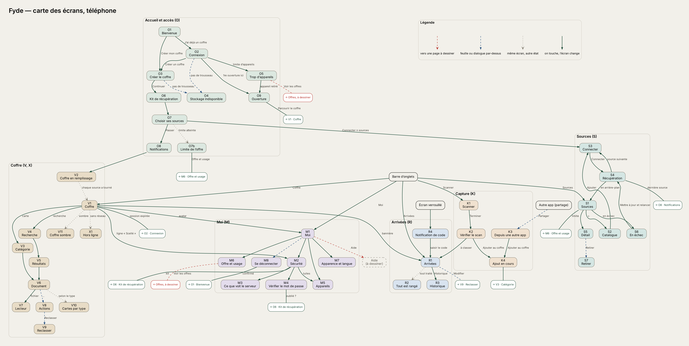
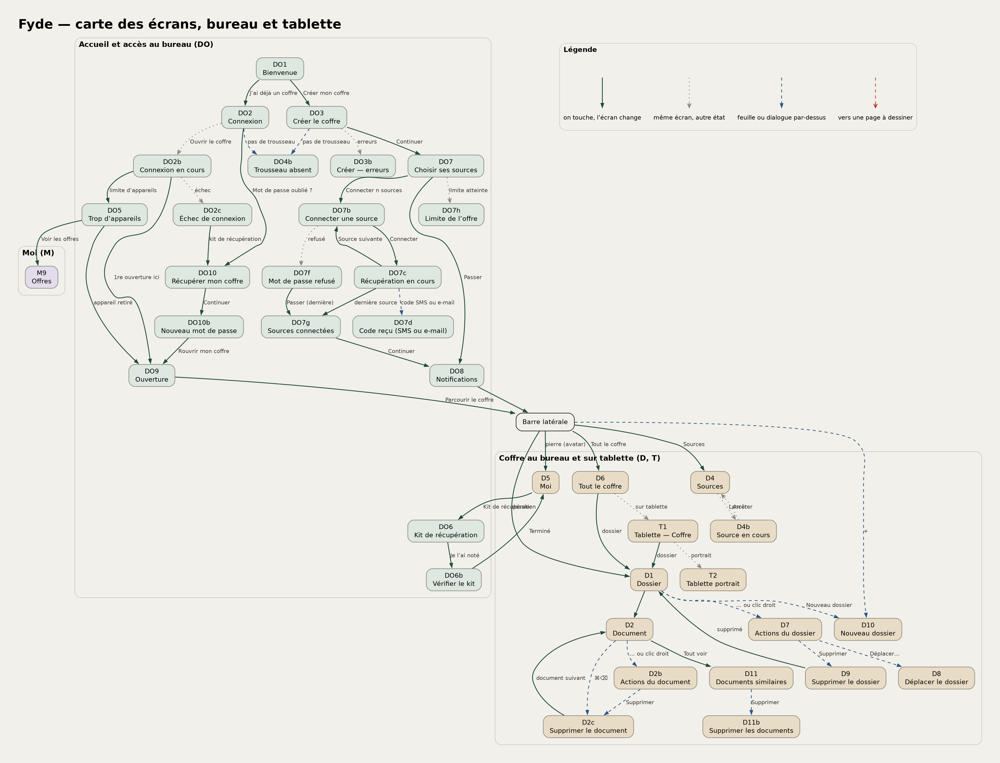

# Screen map

How the 106 reference screens in [`assets/screens/`](assets/screens/) lead to one another. Two
graphs: the phone app, and desktop and tablet. Screen IDs and content are specified in
[`design-system.md`](design-system.md); this page is only about the links between them.

Both graphs are generated by [`assets/maps/screen_map.py`](assets/maps/screen_map.py) (Graphviz)
from one list of nodes and links. When a screen or a link changes, edit that list, run
`python3 screen_map.py` from `assets/maps/`, and update the text below in the same change; the
script fails unless every PNG in `assets/screens/` has a node in the map and a row in
`design-system.md`'s Screens tables, and the reverse.

**Reading the graphs**

- Solid green arrow: a tap moves to that screen.
- Dotted grey arrow: the same screen in another state (limit reached, failure, dark mode…).
- Dashed blue arrow: a sheet or dialog over the screen.
- Dashed red arrow, dashed box: a page that isn't drawn yet.
- White tag "→ O1 · Bienvenue": a jump to a screen drawn elsewhere on the map, shown as a tag
  instead of a long line.

## Phone

### Shell

The tab bar is always there once the vault is open: **Coffre** (V1), **Scanner** (K1, the raised
button), **Sources** (S1) and **Moi** (M1). Every screen below belongs to one tab and pushes inside
it, so going back restores where you were. One screen opens from outside the app: K3, from another
app's share sheet.

### Accueil et accès (O1–O10)

- **O1 Bienvenue** is the first screen without an account on the device, and where logging out
  (M8) ends. "Créer mon coffre" → O3; "J'ai déjà un coffre" → O2.
- **O2 Connexion**: "Créer un coffre" → O3. A failed attempt stays on O2 with an error note. An
  expired session anywhere in the app returns here (V1 → O2), with a warning note.
- **O4 Stockage indisponible** is a sheet over O2 or O3 when the device has no secure storage.
- **O5 Trop d'appareils** follows O2 when the plan's device limit is reached; removing a
  device continues to O9. Its "Voir les offres" opens the plans (M9), read-only.
- **O9 Ouverture** follows a first sign-in on this device, then "Parcourir le coffre" → V1.
- **O10 Récupérer mon coffre** opens from O2's "Mot de passe oublié ?": the 24 words, then a new
  password in **O10b**, which signs in and continues to O9.
- Vault creation is a three-step line: **O3** (account) → **O7** (choose sources) → **O8**
  (notifications) → **V2** (the vault filling up). The recovery kit (**O6**) is not a step: it's
  made later, from M2. The vault starts with no folder: everything arrives in À classer until
  the user creates their own.
- From **O7**, "Connecter n sources" takes each ticked source through **S3** (credentials) and
  **S4** (first run) in turn; after the last one, S4 → O8. "Passer" goes straight to O8.
  **O7b** is O7 at the plan's source limit, and points to M6.

### Coffre (V1–V11, X1, X2)

- **V1 Coffre** is the home of the app. Folder card → **V3**, whose subfolder rows open
  further V3s; "Nouveau dossier" (V1, or "Nouveau" in V3) opens the **V12** sheet. V3's "…" opens
  the **V13** folder actions: Nouveau sous-dossier (V12), Déplacer (**V14**, the folder picker),
  Supprimer (**V15**, then back to the parent). Search → **V4** → **V5**;
  avatar → M1; the "Scellé" line → M2.
- **V2** is V1 while the first sources run; it becomes V1 once each has run. **V11** is V1 in
  dark mode, **X1** is V1 offline, **X2** is V1 with the text at 200%.
- **V3** and **V5** open **V6 Document**. From V6: the file → **V7 Lecteur**; "…" → the **V8**
  actions sheet, whose "Déplacer" opens the **V9** folder picker and "Supprimer de tous mes appareils" the
  **V10** dialog; confirming it returns to the list the document was opened from. How the pass changes by document type
  is a pattern, not a screen ([`modeles-cartes.png`](assets/sheets/modeles-cartes.png)).
- **V6c** is V6 scrolled to its end: DOCUMENTS SIMILAIRES, where a row opens that document (another
  V6) and "Tout voir" → **V16 Documents similaires**, whose rows open theirs too. Ticking one turns
  it into **V16b**, whose selection bar opens **V9b** (Déplacer, the folder picker for several
  documents) or **V10b** (Supprimer, the dialog for several); either returns to V16 once sent.

### Capture (K1–K4)

- **K1 Scanner** (tab bar) → **K2 Vérifier le scan** → "Ajouter au coffre" → **K4 Ajout en
  cours**.
- **K3** is the share sheet opened from another app; "Ajouter au coffre" → K4.
- K4 adds the document to its category (V3).

### Sources (S1–S7)

- **S1 Sources** (tab bar): "+" → **S2 Catalogue** → "Ajouter" → **S3 Connecter** →
  "Connecter" → **S4 Récupération**, which can continue in the background (back to S1).
- A source row → **S5 Détail**; "Retirer" opens the **S7** dialog. A failed source → **S6**;
  "Mettre à jour et relancer" → S4. **S6b** is the failure when the site changed (report it, nothing
  to fix); **S8** is the provider's own page over S4 when it asks for a check (a captcha).
- "Arrêter la récupération" on S4 or S8 stops the run: **S4b** shows what it got, with "Revenir
  aux sources" (S1) and "Relancer" (S4). On S5, Lancer turns into Arrêter while the source runs
  (**S5b**); once stopped, S5 comes back with the stopped status.
- A source can hold several accounts (one per login on the provider's site, e.g. two Ameli
  accounts in one household). "Ajouter un autre compte" on S5 (or "Autre compte" on S2, for a
  source already added) → **S3b**, the connect form for one more account with its Nom du compte,
  → S4. With several accounts, each is its own S1 row and opens **S5c**, which lists the source's
  other accounts; its "Retirer ce compte" opens the **S7b** dialog.
- At the plan's source limit S1 points to M6.

### Moi (M1–M12)

- **M1 Moi** (tab bar or V1's avatar) opens **M2 Sécurité**, **M5 Appareils**, **M6 Offre et
  usage**, **M7 Apparence et langue**, **M12 Mes données** (export, and the account deletion dialog **M12b**), **M10 Aide**, and the **M8**
  logout dialog.
- **M2** → **M3 Ce que voit le serveur**, **M4 Vérifier le mot de passe**, **M11 Changer le mot de passe**, and the recovery kit
  **O6**, checked in **O6b** (O6 is only reached from here; the mockups' step dots and "Plus tard"
  date from when it was a vault-creation step); its device tiles → M5. M4's "oublié ?" → O6.
- **M6** is also reached from O7b and S1; its "Voir les offres" opens **M9 Offres**.
- Confirming **M8** wipes the device and returns to O1.

## Desktop and tablet

### Accueil et accès au bureau (DO1–DO10)

The same flows as O1–O9 in a split window, with the states drawn as their own screens:

- **DO1** → **DO2** or **DO3**.
- **DO2** → **DO2b** while the key is derived → **DO2c** on failure, **DO5** at the device
  limit, or **DO9** on a first sign-in here. **DO4b** is the missing-keyring dialog
  over DO2 as over DO3.
- **DO3** shows its errors as **DO3b**; **DO4b** again if there is no keyring; then **DO7**.
- **DO6** → **DO6b** (the recovery kit) open from M2 Sécurité, beside the Moi menu, not on the
  vault-creation path: their mockups still show the step-2 brand panel.
- **DO7** (or **DO7h** at the limit) → **DO7b** for each ticked source → **DO7c** while it runs.
  From DO7c: a code asked by SMS or e-mail (**DO7d**, one card for both; its "Arrêter la
  récupération" stops the run), "Source suivante" back to
  DO7b, or **DO7g** after the last source. **DO7f** is DO7b after a refused password; skipping
  the last source also reaches DO7g. DO7g or "Passer" → **DO8**.
- DO8 and DO9 open the vault.
- **DO10** (from DO2's "Mot de passe oublié ?" or DO2c's kit link) → **DO10b** → DO9: recovery with the kit.
- DO5's "Voir les offres" opens the plans (M9).

### Coffre au bureau et sur tablette (D1–D6, T1)

The sidebar replaces the tab bar: "Tout le coffre" (**D6**, **T1** on tablet, **T2** in portrait), a folder (**D1**; its "+"
opens **D10 Nouveau dossier**)
and **D4 Sources**; while the selected source runs, D4's panel offers Arrêter in
Lancer's place (**D4b**). D1 → **D2 Document**, whose "…" (or a right-click) opens the **D2b** menu;
its "Supprimer de tous mes appareils" (or ⌘⌫) opens the **D2c** dialog, then the next document. A
folder's "…" or right-click opens the **D7** menu: Déplacer… → **D8**, Supprimer → **D9**, then back to its
parent; D1's "Nouveau dossier" opens D10. The avatar row at the foot of the
sidebar opens **D5 Moi**, the M1 menu with its pages beside it. D2's DOCUMENTS SIMILAIRES "Tout
voir" turns its list column into **D11 Documents similaires**, the open document still beside it;
its selection bar's Supprimer opens the **D11b** dialog (its Déplacer opens V9b as a dialog, not
drawn).

## Phone and desktop counterparts

| Phone | Desktop / tablet |
|---|---|
| O1–O10 | DO1–DO10 (plus DO2b, DO2c, DO3b, DO4b, DO7b–DO7h as separate states) |
| O7b | DO7h |
| S3, S4 inside vault creation | DO7b, DO7c |
| V1 | D6, T1 and T2 (tablet) |
| V3 | D1 |
| V12, V13, V14, V15 | D10, D7, D8, D9 |
| V6 + V7 | D2 |
| V8, V10 | D2b, D2c |
| V16, V16b | D11 |
| V9b, V10b | D11b (and V9b as a dialog) |
| S1 + S5, S5c | D4 |
| S5b | D4b |
| M1–M12 | D5 (menu and page side by side) |
